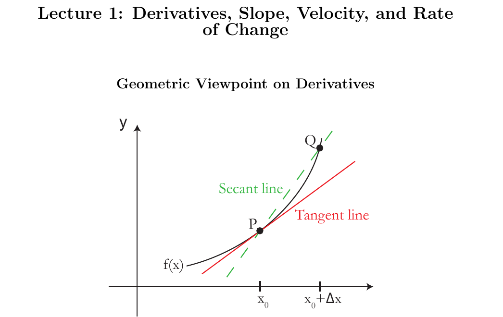
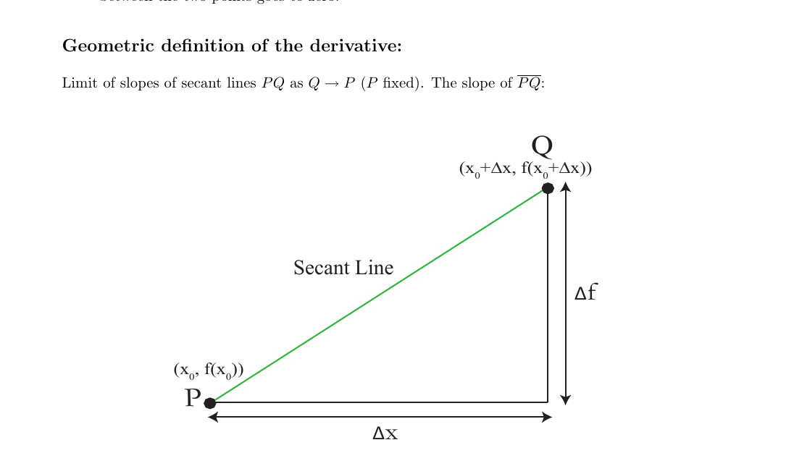
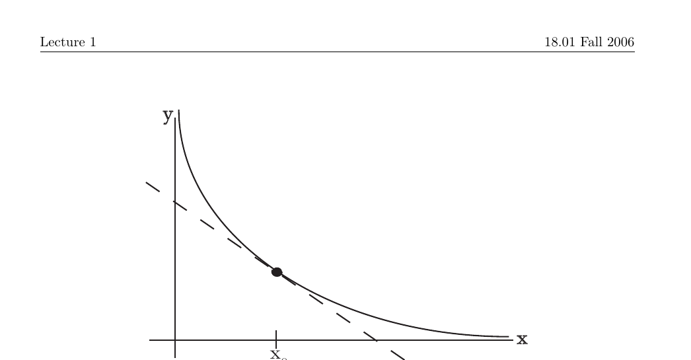
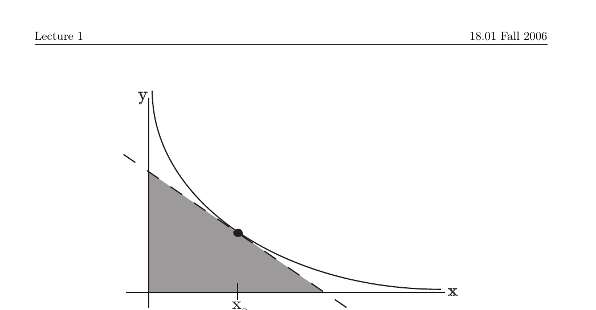
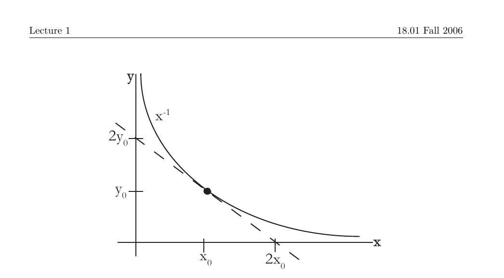

# MIT OCW 18.01 Lecture 1 讲义 · 中文译本

> **来源**：https://ocw.mit.edu/courses/18-01-single-variable-calculus-fall-2006/lec1.pdf  
> **课程**：18.01 Single Variable Calculus，Fall 2006  
> **说明**：英文原文具有权威性；本文件为中文学习转写。引用与条款见 http://ocw.mit.edu/terms 。数学式保留 LaTeX；图为 PDF 页渲染裁切，嵌入于对应正文旁。

---

## Unit 1: Derivatives（导数）

### A. What is a derivative?（导数是什么？）

- Geometric interpretation（几何解释）
- Physical interpretation（物理解释）
- Important for any measurement (economics, political science, finance, physics, etc.)  
  （对一切测量都很重要：经济学、政治学、金融、物理等）

### B. How to differentiate any function you know.（如何对你所知道的任意函数求导）

- 例如：\(\displaystyle\frac{d}{dx}\,e^{x\arctan x}\)。今天我们讨论导数是什么。弄清楚如何对任意函数求导，是本课程前两周的主题。

---

## Lecture 1: Derivatives, Slope, Velocity, and Rate of Change

（第 1 讲：导数、斜率、速度与变化率）

### Geometric Viewpoint on Derivatives（导数的几何观点）

导数是切于 \(f(x)\) 图像的那条切线的斜率。但切线究竟是什么？

- 它**不是**仅仅与图像交于一点的直线。
- 它是割线（图像上两点之间连成的直线）在两点之间距离趋于零时的**极限**。

#### Geometric definition of the derivative（导数的几何定义）

割线 \(PQ\) 的斜率在 \(Q\to P\)（\(P\) 固定）时的极限。\(PQ\) 的斜率：

\[
\lim_{\Delta x\to 0}\frac{\Delta f}{\Delta x}
=\lim_{\Delta x\to 0}\frac{f(x_0+\Delta x)-f(x_0)}{\Delta x}
=f'(x_0)
\]

其中 \(\dfrac{f(x_0+\Delta x)-f(x_0)}{\Delta x}\) 称为 **difference quotient（差商）**；\(f'(x_0)\) 称为 **derivative of \(f\) at \(x_0\)（\(f\) 在 \(x_0\) 处的导数）**。

---

### Example 1. \(f(x)=\dfrac{1}{x}\)

处理导数时要记住一件事：人们往往会忍不住立刻把 \(\Delta x=0\) 代进去。若这样做，你将**总是**得到 \(\dfrac{\Delta f}{\Delta x}=\dfrac{0}{0}\)。你总是需要先做一些约分，才能得到答案。

\[
\begin{aligned}
\frac{\Delta f}{\Delta x}
&=\frac{\dfrac{1}{x_0+\Delta x}-\dfrac{1}{x_0}}{\Delta x}
=\frac{1}{\Delta x}\cdot\frac{x_0-(x_0+\Delta x)}{(x_0+\Delta x)x_0}
=\frac{1}{\Delta x}\cdot\frac{-\Delta x}{(x_0+\Delta x)x_0}
=\frac{-1}{(x_0+\Delta x)x_0}.
\end{aligned}
\]

取 \(\Delta x\to 0\) 的极限：

\[
\lim_{\Delta x\to 0}\frac{-1}{(x_0+\Delta x)x_0}=\frac{-1}{x_0^2}.
\]

因此，

\[
f'(x_0)=-\frac{1}{x_0^2}.
\]

注意 \(f'(x_0)\) 是负的——与上图中切线斜率一致。

---

### Finding the tangent line.（求切线）

在点 \((x_0,y_0)\) 处写出切线方程，使用你们在高中代数里学过的直线方程：

\[
y-y_0=f'(x_0)\,(x-x_0).
\]

代入 \(y_0=f(x_0)=\dfrac{1}{x_0}\) 以及 \(f'(x_0)=-\dfrac{1}{x_0^2}\)，得到：

\[
y-\frac{1}{x_0}=-\frac{1}{x_0^2}\,(x-x_0).
\]

**Just for fun（纯粹好玩）**：计算这条切线与 \(x\) 轴、\(y\) 轴所围成三角形的面积（见图 4 阴影区域）。

先求切线的 **\(x\)-截距**。\(x\)-截距是 \(y=0\) 处。把 \(y=0\) 代入切线方程：

\[
0-\frac{1}{x_0}=-\frac{1}{x_0^2}\,(x-x_0)
\]

\[
-\frac{1}{x_0}=-\frac{1}{x_0^2}\,x+\frac{1}{x_0}
\]

\[
\frac{1}{x_0^2}\,x=\frac{2}{x_0}
\]

\[
x=x_0^2\cdot\frac{2}{x_0}=2x_0.
\]

所以，这条切线的 \(x\)-截距在 \(x=2x_0\)。

接下来我们断言 **\(y\)-截距**在 \(y=2y_0\)。由于 \(y=\dfrac{1}{x}\) 与 \(x=\dfrac{1}{y}\) 是同一方程，交换 \(x\) 与 \(y\) 时图像对称。由对称性，\(y\)-截距在 \(y=2y_0\)。若不信任对称推理，可按求 \(x\)-截距时同样的代数链条推一遍（记住：\(y\)-截距是 \(x=0\) 处）。

最后，

\[
\mathrm{Area}=\frac{1}{2}\,(2y_0)\,(2x_0)=2x_0 y_0=2x_0\cdot\frac{1}{x_0}=2
\]

（见图 5）。

奇怪的是：无论在图像上哪一点画切线，这个三角形的面积**总是 2**。

---

### Notations（记号）

微积分，颇像英语或任何其他语言，是由若干人发展出来的。因此，正如同一件事可以有许多说法，导数也有许多记号。

既然 \(y=f(x)\)，自然可以写

\[
\Delta y=\Delta f=f(x)-f(x_0)=f(x_0+\Delta x)-f(x_0).
\]

我们说 “Delta \(y\)” 或 “Delta \(f\)”，或 “\(y\) 的改变量”。

若两边同除以 \(\Delta x=x-x_0\)，就得到差商的两种写法：

\[
\frac{\Delta y}{\Delta x}=\frac{\Delta f}{\Delta x}.
\]

取 \(\Delta x\to 0\) 的极限，得到

\[
\frac{\Delta y}{\Delta x}\;\to\;\frac{dy}{dx}\quad\text{（Leibniz 记号）}
\]

\[
\frac{\Delta f}{\Delta x}\;\to\;f'(x_0)\quad\text{（Newton 记号）}
\]

使用 Leibniz 记号时，你必须记住导数是在何处求值的——上例中是在 \(x=x_0\)。

其他同样有效的导数记号还包括

\[
\frac{df}{dx},\quad f',\quad\text{以及}\quad Df.
\]

---

### Example 2. \(f(x)=x^n\)，其中 \(n=1,2,3,\ldots\)

\(\dfrac{d}{dx}\,x^n\) 是什么？

把 \(y=f(x)\) 代入差商的定义：

\[
\frac{\Delta y}{\Delta x}=\frac{(x_0+\Delta x)^n-x_0^n}{\Delta x}=\frac{(x+\Delta x)^n-x^n}{\Delta x}.
\]

（从这里起，我们把 \(x_0\) 换成 \(x\)，以少写一些字。）由于

\[
(x+\Delta x)^n=(x+\Delta x)(x+\Delta x)\cdots(x+\Delta x)\quad\text{（共 \(n\) 次）},
\]

可以改写为

\[
x^n+n(\Delta x)\,x^{n-1}+O\bigl((\Delta x)^2\bigr).
\]

\(O((\Delta x)^2)\) 是一种简写，表示「所有带 \((\Delta x)^2\)、\((\Delta x)^3\)、一直到 \((\Delta x)^n\) 的项」。（这是所谓**二项式定理**的一部分；细节见教材。）

\[
\frac{\Delta y}{\Delta x}
=\frac{(x+\Delta x)^n-x^n}{\Delta x}
=\frac{x^n+n(\Delta x)x^{n-1}+O((\Delta x)^2)-x^n}{\Delta x}
=n x^{n-1}+O(\Delta x).
\]

取极限：

\[
\lim_{\Delta x\to 0}\frac{\Delta y}{\Delta x}=n x^{n-1}.
\]

因此，

\[
\frac{d}{dx}\,x^n=n x^{n-1}.
\]

这一结果可推广到多项式。例如，

\[
\frac{d}{dx}\,(x^2+3x^{10})=2x+30x^9.
\]

---

### Physical Interpretation of Derivatives（导数的物理解释）

你可以把导数想成表示一种**变化率**（速度是其中一个例子）。

万圣节时，MIT 学生有个传统：从本楼楼顶扔南瓜，楼高大约 **400 英尺**。

近地表面物体的运动方程（我们现在先接受它）意味着南瓜离地面的高度 \(y\) 为：

\[
y=400-16t^2.
\]

南瓜的**平均速度**（差商）\(=\dfrac{\Delta y}{\Delta t}=\dfrac{\text{走过的距离}}{\text{经过的时间}}\)。

当南瓜落地时 \(y=0\)：

\[
400-16t^2=0.
\]

解得 \(t=5\)。因此南瓜到达地面需要 5 秒。

\[
\text{Average speed}=\frac{400\,\mathrm{ft}}{5\,\mathrm{sec}}=80\,\mathrm{ft/s}.
\]

旁观者大概更关心南瓜砸到地面时有多快。为求 \(t=5\) 时的**瞬时速度**，计算 \(y'\)：

\[
y'=-32t=(-32)(5)=-160\,\mathrm{ft/s}\quad\text{（约 110 mph）}.
\]

\(y'\) 为负，因为南瓜的 \(y\) 坐标在减小：它在向下运动。
