# MIT OCW 18.01 Lecture 2 讲义 · 中文译本

> **来源**：https://ocw.mit.edu/courses/18-01-single-variable-calculus-fall-2006/lec2.pdf  
> **课程**：18.01 Single Variable Calculus，Fall 2006  
> **说明**：英文原文具有权威性；本文件为中文学习转写。引用与条款见 http://ocw.mit.edu/terms 。数学式保留 LaTeX；图为 PDF 页渲染裁切，嵌入于对应正文旁。

---

## Lecture 2: Limits, Continuity, and Trigonometric Limits

（第 2 讲：极限、连续性与三角极限）

### More about the “rate of change” interpretation of the derivative

（关于导数「变化率」解释的更多内容）

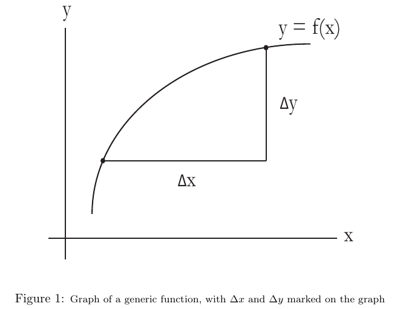

\[
\frac{\Delta y}{\Delta x}\;\longrightarrow\;\frac{dy}{dx}
\quad\text{当}\quad\Delta x\to 0
\]

\[
\text{平均变化率}\;\longrightarrow\;\text{瞬时变化率}
\]

#### Examples（例子）

1. \(q=\) 电荷，\(\dfrac{dq}{dt}=\) 电流（electrical current）

2. \(s=\) 距离，\(\dfrac{ds}{dt}=\) 速度（speed）

3. \(T=\) 温度，\(\dfrac{dT}{dx}=\) 温度梯度（temperature gradient）

4. **测量灵敏度（Sensitivity of measurements）**：习题集 1 上有一个例子。在 GPS 中，无线电信号给出 \(h\)，但带有一定测量误差（见图 2 与图 3）。问题是：我们能量得多准地得到 \(L\)？为此考察 \(\dfrac{\Delta L}{\Delta h}\)。换言之，这些变量彼此相关——我们想知道一个变量的变化如何影响另一个变量。

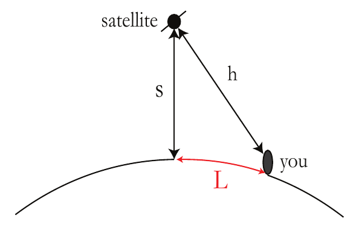

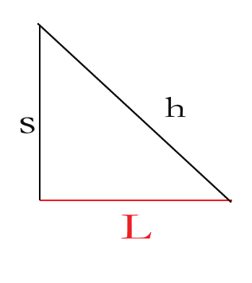

---

## Limits and Continuity（极限与连续性）

### Easy Limits（简单极限）

\[
\lim_{x\to 3}\frac{x^2+x}{x+1}=\frac{3^2+3}{3+1}=\frac{12}{4}=3
\]

对于**简单极限**，只要把极限值代进去，就能得到有意义的答案。

请记住，

\[
\lim_{\Delta x\to 0}\frac{\Delta f}{\Delta x}
=\lim_{x\to x_0}\frac{f(x_0+\Delta x)-f(x_0)}{\Delta x}
\]

**永远不是**简单极限，因为分母 \(\Delta x=0\) 是不允许的。（取极限 \(x\to x_0\) 时，隐含假定 \(x\neq x_0\)。）

---

### Continuity（连续性）

我们说 \(f(x)\) 在 \(x_0\) **连续**，是指

\[
\lim_{x\to x_0}f(x)=f(x_0).
\]

### Pictures（图示）

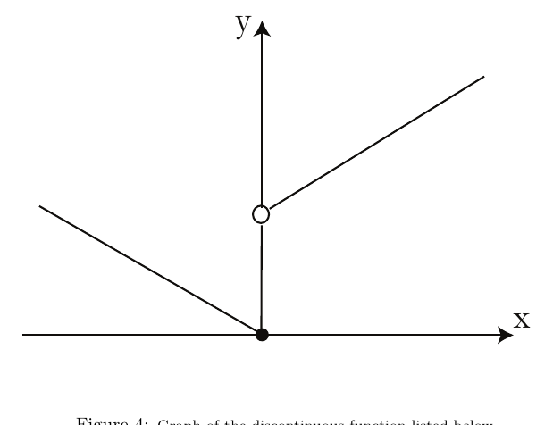

\[
f(x)=\begin{cases}
x+1,& x>0\\
-x,& x\le 0
\end{cases}
\]

这个不连续函数见图 4。对 \(x>0\)，

\[
\lim_{x\to 0^+}f(x)=1
\]

但 \(f(0)=0\)。（也可以说：\(f\) 在 \(0\) 处**左连续**，但不右连续。）

---

### 1. Removable Discontinuity（可去间断）

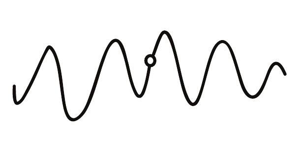

#### Definition of removable discontinuity（可去间断的定义）

- **右极限（Right-hand limit）**：\(\displaystyle\lim_{x\to x_0^+}f(x)\) 表示在 \(x>x_0\) 的限制下取 \(\lim_{x\to x_0}f(x)\)。
- **左极限（Left-hand limit）**：\(\displaystyle\lim_{x\to x_0^-}f(x)\) 表示在 \(x<x_0\) 的限制下取 \(\lim_{x\to x_0}f(x)\)。

若 \(\displaystyle\lim_{x\to x_0^+}f(x)=\lim_{x\to x_0^-}f(x)\)，但该值不等于 \(f(x_0)\)，或者 \(f(x_0)\) 根本无定义，则称此间断为**可去的（removable）**。

例如，\(\dfrac{\sin x}{x}\) 在 \(x\neq 0\) 有定义。稍后我们会看到如何求 \(x\to 0\) 时的极限。

---

### 2. Jump Discontinuity（跳跃间断）

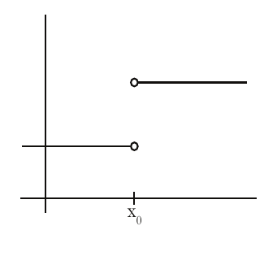

当 \(x\to x_0\) 时，左极限（\(x<x_0\)）存在，右极限（\(x>x_0\)）也存在，但它们**不相等**。

---

### 3. Infinite Discontinuity（无穷间断）

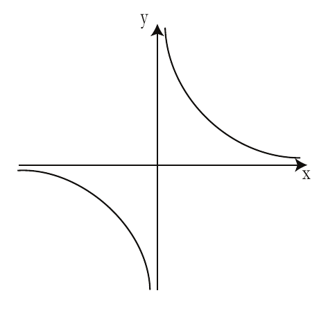

\[
\text{右极限：}\quad\lim_{x\to 0^+}\frac1x=\infty;\qquad
\text{左极限：}\quad\lim_{x\to 0^-}\frac1x=-\infty.
\]

---

### 4. Other (ugly) discontinuities（其他丑陋间断）

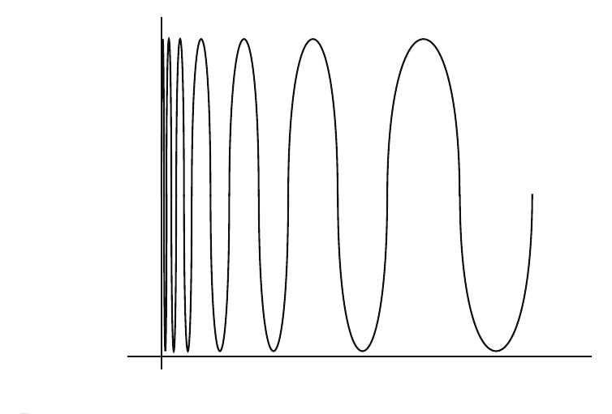

这种函数甚至不会趋向 \(\pm\infty\)——说它趋向任何东西都没有意义。对这类情形，我们说**极限不存在**。

---

## Picturing the derivative（画出导数）

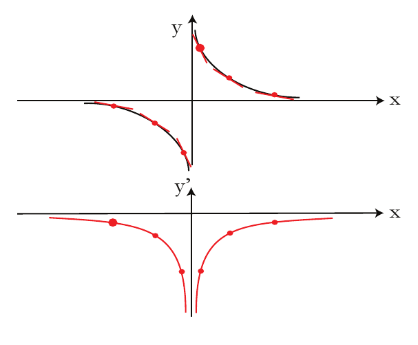

注意：\(f(x)\) 的图像**并不**看起来像 \(f'(x)\) 的图像！（你或许还会注意到：\(f(x)\) 是奇函数，而 \(f'(x)\) 是偶函数。奇函数的导数总是偶函数，反之亦然。）

---

## Pumpkin Drop, Part II（南瓜坠落 · 第二部）

这一次，有人把南瓜扔过校园里最高的那栋楼。

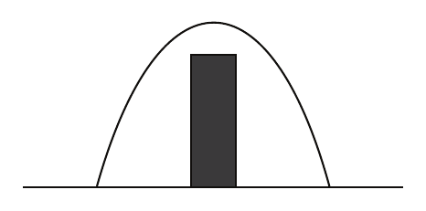

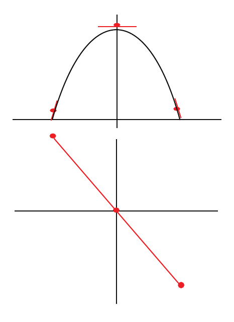

---

## Two Trig Limits（两个三角极限）

**注意**：下面表达式中的 \(\theta\) 以**弧度**计——**不是**角度！

\[
\lim_{\theta\to 0}\frac{\sin\theta}{\theta}=1;\qquad
\lim_{\theta\to 0}\frac{1-\cos\theta}{\theta}=0.
\]

下面是第一个极限的几何证明：

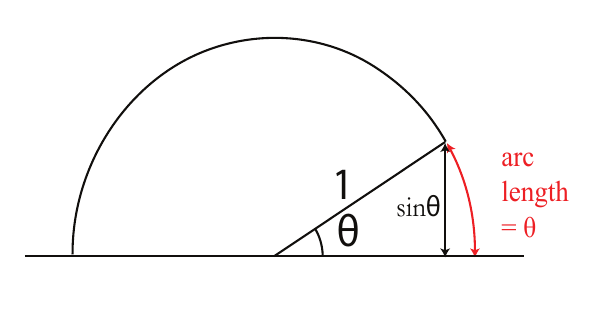

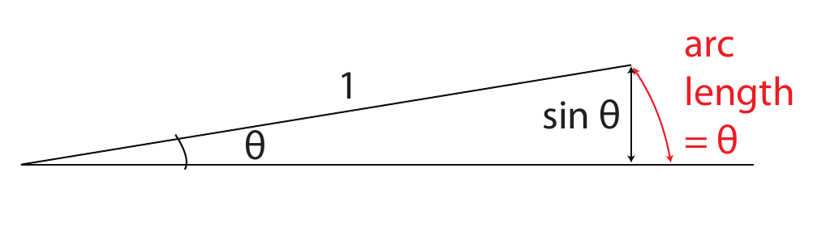

想象 \(\theta\) 变得非常小时图像会发生什么（见图 13）。当 \(\theta\to 0\) 时，我们看到

\[
\frac{\sin\theta}{\theta}\to 1.
\]

那么涉及余弦的第二个极限呢？

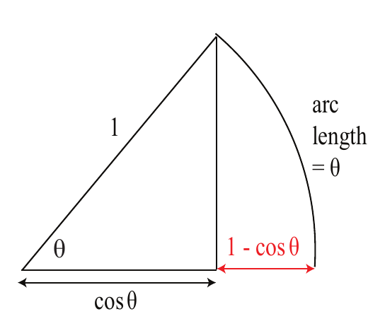

从图 15 可以看出：当 \(\theta\to 0\) 时，短线段 \(1-\cos\theta\) 的长度远小于沿圆弧的竖直距离 \(\theta\)。因此

\[
\frac{1-\cos\theta}{\theta}\to 0.
\]

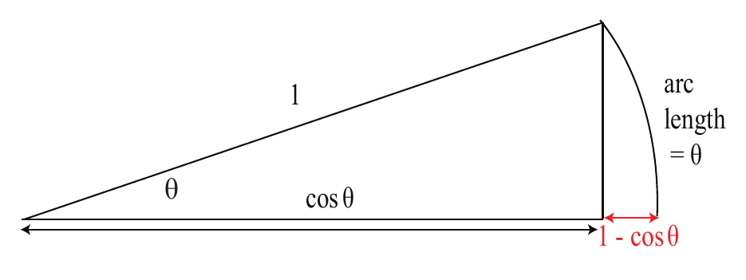

---

## Theorem: Differentiable Implies Continuous

（定理：可导蕴含连续）

我们以一个定理结束本讲；它将帮助我们下次计算更多导数。

**定理**：若 \(f\) 在 \(x_0\) **可导**，则 \(f\) 在 \(x_0\) **连续**。

**证明**：

\[
\lim_{x\to x_0}\bigl(f(x)-f(x_0)\bigr)
=\lim_{x\to x_0}\left[\frac{f(x)-f(x_0)}{x-x_0}\right](x-x_0)
=f'(x_0)\cdot 0=0.
\]

记住：**永远不能除以零！** 第一步是乘以 \(\dfrac{x-x_0}{x-x_0}\)。看起来不合法，因为当 \(x=x_0\) 时我们在乘以 \(\dfrac{0}{0}\)。但取极限 \(x\to x_0\) 时，我们**总是**假定 \(x\neq x_0\)。换言之 \(x-x_0\neq 0\)。所以证明是有效的。
