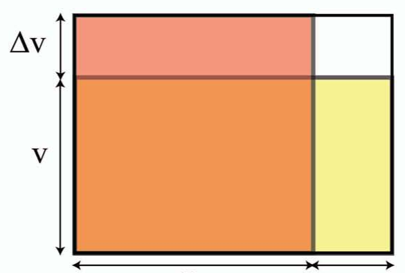

# MIT OCW 18.01 Lecture 3 讲义 · 中文译本

> **来源**：https://ocw.mit.edu/courses/18-01-single-variable-calculus-fall-2006/lec3.pdf  
> **课程**：18.01 Single Variable Calculus，Fall 2006  
> **说明**：英文原文具有权威性；本文件为中文学习转写。引用与条款见 http://ocw.mit.edu/terms 。数学式保留 LaTeX；图为 PDF 页渲染裁切，嵌入于对应正文旁。

---

## Lecture 3 (presented by Kobi Kremnizer):
## Derivatives of Products, Quotients, Sine, and Cosine

（第 3 讲〔由 Kobi Kremnizer 讲授〕：乘积、商、正弦与余弦的导数）

---

## Derivative Formulas（导数公式）

导数公式有两种：

1. **具体例子（Specific Examples）**：\(\displaystyle\frac{d}{dx}x^n\) 或 \(\displaystyle\frac{d}{dx}\Bigl(\frac{1}{x}\Bigr)\)。
2. **一般例子（General Examples）**：\((u+v)'=u'+v'\)，以及 \((cu)'=cu'\)（其中 \(c\) 为常数）。

本日使用的记号约定：

\[
(u+v)(x)=u(x)+v(x),\qquad
(uv)(x)=u(x)\,v(x).
\]

### Proof of \((u+v)'=u'+v'\)（General）

（\((u+v)'=u'+v'\) 的证明〔一般〕）

从导数的定义出发：

\[
\begin{aligned}
(u+v)'(x)
&=\lim_{\Delta x\to 0}\frac{(u+v)(x+\Delta x)-(u+v)(x)}{\Delta x}\\
&=\lim_{\Delta x\to 0}\frac{u(x+\Delta x)+v(x+\Delta x)-u(x)-v(x)}{\Delta x}\\
&=\lim_{\Delta x\to 0}\left\{
\frac{u(x+\Delta x)-u(x)}{\Delta x}
+\frac{v(x+\Delta x)-v(x)}{\Delta x}
\right\}
=u'(x)+v'(x).
\end{aligned}
\]

按同样手续可证 \((cu)'=cu'\)。

---

## Derivatives of \(\sin x\) and \(\cos x\)（Specific）

（\(\sin x\) 与 \(\cos x\) 的导数〔具体〕）

上次我们算过

\[
\lim_{x\to 0}\frac{\sin x}{x}=1.
\]

于是

\[
\begin{aligned}
\left.\frac{d}{dx}(\sin x)\right|_{x=0}
&=\lim_{\Delta x\to 0}\frac{\sin(0+\Delta x)-\sin 0}{\Delta x}
=\lim_{\Delta x\to 0}\frac{\sin(\Delta x)}{\Delta x}=1,\\[0.5em]
\left.\frac{d}{dx}(\cos x)\right|_{x=0}
&=\lim_{\Delta x\to 0}\frac{\cos(0+\Delta x)-\cos 0}{\Delta x}
=\lim_{\Delta x\to 0}\frac{\cos(\Delta x)-1}{\Delta x}=0.
\end{aligned}
\]

所以我们已经知道 \(\dfrac{d}{dx}\sin x\) 与 \(\dfrac{d}{dx}\cos x\) 在 \(x=0\) 处的值。下面求任意 \(x\) 处的值。

\[
\frac{d}{dx}\sin x
=\lim_{\Delta x\to 0}\frac{\sin(x+\Delta x)-\sin x}{\Delta x}.
\]

**回忆**：\(\sin(a+b)=\sin a\cos b+\cos a\sin b\)。于是

\[
\begin{aligned}
\frac{d}{dx}\sin x
&=\lim_{\Delta x\to 0}\frac{\sin x\cos\Delta x+\cos x\sin\Delta x-\sin x}{\Delta x}\\
&=\lim_{\Delta x\to 0}\left[
\sin x\cdot\frac{\cos\Delta x-1}{\Delta x}
+\cos x\cdot\frac{\sin\Delta x}{\Delta x}
\right]\\
&=\lim_{\Delta x\to 0}\sin x\left(\frac{\cos\Delta x-1}{\Delta x}\right)
+\lim_{\Delta x\to 0}\cos x\left(\frac{\sin\Delta x}{\Delta x}\right).
\end{aligned}
\]

由于 \(\dfrac{\cos\Delta x-1}{\Delta x}\to 0\) 且 \(\dfrac{\sin\Delta x}{\Delta x}\to 1\)，上式化简为

\[
\frac{d}{dx}\sin x=\cos x.
\]

类似计算给出

\[
\frac{d}{dx}\cos x=-\sin x.
\]

---

## Product formula (General)（乘积公式〔一般〕）

\[
(uv)'=u'v+uv'.
\]

### Proof（证明）

\[
(uv)'
=\lim_{\Delta x\to 0}\frac{(uv)(x+\Delta x)-(uv)(x)}{\Delta x}
=\lim_{\Delta x\to 0}\frac{u(x+\Delta x)v(x+\Delta x)-u(x)v(x)}{\Delta x}.
\]

显然

\[
u(x+\Delta x)v(x)-u(x+\Delta x)v(x)=0,
\]

把它加到分子上不会改变任何东西。于是

\[
(uv)'
=\lim_{\Delta x\to 0}\frac{
u(x+\Delta x)v(x)-u(x)v(x)
+u(x+\Delta x)v(x+\Delta x)-u(x+\Delta x)v(x)
}{\Delta x}.
\]

重新整理得

\[
(uv)'
=\lim_{\Delta x\to 0}\left[
\left(\frac{u(x+\Delta x)-u(x)}{\Delta x}\right)v(x)
+u(x+\Delta x)\left(\frac{v(x+\Delta x)-v(x)}{\Delta x}\right)
\right].
\]

记住：和的极限等于极限的和。因此

\[
(uv)'=u'(x)v(x)+u(x)v'(x).
\]

**注**：我们还用到了

\[
\lim_{\Delta x\to 0}u(x+\Delta x)=u(x)
\]

（因为 \(u\) 连续）。本证明假定 \(u\) 与 \(v\) 都有导数，而这蕴含二者都连续。

---

### An intuitive justification（直观说明）

我们想求大矩形与较小的内矩形之间的面积差。内（橙色）矩形面积为 \(uv\)。定义 \(u\) 的改变量

\[
\Delta u=u(x+\Delta x)-u(x).
\]

并简记 \(u=u(x)\)，从而 \(u(x+\Delta x)=u+\Delta u\)；类似地 \(v(x+\Delta x)=v+\Delta v\)。因此最大矩形的面积是 \((u+\Delta u)(v+\Delta v)\)。

若让 \(v\) 增加而保持 \(u\) 不变，就加上红色阴影区域；若让 \(u\) 增加而保持 \(v\) 不变，就加上黄色阴影区域。红、黄两块面积之和为

\[
\bigl[u(v+\Delta v)-uv\bigr]+\bigl[v(u+\Delta u)-uv\bigr]=u\,\Delta v+v\,\Delta u.
\]

若 \(\Delta u\) 与 \(\Delta v\) 很小，则 \((\Delta u)(\Delta v)\approx 0\)，即白色矩形的面积非常小。因此最大矩形与橙色矩形的面积差，近似等于红、黄两块面积之和。于是

\[
\bigl[(u+\Delta u)(v+\Delta v)-uv\bigr]\approx u\,\Delta v+v\,\Delta u.
\]

（两边除以 \(\Delta x\)，再令 \(\Delta x\to 0\)，即可完成论证。）

---

## Quotient formula (General)（商公式〔一般〕）

为计算 \(u/v\) 的导数，仍用上面的记号 \(\Delta u\)、\(\Delta v\)。于是

\[
\begin{aligned}
\frac{u(x+\Delta x)}{v(x+\Delta x)}-\frac{u(x)}{v(x)}
&=\frac{u+\Delta u}{v+\Delta v}-\frac{u}{v}\\
&=\frac{(u+\Delta u)v-u(v+\Delta v)}{(v+\Delta v)v}
\quad\text{（通分）}\\
&=\frac{(\Delta u)v-u(\Delta v)}{(v+\Delta v)v}
\quad\text{（消去 }uv-uv\text{）}.
\end{aligned}
\]

故

\[
\frac{1}{\Delta x}\left(
\frac{u+\Delta u}{v+\Delta v}-\frac{u}{v}
\right)
=\frac{\bigl(\frac{\Delta u}{\Delta x}\bigr)v-u\bigl(\frac{\Delta v}{\Delta x}\bigr)}{(v+\Delta v)v}
\;\xrightarrow{\Delta x\to 0}\;
\frac{v\,\dfrac{du}{dx}-u\,\dfrac{dv}{dx}}{v^2}.
\]

因此

\[
\left(\frac{u}{v}\right)'=\frac{u'v-uv'}{v^2}.
\]
