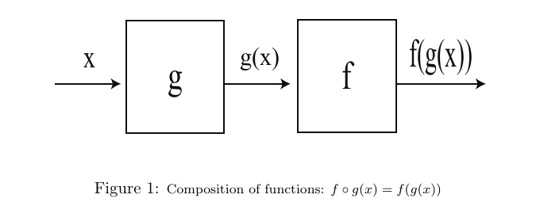

# MIT OCW 18.01 Lecture 4 讲义 · 中文译本

> **来源**：https://ocw.mit.edu/courses/18-01-single-variable-calculus-fall-2006/lec4.pdf  
> **课程**：18.01 Single Variable Calculus，Fall 2006  
> **说明**：英文原文具有权威性；本文件为中文学习转写。引用与条款见 http://ocw.mit.edu/terms 。数学式保留 LaTeX；图为 PDF 页渲染裁切，嵌入于对应正文旁。

---

## Lecture 4: Chain Rule, and Higher Derivatives

（第 4 讲：链式法则与高阶导数）

日期：Sept. 14, 2006｜18.01 Fall 2006

---

## Chain Rule（链式法则）

我们已经有了处理加法、减法与乘法表达式的一般求导手续。那么**复合**呢？

### Example 1. \(y=f(x)=\sin x\)，\(x=g(t)=t^2\)

于是 \(y=f(g(t))=\sin(t^2)\)。为求 \(\dfrac{dy}{dt}\)，记

\[
\begin{array}{ll}
t_0=t_0 & t=t_0+\Delta t\\
x_0=g(t_0) & x=x_0+\Delta x\\
y_0=f(x_0) & y=y_0+\Delta y
\end{array}
\]

则

\[
\frac{\Delta y}{\Delta t}=\frac{\Delta y}{\Delta x}\cdot\frac{\Delta x}{\Delta t}.
\]

当 \(\Delta t\to 0\) 时，由连续性亦有 \(\Delta x\to 0\)。于是得到：

\[
\frac{dy}{dt}=\frac{dy}{dx}\frac{dx}{dt}
\quad\leftarrow\text{The Chain Rule!（链式法则！）}
\]

在本例中，\(\dfrac{dx}{dt}=2t\)，\(\dfrac{dy}{dx}=\cos x\)。所以

\[
\frac{d}{dt}\bigl(\sin(t^2)\bigr)
=\Bigl(\frac{dy}{dx}\Bigr)\Bigl(\frac{dx}{dt}\Bigr)
=(\cos x)(2t)
=2t\cos(t^2).
\]

### Another notation for the chain rule（链式法则的另一记号）

\[
\frac{d}{dt}f(g(t))=f'(g(t))\,g'(t)
\qquad\text{或}\qquad
\frac{d}{dx}f(g(x))=f'(g(x))\,g'(x).
\]

### Example 1.（continued）函数 \(f(x)=\sin x\) 与 \(g(x)=x^2\) 的复合

\[
\begin{aligned}
(f\circ g)(x)&=f(g(x))=\sin(x^2),\\
(g\circ f)(x)&=g(f(x))=\sin^2(x).
\end{aligned}
\]

**注意**：\(f\circ g\neq g\circ f\)。**Not Commutative!（复合不可交换！）**

---

### Example 2. \(\dfrac{d}{dx}\cos\dfrac{1}{x}=?\)

令 \(u=\dfrac{1}{x}\)。则

\[
\frac{dy}{dx}=\frac{dy}{du}\frac{du}{dx}.
\]

\[
\frac{dy}{du}=-\sin(u),\qquad
\frac{du}{dx}=-\frac{1}{x^2}.
\]

故

\[
\frac{dy}{dx}
=(-\sin u)\Bigl(-\frac{1}{x^2}\Bigr)
=\frac{\sin u}{x^2}
=\frac{\sin(1/x)}{x^2}.
\]

---

### Example 3. \(\dfrac{d}{dx}x^{-n}=?\)

有两种做法。\(x^{-n}=\bigl(\dfrac{1}{x}\bigr)^n\)，或 \(x^{-n}=\dfrac{1}{x^n}\)。

**1.**

\[
\begin{aligned}
\frac{d}{dx}x^{-n}
&=\frac{d}{dx}\Bigl(\frac{1}{x}\Bigr)^n
=n\Bigl(\frac{1}{x}\Bigr)^{n-1}\Bigl(-\frac{1}{x^2}\Bigr)\\
&=-n\,x^{-(n-1)}\,x^{-2}
=-n\,x^{-n-1}.
\end{aligned}
\]

**2.**（把 \(x^n\) 想成 \(u\)）

\[
\begin{aligned}
\frac{d}{dx}x^{-n}
&=\frac{d}{dx}\Bigl(\frac{1}{x^n}\Bigr)
=n x^{n-1}\cdot\Bigl(-\frac{1}{x^{2n}}\Bigr)
=-n\,x^{-n-1}.
\end{aligned}
\]

---

## Higher Derivatives（高阶导数）

高阶导数就是导数的导数。例如若 \(g=f'\)，则 \(h=g'\) 是 \(f\) 的二阶导数。我们写 \(h=(f')'=f''\)。

### Notations（记号）

\[
\begin{array}{c|c|c}
f'(x) & Df & \dfrac{df}{dx}\\[0.6em]
f''(x) & D^2f & \dfrac{d^2f}{dx^2}\\[0.6em]
f'''(x) & D^3f & \dfrac{d^3f}{dx^3}\\[0.6em]
f^{(n)}(x) & D^nf & \dfrac{d^nf}{dx^n}
\end{array}
\]

高阶导数相当直接——只需不停地求导！

### Example. \(D^n x^n=?\)

从小数开始，寻找模式：

\[
\begin{aligned}
Dx&=1,\\
D^2x^2&=D(2x)=2\quad(=1\cdot 2),\\
D^3x^3&=D^2(3x^2)=D(6x)=6\quad(=1\cdot 2\cdot 3),\\
D^4x^4&=D^3(4x^3)=D^2(12x^2)=D(24x)=24\quad(=1\cdot 2\cdot 3\cdot 4).
\end{aligned}
\]

于是我们猜测

\[
D^n x^n=n!.
\]

记号 \(n!\) 称为「\(n\) factorial（\(n\) 的阶乘）」，定义为

\[
n!=n(n-1)\cdots 2\cdot 1.
\]

### Proof by Induction（归纳法证明）

我们已经检查了基础情形（\(n=1\)）。

**归纳步骤**：假定已知 \(D^n x^n=n!\)（第 \(n\) 款）。证明第 \(n+1\) 款亦成立：

\[
\begin{aligned}
D^{n+1}x^{n+1}
&=D^n\bigl(D x^{n+1}\bigr)
=D^n\bigl((n+1)x^n\bigr)
=(n+1)\,D^n x^n
=(n+1)\,(n!)
=(n+1)!.
\end{aligned}
\]

**Proved!（证毕！）**
