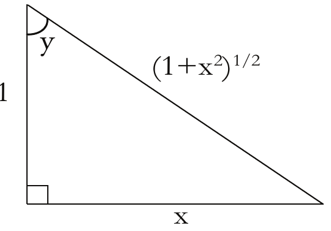
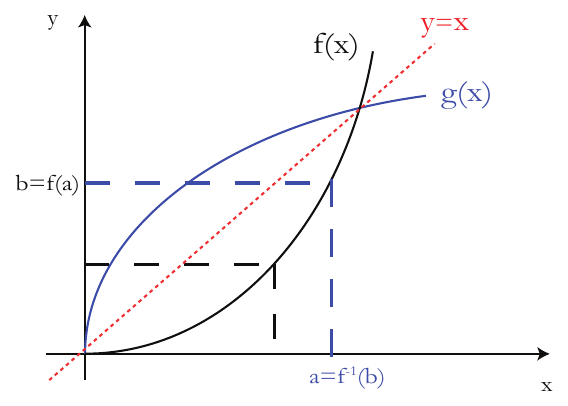

# MIT OCW 18.01 Lecture 5 讲义 · 中文译本

> **来源**：https://ocw.mit.edu/courses/18-01-single-variable-calculus-fall-2006/lec5.pdf  
> **课程**：18.01 Single Variable Calculus，Fall 2006  
> **说明**：英文原文具有权威性；本文件为中文学习转写。引用与条款见 http://ocw.mit.edu/terms 。数学式保留 LaTeX；图为 PDF 页渲染裁切，嵌入于对应正文旁。

---

## Lecture 5: Implicit Differentiation and Inverses

（第 5 讲：隐函数求导与反函数）

18.01 Fall 2006

---

## Implicit Differentiation（隐函数求导）

### Example 1. \(\dfrac{d}{dx}(x^a)=a x^{a-1}\)

我们已对 \(a=0,1,2,\ldots\) 用显式计算证明过这条公式；由此也得到了 \(a=-1,-2,\ldots\) 的情形。现在把它推广到有理数指数：

\[
a=\frac{m}{n},\qquad y=x^{m/n},
\]

其中 \(m,n\) 为整数。我们想求 \(\dfrac{dy}{dx}\)。可以写 \(y^n=x^m\)，从而

\[
n y^{n-1}\frac{dy}{dx}=m x^{m-1}.
\]

解出 \(\dfrac{dy}{dx}\)：

\[
\frac{dy}{dx}=\frac{m}{n}\frac{x^{m-1}}{y^{n-1}}.
\]

我们知道 \(y=x^{m/n}\) 是 \(x\) 的函数。代入并化简：

\[
\begin{aligned}
\frac{dy}{dx}
&=\frac{m}{n}\frac{x^{m-1}}{\bigl(x^{m/n}\bigr)^{n-1}}
=\frac{m}{n}\frac{x^{m-1}}{x^{m(n-1)/n}}
=\frac{m}{n}\,x^{(m-1)-m(n-1)/n}\\
&=\frac{m}{n}\,x^{\bigl(n(m-1)-m(n-1)\bigr)/n}
=\frac{m}{n}\,x^{(nm-n-nm+m)/n}
=\frac{m}{n}\,x^{(m-n)/n}
=\frac{m}{n}\,x^{m/n-1}.
\end{aligned}
\]

于是

\[
\frac{dy}{dx}=\frac{m}{n}\,x^{m/n-1}.
\]

**这正是我们希望得到的答案！**

---

### Example 2. 半径为 1 的圆：\(x^2+y^2=1\)

可写成 \(y^2=1-x^2\)，故 \(y=\pm\sqrt{1-x^2}\)。先看正支：

\[
y=+\sqrt{1-x^2}=(1-x^2)^{1/2}.
\]

\[
\frac{dy}{dx}
=\frac12(1-x^2)^{-1/2}\cdot(-2x)
=\frac{-x}{\sqrt{1-x^2}}
=\frac{-x}{y}.
\]

现在用**隐函数求导**做同一件事：

\[
\begin{aligned}
x^2+y^2&=1,\\
\frac{d}{dx}(x^2+y^2)&=\frac{d}{dx}(1)=0,\\
\frac{d}{dx}(x^2)+\frac{d}{dx}(y^2)&=0.
\end{aligned}
\]

对第二项用链式法则：

\[
2x+2y\frac{dy}{dx}=0
\quad\Rightarrow\quad
2y\frac{dy}{dx}=-2x
\quad\Rightarrow\quad
\frac{dy}{dx}=\frac{-x}{y}.
\]

**同一答案！**

---

### Example 3. \(y^3+xy^2+1=0\)

此时不容易解出 \(y\) 作为 \(x\) 的函数。改用隐函数求导求 \(\dfrac{dy}{dx}\)：

\[
3y^2\frac{dy}{dx}+y^2+2xy\frac{dy}{dx}=0.
\]

解出 \(\dfrac{dy}{dx}\)（用 \(x,y\) 表示）：

\[
\frac{dy}{dx}\,(3y^2+2xy)=-y^2
\quad\Rightarrow\quad
\frac{dy}{dx}=\frac{-y^2}{3y^2+2xy}.
\]

---

## Inverse Functions（反函数）

若 \(y=f(x)\) 且 \(g(y)=x\)，则称 \(g\) 为 \(f\) 的反函数 \(f^{-1}\)：

\[
x=g(y)=f^{-1}(y).
\]

用隐函数求导求反函数的导数：

\[
\begin{aligned}
y&=f(x),\\
f^{-1}(y)&=x,\\
\frac{d}{dx}\bigl(f^{-1}(y)\bigr)&=\frac{d}{dx}(x)=1.
\end{aligned}
\]

由链式法则：

\[
\frac{d}{dy}\bigl(f^{-1}(y)\bigr)\cdot\frac{dy}{dx}=1,
\]

从而

\[
\frac{d}{dy}\bigl(f^{-1}(y)\bigr)=\frac{1}{\dfrac{dy}{dx}}.
\]

因此，隐函数求导使我们能够求出反函数的导数。

---

### Example. \(y=\arctan(x)\)

\[
\begin{aligned}
\tan y&=x,\\
\frac{d}{dx}[\tan(y)]&=\frac{dx}{dx}=1,\\
\frac{d}{dy}[\tan(y)]\cdot\frac{dy}{dx}&=1,\\
\frac{1}{\cos^2(y)}\frac{dy}{dx}&=1,\\
\frac{dy}{dx}&=\cos^2(y)=\cos^2\bigl(\arctan(x)\bigr).
\end{aligned}
\]

这种形式很乱。用一点几何来化简它。

在这个三角形中，\(\tan(y)=x\)，故

\[
\arctan(x)=y.
\]

勾股定理给出斜边长：

\[
h=\sqrt{1+x^2}.
\]

由此

\[
\cos(y)=\frac{1}{\sqrt{1+x^2}},
\qquad
\cos^2(y)=\left(\frac{1}{\sqrt{1+x^2}}\right)^2=\frac{1}{1+x^2}.
\]

所以

\[
\frac{dy}{dx}=\frac{1}{1+x^2}.
\]

换言之，

\[
\boxed{\frac{d}{dx}\arctan(x)=\frac{1}{1+x^2}}.
\]

---

## Graphing an Inverse Function（反函数的作图）

设 \(y=f(x)\)，且 \(g(y)=f^{-1}(y)=x\)。要把 \(g\) 与 \(f\) 画在同一图上，需要把 \(g\) 写成自变量为 \(x\) 的函数。若 \(g(x)=y\)，则 \(x=f(y)\)——我们所做的就是交换变量 \(x\) 与 \(y\)。这由 Fig. 2 说明。

\[
\begin{aligned}
f^{-1}\bigl(f(x)\bigr)&=x
&&f^{-1}\circ f(x)=x,\\
f\bigl(f^{-1}(x)\bigr)&=x
&&f\circ f^{-1}(x)=x.
\end{aligned}
\]

**Figure 2：**可以把 \(f^{-1}\) 想成 \(f\) 的图像关于直线 \(y=x\) 反射而得。
