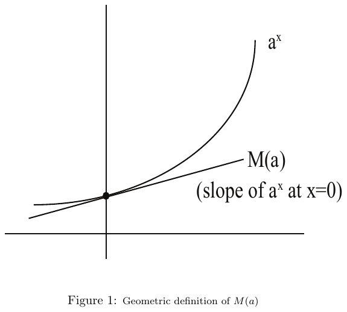
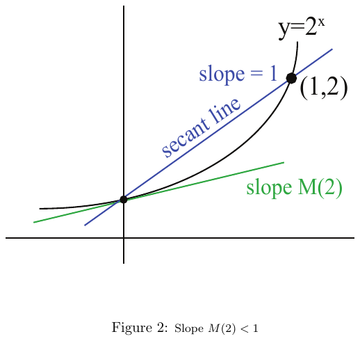
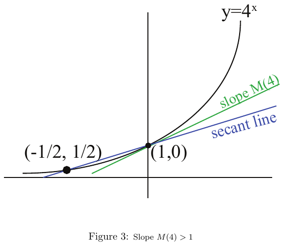

# MIT OCW 18.01 Lecture 6 讲义 · 中文译本

> **来源**：https://ocw.mit.edu/courses/18-01-single-variable-calculus-fall-2006/lec6.pdf  
> **课程**：18.01 Single Variable Calculus，Fall 2006  
> **说明**：英文原文具有权威性；本文件为中文学习转写。引用与条款见 http://ocw.mit.edu/terms 。数学式保留 LaTeX；图为 PDF 页渲染裁切，嵌入于对应正文旁。

---

## Lecture 6: Exponential and Log, Logarithmic Differentiation, Hyperbolic Functions

（第 6 讲：指数与对数、对数微分、双曲函数）

18.01 Fall 2006

---

## Taking the derivatives of exponentials and logarithms（指数与对数的求导）

### Background（背景）

我们总是假定底数 \(a>1\)。

\[
a^0=1;\qquad a^1=a;\qquad a^2=a\cdot a;\qquad \ldots
\]

\[
\begin{aligned}
a^{x_1+x_2}&=a^{x_1}a^{x_2},\\
(a^{x_1})^{x_2}&=a^{x_1 x_2},\\
a^{p/q}&=\sqrt[q]{a^p}\quad\text{（其中 \(p,q\) 为整数）}.
\end{aligned}
\]

要对实数 \(r\) 定义 \(a^r\)，按**连续性**填补。

---

### Today’s main task: find \(\dfrac{d}{dx}a^x\)（今日主任务）

可写

\[
\frac{d}{dx}a^x=\lim_{\Delta x\to0}\frac{a^{x+\Delta x}-a^x}{\Delta x}.
\]

提出 \(a^x\)：

\[
\lim_{\Delta x\to0}\frac{a^{x+\Delta x}-a^x}{\Delta x}
=\lim_{\Delta x\to0}a^x\frac{a^{\Delta x}-1}{\Delta x}
=a^x\lim_{\Delta x\to0}\frac{a^{\Delta x}-1}{\Delta x}.
\]

记

\[
M(a)\equiv\lim_{\Delta x\to0}\frac{a^{\Delta x}-1}{\Delta x}.
\]

尚不知 \(M(a)\) 是什么，但已有

\[
\frac{d}{dx}a^x=M(a)\,a^x.
\]

\(M(a)\) 有两种说法：

**1. 分析地**，\(M(a)=\dfrac{d}{dx}a^x\) 在 \(x=0\) 处的值。确实，

\[
M(a)=\lim_{\Delta x\to0}\frac{a^{0+\Delta x}-a^0}{\Delta x}
=\Bigl.\frac{d}{dx}a^x\Bigr|_{x=0}.
\]

**2. 几何地**，\(M(a)\) 是图像 \(y=a^x\) 在 \(x=0\) 处的斜率。

弄清 \(M(a)\) 的窍门是**回避问题**：定义 \(e\) 为满足 \(M(e)=1\) 的那个数。能否保证这样的 \(e\) 存在？首先注意：底 \(a\) 增大时，图像 \(a^x\) 变陡。其次，对 \(a=2\) 与 \(a=4\) 用几何估计斜率 \(M(a)\)。

看 Fig. 2 中 \(y=2^x\) 的图像。从 \((0,1)\) 到 \((1,2)\) 的割线斜率为 1。因此 \(y=2^x\) 在 \(x=0\) 的斜率更小：\(M(2)<1\)（见图 2）。

再看 Fig. 3 中 \(y=4^x\) 的图像。从 \(\bigl(-\tfrac12,\tfrac12\bigr)\) 到 \((0,1)\) 的割线斜率为 1。（印刷图将该点误标为 \((1,0)\)；按坐标与斜率 1 应对 \((0,1)\)。）因此 \(y=4^x\) 在 \(x=0\) 的斜率更大：\(M(4)>1\)（见图 3）。

故在 2 与 4 之间，存在某个底，使其在 \(x=0\) 的斜率为 1。

于是可定义 \(e\) 为满足

\[
M(e)=1
\]

的唯一数；换言之，

\[
\lim_{h\to0}\frac{e^h-1}{h}=1;
\]

再换言之，

\[
\frac{d}{dx}(e^x)=1\quad\text{在 }x=0.
\]

那么 \(\dfrac{d}{dx}(e^x)\) 是什么？我们刚定义 \(M(e)=1\)，且 \(\dfrac{d}{dx}(e^x)=M(e)e^x\)，故

\[
\boxed{\frac{d}{dx}(e^x)=e^x}.
\]

---

## Natural log（自然对数：\(e^x\) 的反函数）

为更好理解 \(M(a)\)，研究自然对数 \(\ln(x)\)。定义如下：

\[
\text{若 }y=e^x,\text{ 则 }\ln(y)=x
\]

（或）

\[
\text{若 }w=\ln(x),\text{ 则 }e^w=x.
\]

注意：即使 \(x\) 为负，\(e^x\) 也总为正。回顾 \(\ln(1)=0\)；当 \(0<x<1\) 时 \(\ln(x)<0\)；当 \(x>1\) 时 \(\ln(x)>0\)。并回顾

\[
\ln(x_1 x_2)=\ln x_1+\ln x_2.
\]

用**隐函数求导**求 \(\dfrac{d}{dx}\ln(x)\)。设 \(w=\ln(x)\)，求 \(\dfrac{dw}{dx}\)：

\[
\begin{aligned}
e^w&=x,\\
\frac{d}{dx}(e^w)&=\frac{d}{dx}(x),\\
\frac{d}{dw}(e^w)\cdot\frac{dw}{dx}&=1,\\
e^w\frac{dw}{dx}&=1,\\
\frac{dw}{dx}&=\frac{1}{e^w}=\frac{1}{x}.
\end{aligned}
\]

于是

\[
\boxed{\frac{d}{dx}(\ln(x))=\frac{1}{x}}.
\]

---

## 回到 \(\dfrac{d}{dx}(a^x)\)

有两种方法。

### Method 1: Write base \(e\) and use chain rule.（方法一：改写成底 \(e\)，用链式法则）

把 \(a\) 改写为 \(e^{\ln(a)}\)。则

\[
a^x=\bigl(e^{\ln(a)}\bigr)^x=e^{x\ln(a)}.
\]

逐步习惯链式：

\[
\frac{d}{dx}e^x=e^x,
\qquad
\frac{d}{dx}e^{3x}=3e^{3x}.
\]

记住：\(\ln(a)\) 只是一个**常数**，不是变量！因此

\[
\frac{d}{dx}e^{(\ln a)x}=(\ln a)\,e^{(\ln a)x},
\]

亦即

\[
\boxed{\frac{d}{dx}(a^x)=\ln(a)\cdot a^x}.
\]

回顾 \(\dfrac{d}{dx}(a^x)=M(a)\cdot a^x\)，故现在知道

\[
M(a)=\ln(a).
\]

即便坚持从别的底出发（例如 10），自然对数仍会出现：

\[
\frac{d}{dx}10^x=(\ln 10)\,10^x.
\]

底 \(e\) 起初可能显得奇怪，但它处处出现。过一段时间，你会体会它有多「自然」。

---

### Method 2: Logarithmic Differentiation.（方法二：对数微分）

想法是：求 \(\dfrac{d}{dx}f(x)\) 时，改为先求 \(\dfrac{d}{dx}\ln(f(x))\)——有时更容易。令 \(u=f(x)\)。

\[
\frac{d}{dx}\ln(u)=\frac{d\ln(u)}{du}\cdot\frac{du}{dx}=\frac{1}{u}\frac{du}{dx}.
\]

由于 \(u=f\) 且 \(\dfrac{du}{dx}=f'\)，也可写

\[
(\ln f)'=\frac{f'}{f}
\quad\text{或}\quad
f'=f\,(\ln f)'.
\]

应用到 \(f(x)=a^x\)：

\[
\ln f(x)=x\ln a
\quad\Rightarrow\quad
\frac{d}{dx}\ln(f)=\frac{d}{dx}\ln(a^x)=\frac{d}{dx}(x\ln(a))=\ln(a).
\]

（记住 \(\ln(a)\) 是常数。）故

\[
\frac{d}{dx}(\ln f)=\ln(a)=\frac{f'}{f}
\quad\Rightarrow\quad
f'=\ln(a)\,f
\quad\Rightarrow\quad
\frac{d}{dx}a^x=(\ln a)\,a^x.
\]

---

### Example 1. \(\dfrac{d}{dx}(x^x)=?\)

指数「在动」时，应使用底 \(e\) 或对数微分。本例用后者。

\[
\begin{aligned}
f&=x^x,\\
\ln f&=x\ln x,\\
(\ln f)'&=1\cdot(\ln x)+x\cdot\frac{1}{x}=\ln(x)+1,\\
(\ln f)'&=\frac{f'}{f}.
\end{aligned}
\]

因此

\[
\boxed{f'=f\,(\ln f)'=x^x\bigl(\ln(x)+1\bigr)}.
\]

若用底 \(e\) 途径，则写 \(f=e^{x\ln x}\) 再用链式——答案相同，书写稍多。

---

### Example 2. Use logs to evaluate \(\lim_{k\to\infty}\Bigl(1+\dfrac{1}{k}\Bigr)^k\).

因为指数 \(k\) 在变，最好先求对数的极限：

\[
\lim_{k\to\infty}\ln\Bigl[\Bigl(1+\frac{1}{k}\Bigr)^k\Bigr].
\]

我们知道

\[
\ln\Bigl[\Bigl(1+\frac{1}{k}\Bigr)^k\Bigr]=k\ln\Bigl(1+\frac{1}{k}\Bigr).
\]

该式有两部分在竞争、互相平衡：\(k\to\infty\)，而 \(\ln\bigl(1+\tfrac{1}{k}\bigr)\to 0\)。

\[
\begin{aligned}
\ln\Bigl[\Bigl(1+\frac{1}{k}\Bigr)^k\Bigr]
&=k\ln\Bigl(1+\frac{1}{k}\Bigr)
=\frac{\ln\bigl(1+\tfrac{1}{k}\bigr)}{\tfrac{1}{k}}
=\frac{\ln(1+h)}{h}
\quad\Bigl(h=\frac{1}{k}\Bigr).
\end{aligned}
\]

又因 \(\ln 1=0\)，

\[
\ln\Bigl[\Bigl(1+\frac{1}{k}\Bigr)^k\Bigr]=\frac{\ln(1+h)-\ln(1)}{h}.
\]

取极限：\(h=\dfrac{1}{k}\to0\)（当 \(k\to\infty\)），故

\[
\lim_{h\to0}\frac{\ln(1+h)-\ln(1)}{h}
=\Bigl.\frac{d}{dx}\ln(x)\Bigr|_{x=1}=1.
\]

总之，

\[
\lim_{k\to\infty}\ln\Bigl(1+\frac{1}{k}\Bigr)^k=1.
\]

我们刚得到：若 \(a_k=\ln\bigl[\bigl(1+\tfrac{1}{k}\bigr)^k\bigr]\)，则 \(a_k\to1\)（\(k\to\infty\)）。若 \(b_k=\bigl(1+\tfrac{1}{k}\bigr)^k\)，则 \(b_k=e^{a_k}\to e^1\)（\(k\to\infty\)）。也就是说，所求极限为

\[
\boxed{\lim_{k\to\infty}\Bigl(1+\frac{1}{k}\Bigr)^k=e}.
\]

**Remark 1.** 我们从未弄清 \(e\) 的精确数值。现在可用该极限公式；\(k=10\) 已给出相当不错的近似。

**Remark 2.** 对数用于一切科学，甚至金融。想想股市：若说今天跌了 50 点，你需要知道跌前大盘是 300 点还是 10{,}000 点。换言之，你关心的是**百分比变化**，即改变量与起始值之比：

\[
\frac{f'(t)}{f(t)}=\frac{d}{dt}\ln\bigl(f(t)\bigr).
\]
