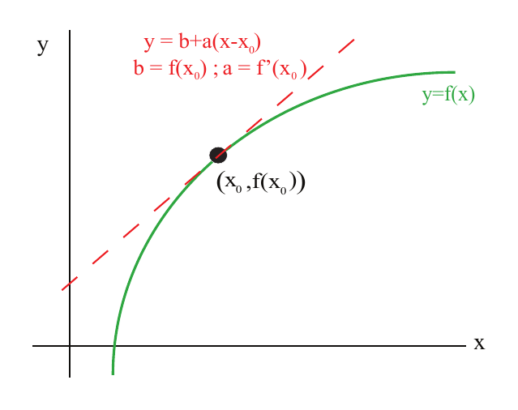
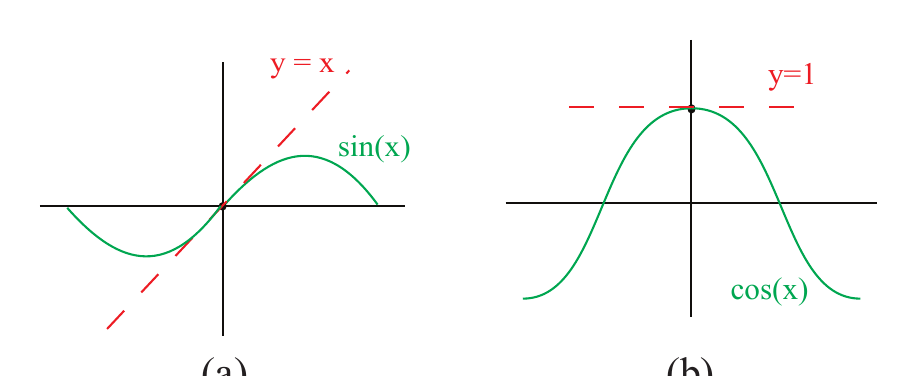
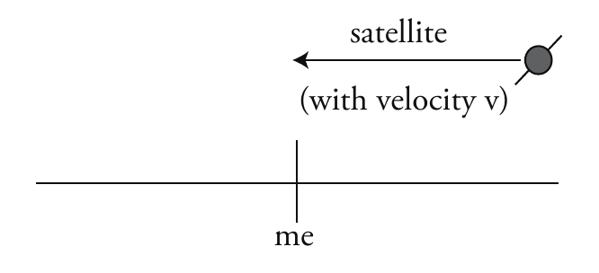
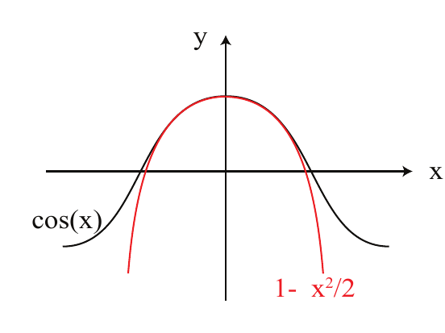

# MIT OCW 18.01 Lecture 9 讲义 · 中文译本

> **编号说明（必读）**：本文件名写作 `OCW_18.01_L08_…`，是为与 Bilibili 合集 **BV1mNgm66EZu · P8**（08-线性与二次近似）对齐。对应的官方 PDF 实为 Fall 2006 **`lec9.pdf`（Lecture 9: Linear and Quadratic Approximations）**。OCW 课程日历中的 **Lecture 8** 是 Exam 1，**没有**常规讲义 PDF / 本系列课堂录像；故 Bilibili P8 ↔ OCW Lecture 9，而非 Lecture 8。  
> **来源**：https://ocw.mit.edu/courses/18-01-single-variable-calculus-fall-2006/lec9.pdf  
> **课程**：18.01 Single Variable Calculus，Fall 2006  
> **说明**：英文原文具有权威性；本文件为中文学习转写。引用与条款见 http://ocw.mit.edu/terms 。数学式保留 LaTeX；图为 PDF 页渲染裁切，嵌入于对应正文旁。

---

## Lecture 9: Linear and Quadratic Approximations

（第 9 讲：线性近似与二次近似）

18.01 Fall 2006

### Unit 2: Applications of Differentiation（微分的应用）

今天我们要用微分来做近似。

---

## Linear Approximation（线性近似）

切线近似 \(f(x)\)。在切点 \(x_0\) 附近近似很好；一旦离开 \(x_0\)，近似就逐渐变差。

\[
f(x)\approx f(x_0)+f'(x_0)(x-x_0).
\]

### Example 1. \(f(x)=\ln x\)，\(x_0=1\)（基点）

\[
f(1)=\ln1=0,\qquad
f'(1)=\frac{1}{x}\Big|_{x=1}=1.
\]

\[
\ln x\approx f(1)+f'(1)(x-1)=0+1\cdot(x-1)=x-1.
\]

改换基点：令 \(x=1+u\)，则 \(u=x-1\)，

\[
\ln(1+u)\approx u.
\]

此时基点为 \(u_0=x_0-1=0\)。

---

## Basic list of linear approximations（基本线性近似表）

本表一律取基点 \(x_0=0\)，并假定 \(|x|\ll 1\)。

1. \(\sin x\approx x\)（若 \(x\approx0\)）（见图 2(a)）
2. \(\cos x\approx 1\)（若 \(x\approx0\)）（见图 2(b)）
3. \(e^x\approx 1+x\)（若 \(x\approx0\)）
4. \(\ln(1+x)\approx x\)（若 \(x\approx0\)）
5. \((1+x)^r\approx 1+rx\)（若 \(x\approx0\)）

### Proofs（证明）

**1 的证明**：取 \(f(x)=\sin x\)，则 \(f'(x)=\cos x\)，\(f(0)=0\)，\(f'(0)=1\)，

\[
f(x)\approx f(0)+f'(0)(x-0)=0+1\cdot x=x.
\]

（2、3 的证法类似。4 已在上面证过。）

**5 的证明**：

\[
f(x)=(1+x)^r,\qquad f(0)=1,
\]

\[
f'(0)=\frac{d}{dx}(1+x)^r\Big|_{x=0}=r(1+x)^{r-1}\Big|_{x=0}=r,
\]

\[
f(x)\approx f(0)+f'(0)x=1+rx.
\]

---

### Example 2. 求 \(f(x)=\dfrac{e^{-2x}}{\sqrt{1+x}}\) 在 \(x=0\) 附近的线性近似

也可以先算出 \(f'(x)\) 再求 \(f'(0)\)。这里改为把基本近似**代数地组合**起来。

\[
e^{-2x}\approx 1+(-2x)
\quad\bigl(e^{u}\approx1+u,\; u=-2x\bigr).
\]

\[
\sqrt{1+x}=(1+x)^{1/2}\approx 1+\frac12 x.
\]

合在一起：

\[
\frac{e^{-2x}}{\sqrt{1+x}}
\approx\frac{1-2x}{1+\frac12 x}
\approx(1-2x)\Bigl(1+\frac12 x\Bigr)^{-1}.
\]

又 \(\bigl(1+\frac12 x\bigr)^{-1}\approx1-\frac12 x\)（用 \((1+u)^{-1}\approx1-u\)，\(u=x/2\)）。于是

\[
\frac{e^{-2x}}{\sqrt{1+x}}
\approx(1-2x)\Bigl(1-\frac12 x\Bigr)
=1-2x-\frac12 x+2\cdot\Bigl(\frac12\Bigr)x^2.
\]

现在丢掉最后的 \(x^2\) 项——因为在做这些近似时，已经扔掉过若干 \(x^2\)（及更高阶）项。记住我们假定 \(|x|\ll1\)：此时 \(x^2\) 很小，\(x^3\) 更小，高阶项可以忽略。于是

\[
\frac{e^{-2x}}{\sqrt{1+x}}\approx1-2x-\frac12 x=1-\frac52 x.
\]

由 \(f(x)\approx1-\frac52 x\) 可直接读出 \(f(0)=1\)、\(f'(0)=-\frac52\)，往往比真去算 \(f'(x)\) 更快。

> **脚注捷径**：两步 \(\dfrac{1}{\sqrt{1+x}}\approx\dfrac{1}{1+\frac12 x}\approx1-\frac12 x\) 可一步写成
> \[
> \frac{1}{\sqrt{1+x}}=(1+x)^{-1/2}\approx1-\frac12 x.
> \]

---

### Example 3. \(f(x)=(1+2x)^{10}\)

第一次考试曾要求算

\[
\lim_{x\to0}\frac{(1+2x)^{10}-1}{x}.
\]

用 Unit 1 工具的最快做法是：

\[
\lim_{x\to0}\frac{(1+2x)^{10}-1}{x}
=\lim_{x\to0}\frac{f(x)-f(0)}{x}
=f'(0)=20,
\]

因为 \(f'(x)=10(1+2x)^9\cdot2\)，在 \(x=0\) 处为 \(20\)。

现在用线性近似换一种做法：

\[
(1+2x)^{10}\approx1+10\cdot(2x)
\quad\bigl((1+u)^r\approx1+ru,\; u=2x,\; r=10\bigr).
\]

于是

\[
\frac{(1+2x)^{10}-1}{x}\approx\frac{1+20x-1}{x}=20.
\]

---

### Example 4: Planet Quirk（夸克星球）

假设我在夸克星球上，一颗卫星以速度 \(v\) 从头顶飞过。我们想求卫星上时钟相对我腕表所经历的**时间膨胀**（狭义相对论）。借用公式

\[
T'=\frac{T}{\sqrt{1-\dfrac{v^2}{c^2}}}.
\]

这里 \(T'\) 是我腕表测得的时间，\(T\) 是卫星上测得的时间。

\[
T'=T\Bigl(1-\frac{v^2}{c^2}\Bigr)^{-1/2}
\approx T\Bigl(1+\frac12\frac{v^2}{c^2}\Bigr),
\]

其中用了 \((1+u)^r\approx1+ru\)，\(u=-v^2/c^2\)，\(r=-\frac12\)。

若 \(v=4\,\mathrm{km/s}\)，光速 \(c=3\times10^5\,\mathrm{km/s}\)，则 \(v^2/c^2\approx10^{-10}\)。地面与卫星测时几乎无差别。尽管如此，工程师正是用这一近似（以及若干同类近似）来校准 GPS 卫星的无线电发射机（卫星以略微偏移的频率发射）。

---

## Quadratic Approximations（二次近似）

二次近似更复杂，只在需要更高精度时使用。

\[
f(x)\approx f(x_0)+f'(x_0)(x-x_0)+\frac{f''(x_0)}{2}(x-x_0)^2
\qquad(x\approx x_0).
\]

**几何图像**：二次近似给出函数的**最佳拟合抛物线**。例如取 \(f(x)=\cos x\)（见图 4）。若 \(x_0=0\)，则 \(f(0)=\cos0=1\)，且

\[
\begin{aligned}
f'(x)&=-\sin x &&\Rightarrow&& f'(0)=0,\\
f''(x)&=-\cos x &&\Rightarrow&& f''(0)=-1,
\end{aligned}
\]

\[
\cos x\approx1+0\cdot x-\frac12 x^2=1-\frac12 x^2.
\]

你或许会问：\(x^2\) 前面那个 \(\frac12\) 从何而来？它是为了让该近似对**二次函数恰好精确**。例如设

\[
f(x)=a+bx+cx^2,\qquad
f'(x)=b+2cx,\qquad
f''(x)=2c.
\]

取基点 \(x_0=0\)：

\[
\begin{aligned}
f(0)&=a &&\Rightarrow&& a=f(0),\\
f'(0)&=b &&\Rightarrow&& b=f'(0),\\
f''(0)&=2c &&\Rightarrow&& c=\frac{f''(0)}{2}.
\end{aligned}
\]

---

### Basic Quadratic Approximations（基本二次近似）

\[
f(x)\approx f(0)+f'(0)x+\frac{f''(0)}{2}x^2\qquad(x\approx0).
\]

1. \(\sin x\approx x\)（若 \(x\approx0\)）
2. \(\cos x\approx 1-\dfrac{x^2}{2}\)（若 \(x\approx0\)）
3. \(e^x\approx 1+x+\dfrac12 x^2\)（若 \(x\approx0\)）
4. \(\ln(1+x)\approx x-\dfrac12 x^2\)（若 \(x\approx0\)）
5. \((1+x)^r\approx 1+rx+\dfrac{r(r-1)}{2}x^2\)（若 \(x\approx0\)）

**证明**：对每一情形计算 \(f(0)\)、\(f'(0)\)、\(f''(0)\)。下面写出情形 4：

\[
\begin{aligned}
f(x)&=\ln(1+x) &&\Rightarrow&& f(0)=\ln1=0,\\
f'(x)&=\frac{1}{1+x} &&\Rightarrow&& f'(0)=1,\\
f''(x)&=-\frac{1}{(1+x)^2} &&\Rightarrow&& f''(0)=-1.
\end{aligned}
\]

把二次近似用回夸克星球例子：

\[
\Bigl(1-\frac{v^2}{c^2}\Bigr)^{-1/2}
\approx1+\frac12\frac{v^2}{c^2}
+\frac{\bigl(-\frac12\bigr)\bigl(-\frac12-1\bigr)}{2}\Bigl(-\frac{v^2}{c^2}\Bigr)^2,
\]

（情形 5，\(x=-v^2/c^2\)，\(r=-\frac12\)。）

由于 \(v^2/c^2\approx10^{-10}\)，最后一项量级为 \(\bigl(v^2/c^2\bigr)^2\approx10^{-20}\)。即便最好的原子钟也无法测到这一精度。二次项如此之小，本例大可忽略它，继续用线性近似。

---

### Example 5. \(f(x)=\dfrac{e^{-2x}}{\sqrt{1+x}}\)

求该式的二次近似。改写 \(f(x)=e^{-2x}(1+x)^{-1/2}\)。对各因子用二次近似：

\[
f(x)\approx
\Bigl(1-2x+\frac12(-2x)^2\Bigr)
\Biggl(
1-\frac12 x+\frac{\bigl(-\frac12\bigr)\bigl(-\frac12-1\bigr)}{2}x^2
\Biggr).
\]

展开并只保留到 \(x^2\)：

\[
f(x)\approx1-2x-\frac12 x+(-2)\Bigl(-\frac12\Bigr)x^2+2x^2+\frac38 x^2
=1-\frac52 x+\frac{27}{8}x^2.
\]

（注：丢掉 \(x^3\) 及更高阶。这是二次近似，不关心高于 \(x^2\) 的项。）
