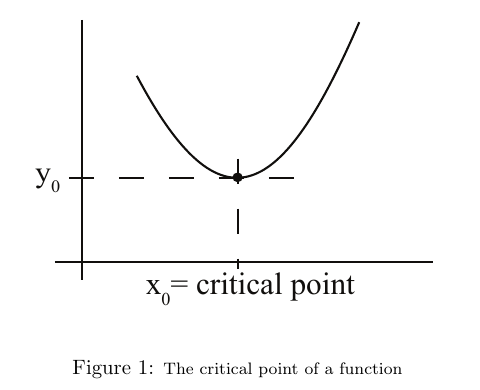
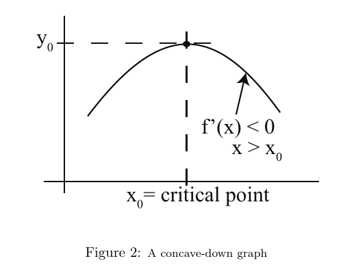
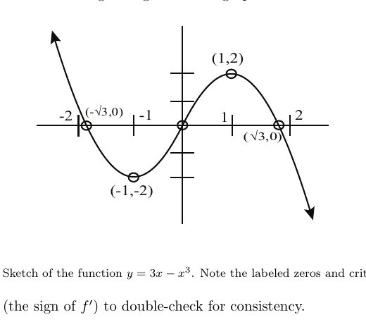
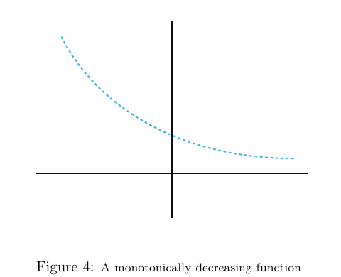
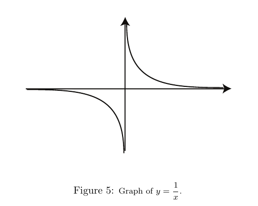
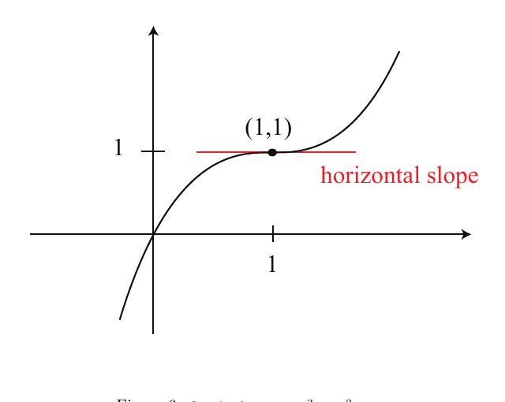
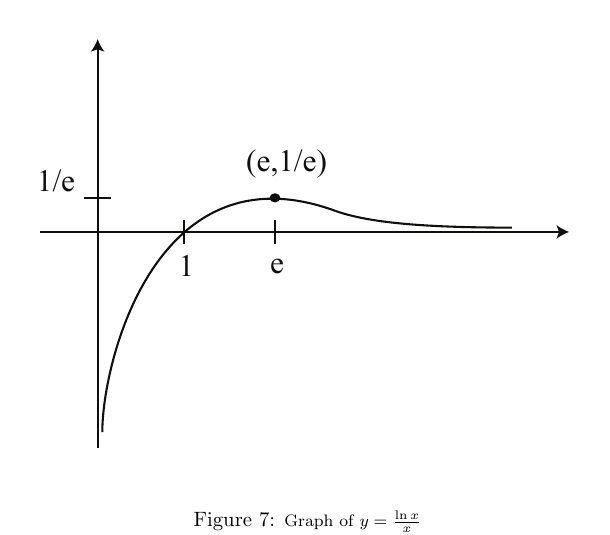
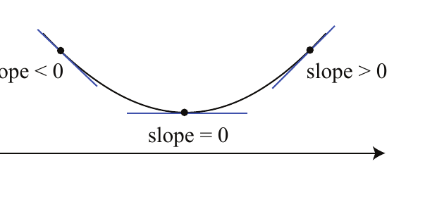
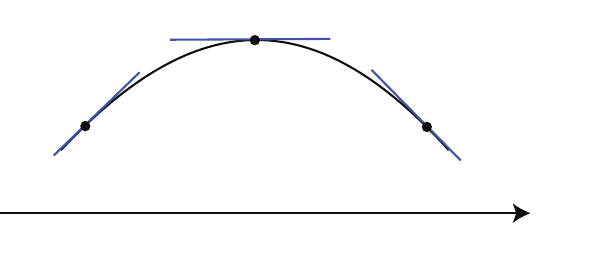
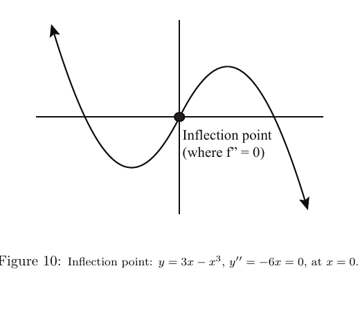

# MIT OCW 18.01 Lecture 10 讲义 · 中文译本

> **编号说明（必读）**：本文件名写作 `OCW_18.01_L09_…`，是为与 Bilibili 合集 **BV1mNgm66EZu · P9**（09-近似公式与曲线作图）对齐。对应的官方 PDF 实为 Fall 2006 **`lec10.pdf`（Lecture 10: Curve Sketching）**。Bilibili P9 视频开场自报「第十讲」，但前半先收完二次近似，后半才进入曲线作图；标题把两段拼在一起——**讲义正文以下按 `lec10.pdf`（Curve Sketching）转写**，近似收尾内容见同目录 [`MIT1801_L09_课上思路.md`](./MIT1801_L09_课上思路.md)。  
> **来源**：https://ocw.mit.edu/courses/18-01-single-variable-calculus-fall-2006/lec10.pdf  
> **课程**：18.01 Single Variable Calculus，Fall 2006  
> **说明**：英文原文具有权威性；本文件为中文学习转写。引用与条款见 http://ocw.mit.edu/terms 。数学式保留 LaTeX；图为 PDF 页渲染裁切，嵌入于对应正文旁。

---

## Lecture 10: Curve Sketching

（第 10 讲：曲线作图）

18.01 Fall 2006

**目标**：利用 \(f'\) 与 \(f''\) 的性态画出 \(f\) 的图像。我们要的是**定性正确**的草图，不必按比例精确。

---

## Typical Picture（典型图像）

此处 \(y_0\) 是极小值，\(x_0\) 是取得该极小值的点。

注意：当 \(x<x_0\) 时 \(f'(x)<0\)，即在临界点左侧 \(f\) **递减**；当 \(x>x_0\) 时 \(f'(x)>0\)，即在临界点右侧 \(f\) **递增**。

### Another typical picture（另一种典型图像）

此处 \(y_0\) 是临界（极大）值，\(x_0\) 是临界点。\(f\) 在临界点右侧递减，在 \(x_0\) 左侧递增。

---

## Rubric for curve-sketching（曲线作图步骤清单）

1. **（预备技能）** 标出 \(f\) 的不连续点——尤其是无穷型不连续！
2. 求**临界点**（critical points）。通常是 \(f'(x)=0\) 的点（斜率由正变负或由负变正之处）。
3. (a) 若相对容易，标出临界点（与临界值）。  
   (b) 若尚不明显，判定临界点之间 \(f'(x)\) 的符号。
4. **（预备技能）** 求并标出 \(f\) 的零点（\(f(x)=0\) 的 \(x\)）。只在相对容易时做。
5. **（预备技能）** 判定端点性态（或 \(x\to\pm\infty\) 时的性态）。

---

## Example 1. \(y=3x-x^3\)

1. 无不连续点。
2. \(y'=3-3x^2=3(1-x^2)\)，故 \(y'=0\) 于 \(x=\pm1\)。
3. (a) 在 \(x=1\)，\(y=3-1=2\)。  
   (b) 在 \(x=-1\)，\(y=-3+1=-2\)。把这两点标在图上。
4. 求零点：\(y=3x-x^3=x(3-x^2)=0\)，故零点在 \(x=0,\;\pm\sqrt{3}\)。
5. \(x\to\pm\infty\) 时的性态：当 \(x\to\infty\) 时，\(y\) 中 \(x^3\) 项主导，故 \(y\to-\infty\)；同理 \(x\to-\infty\) 时 \(y\to\infty\)。

把以上信息合在一起，得到 Fig. 3 所示图像。

再用步骤 3b（\(f'\) 的符号）做一致性核对：

\[
y'=3-3x^2=3(1-x^2).
\]

当 \(|x|<1\) 时 \(y'>0\)；当 \(|x|>1\) 时 \(y'<0\)。果然，\(y\) 在 \(x=-1\) 与 \(x=1\) 之间递增，在其余地方递减。

---

## Example 2. \(y=\dfrac{1}{x}\)

本例说明：为何必须在考察导数性质**之前**先找不连续点。计算

\[
y'=\frac{-1}{x^2}<0.
\]

**警告**：导数永不为正，你或许会以为 \(y\) 始终递减，图像类似 Fig. 4。

但你大概已经知道，\(y=1/x\) 的图像完全不是这样！它实际如 Fig. 5。事实上，\(y=1/x\) 除了在 \(x=0\) 处从 \(-\infty\) **跳到** \(+\infty\) 之外，在各连通分支上递减。这正是必须警惕不连续点的原因。

---

## Example 3. \(y=x^3-3x^2+3x\)

\[
y'=3x^2-6x+3=3(x^2-2x+1)=3(x-1)^2.
\]

在 \(x=1\) 有临界点。\(y'\) 在 \(x=1\) 两侧皆 \(>0\)，故 \(y\) **处处递增**。此时临界点处 \(y'\) 的符号不变，但图像会在该处变平（见 Fig. 6）。

---

## Example 4. \(y=\dfrac{\ln x}{x}\)

（注：该函数仅在 \(x>0\) 有定义。）

当 \(x\) 趋向 \(0\) 时发生什么？令 \(x=2^{-n}\)，则

\[
y=\frac{\ln 2^{-n}}{2^{-n}}=(-n\ln 2)\,2^{n}\to-\infty\quad(n\to\infty).
\]

换言之，当 \(x\to0^+\) 时 \(y\to-\infty\)。

其次求临界点。由商法则：

\[
y'=\frac{x\cdot(1/x)-1\cdot(\ln x)}{x^2}=\frac{1-\ln x}{x^2}.
\]

\[
y'=0\implies 1-\ln x=0\implies\ln x=1\implies x=e.
\]

临界值为

\[
y\big|_{x=e}=\frac{\ln e}{e}=\frac{1}{e}.
\]

再求零点：

\[
y=0\iff\ln x=0\implies x=1.
\]

当 \(x\to\infty\) 时，令 \(x=2^{n}\)：

\[
y=\frac{\ln 2^{n}}{2^{n}}=\frac{n\ln 2}{2^{n}}\approx\frac{n(0.7)}{2^{n}}\to0\quad(n\to\infty).
\]

合在一起得到 Fig. 7。

最后用步骤 3b 核对：

\[
y'=\frac{1-\ln x}{x^2}>0\quad\text{当 }0<x<e.
\]

果然，函数在 \(0\) 与临界点之间递增。

---

## 2nd Derivative Information（二阶导数信息）

当 \(f''>0\) 时，\(f'\) 递增；当 \(f''<0\) 时，\(f'\) 递减。（见 Fig. 8 与 Fig. 9）

因此，二阶导数的符号告诉我们图像的凹向（concavity / convexity）。二阶导数有两个用途：

1. **判定临界点是极大还是极小**——即**二阶导数判别法**（second derivative test）：

| \(f'(x_0)\) | \(f''(x_0)\) | 临界点是 |
|---|---|---|
| \(0\) | 负 | 极大（maximum） |
| \(0\) | 正 | 极小（minimum） |

2. **凹向「装饰」**（concave/convex decoration）。

---

## Inflection Points（拐点）

\(f''=0\) 的点称为**拐点**（inflection points）。通常在这些点，图像由上凹变为下凹，或相反。参见 Fig. 10（对 Example 1 的情形）。

（Fig. 10 出自 `lec10.pdf` 末页；与 Fig. 1–9 一并裁入 `ocw_figs/`，供拐点段落嵌入。）
