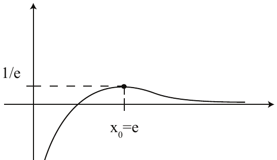
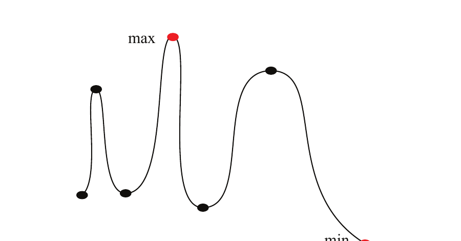
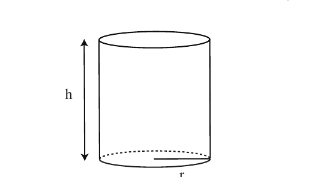
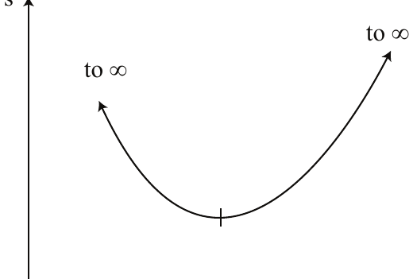
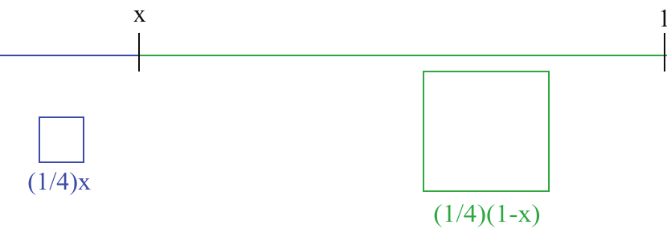
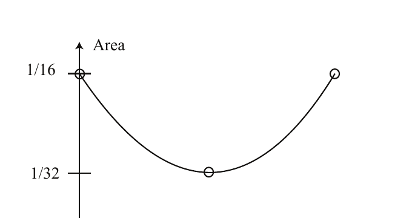

# MIT OCW 18.01 Lecture 11 讲义 · 中文译本

> **编号说明（必读）**：本文件名写作 `OCW_18.01_L10_…`，是为与 Bilibili 合集 **BV1mNgm66EZu · P10**（10-最值问题与函数作图）对齐。对应的官方 PDF 实为 Fall 2006 **`lec11.pdf`（Lecture 11: Max/Min Problems）**。OCW 课程日历中的 **Lecture 8** 是 Exam 1，**没有**常规讲义 PDF / 本系列课堂录像；故 Bilibili P10 ↔ OCW Lecture 11。Bilibili P10 视频开场自报「第十一讲」，但大半节仍在曲线作图（含 \((x+1)/(x+2)\) 与 \(x/\ln x\)），末段才切入 max/min 关键句并预告应用例「下次」——**讲义正文以下按 `lec11.pdf`（Max/Min）转写**，课堂作图主线见同目录 [`MIT1801_L10_课上思路.md`](./MIT1801_L10_课上思路.md)。  
> **来源**：https://ocw.mit.edu/courses/18-01-single-variable-calculus-fall-2006/lec11.pdf  
> **课程**：18.01 Single Variable Calculus，Fall 2006  
> **说明**：英文原文具有权威性；本文件为中文学习转写。引用与条款见 http://ocw.mit.edu/terms 。数学式保留 LaTeX；图为 PDF 页渲染裁切，嵌入于对应正文旁。

---

## Lecture 11: Max/Min Problems

（第 11 讲：最大值 / 最小值问题）

18.01 Fall 2006

---

## Example 1. \(y=\dfrac{\ln x}{x}\)

（与上一讲同一函数）

- **最大值是多少？** 答：\(y=\dfrac{1}{e}\)。
- **最大值在何处取得？** 答：\(x=e\)。（见 Fig. 1）

**当心**：有人会问「最大值是什么？」。答案**不是** \(e\)。你会习惯于去找临界点 \(x=e\)（这是主要的微积分步骤），以至于忘记求最大值本身 \(y=1/e\)。临界点 \(x=e\) 与临界值 \(y=1/e\) **两者都重要**。合在一起，它们构成图像上的转折点 \(\bigl(e,\,1/e\bigr)\)。

---

## Example 2. 求 Fig. 2 中函数的最大值与最小值

答：若已经画出图像，最大值与最小值的位置一目了然。重点是：**不画完整草图**也能找到它们。

**想法**：在**临界点**与**端点**之中寻找 max 与 min。从 Fig. 2 可以看出，只需比较这些点对应的高度（\(y\) 值）。（也要提防不连续点！）

---

## Example 3. 开顶罐：固定体积下表面积最小

求一个**开顶**圆柱形罐，在围住固定体积 \(V\) 的条件下，使表面积最小。

1. **画图。**
2. **确定变量。**（本例为 \(r,\,h,\,V\) 以及表面积 \(S\)。）
3. **写出约束，并用公式表达。** 本例约束为
   \[
   V=\pi r^{2} h=\text{常数}.
   \]
   同时还需要表面积公式：
   \[
   S=\pi r^{2}+(2\pi r)h.
   \]
   用符号表述：在 \(V\) 固定时最小化 \(S\)。

4. **用约束把一切表成 \(r\)（以及常数 \(V\)）的函数：**
   \[
   h=\frac{V}{\pi r^{2}};\qquad
   S=\pi r^{2}+(2\pi r)\frac{V}{\pi r^{2}}=\pi r^{2}+\frac{2V}{r}.
   \]

5. **求临界点**（解 \(dS/dr=0\)），并检查端点。\(S\) 的 max/min 必在这些位置之一达到。
   \[
   \frac{dS}{dr}=2\pi r-\frac{2V}{r^{2}}=0
   \implies \pi r^{3}-V=0
   \implies r^{3}=\frac{V}{\pi}
   \implies r=\Bigl(\frac{V}{\pi}\Bigr)^{1/3}.
   \]

   还没完。仍须在端点处考察 \(S\)：\(r=0\) 与「\(r=\infty\)」。
   \[
   S=\pi r^{2}+\frac{2V}{r},\qquad 0\le r<\infty.
   \]
   当 \(r\to 0\) 时，第二项 \(2V/r\to\infty\)，故 \(S\to\infty\)。当 \(r\to\infty\) 时，第一项 \(\pi r^{2}\to\infty\)，故 \(S\to\infty\)。两端皆为 \(+\infty\)，因此最小值在临界点 \(r=(V/\pi)^{1/3}\) 达到，而非任一端点。

仍未结束。还要求出表面积的最小值，以及对应的 \(h\)。
\[
r=\Bigl(\frac{V}{\pi}\Bigr)^{1/3};\qquad
h=\frac{V}{\pi r^{2}}=\frac{V}{\pi}\Bigl(\frac{V}{\pi}\Bigr)^{-2/3}=\Bigl(\frac{V}{\pi}\Bigr)^{1/3}.
\]
\[
S=\pi r^{2}+2\frac{V}{r}
=\pi\Bigl(\frac{V}{\pi}\Bigr)^{2/3}+2V\Bigl(\frac{V}{\pi}\Bigr)^{-1/3}
=3\pi^{1/3}V^{2/3}.
\]

最后，往往更好的答法是给出罐的**比例**。也就是 \(h/r\) 是多少？答：
\[
\frac{h}{r}=\frac{(V/\pi)^{1/3}}{(V/\pi)^{1/3}}=1.
\]

---

## Example 4. 铁丝弯成两个正方形

考虑一根长为 1 的铁丝，剪成两段，各自弯成正方形。要确定剪在何处，才能使两个正方形围出的**总面积尽可能大**。

第一段边长为 \(x/4\)，面积为 \(x^{2}/16\)。第二段边长为 \((1-x)/4\)，面积为 \(((1-x)/4)^{2}\)。总面积
\[
A=\Bigl(\frac{x}{4}\Bigr)^{2}+\Bigl(\frac{1-x}{4}\Bigr)^{2}.
\]
求导：
\[
A'=\frac{2x}{16}+\frac{2(1-x)}{16}(-1)=\frac{x}{8}-\frac{1-x}{8}=0
\implies 2x-1=0
\implies x=\frac12.
\]
该临界点处的面积为
\[
A=\Bigl(\frac{1/2}{4}\Bigr)^{2}+\Bigl(\frac{1/2}{4}\Bigr)^{2}=\frac{1}{32}.
\]

还没完——必须检查端点！在 \(x=0\)：
\[
A=0^{2}+\Bigl(\frac{1-0}{4}\Bigr)^{2}=\frac{1}{16}.
\]
在 \(x=1\)：
\[
A=\Bigl(\frac{1}{4}\Bigr)^{2}+0^{2}=\frac{1}{16}.
\]

对照 Fig. 6 的端点可知：**最小**面积在 \(x=1/2\) 达到。**最大**面积不在开区间 \(0<x<1\) 内达到，而在 \(x=0\) 或 \(x=1\) 达到——对应于把整段铁丝都用来做一个正方形。

**教训（Moral）**：别忘记端点。若只看临界点，你可能找到的是**最差**答案，而不是最好答案。
