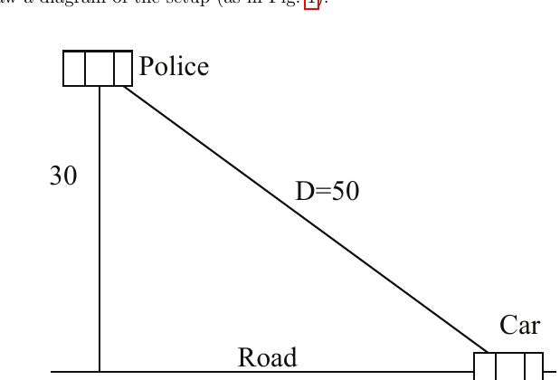
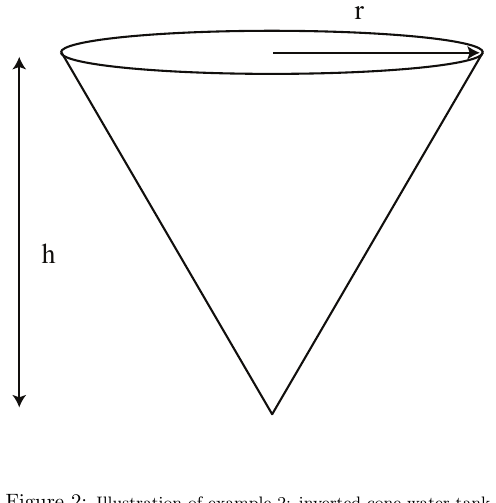
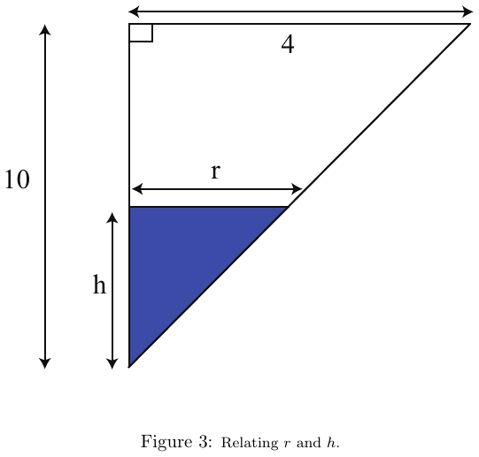
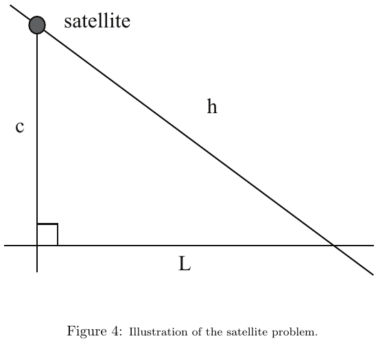
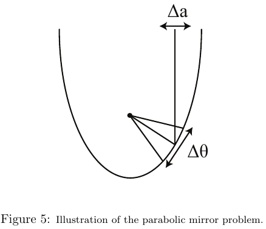

# MIT OCW 18.01 Lecture 12 讲义 · 中文译本

> **编号说明（必读）**：本文件名写作 `OCW_18.01_L11_…`，是为与 Bilibili 合集 **BV1mNgm66EZu · P11**（11-优化问题实战）对齐。对应的官方 PDF 实为 Fall 2006 **`lec12.pdf`（Lecture 12: Related Rates）**。OCW 课程日历中的 **Lecture 8** 是 Exam 1，**没有**常规讲义 PDF / 本系列课堂录像；故 Bilibili P11 ↔ OCW Lecture 12。Bilibili P11 视频开场自报「第十二讲」，但大半节仍在最大值/最小值应用（铁丝两正方形、无盖盒子约束），末段才切入 related rates 警察题建模并预告「下次」算出 \(dx/dt\)——**讲义正文以下按 `lec12.pdf`（Related Rates）转写**，课堂 max/min 主线见同目录 [`MIT1801_L11_课上思路.md`](./MIT1801_L11_课上思路.md)。  
> **来源**：https://ocw.mit.edu/courses/18-01-single-variable-calculus-fall-2006/lec12.pdf  
> **课程**：18.01 Single Variable Calculus，Fall 2006  
> **说明**：英文原文具有权威性；本文件为中文学习转写。引用与条款见 http://ocw.mit.edu/terms 。数学式保留 LaTeX；图为 PDF 页渲染裁切，嵌入于对应正文旁。

---

## Lecture 12: Related Rates

（第 12 讲：相关变化率）

18.01 Fall 2006

---

## Example 1. 警察雷达：你超速了吗？

警察离路边 30 英尺。雷达显示：当你的车距雷达枪 50 英尺时，你正以每秒 80 英尺的速率沿雷达方向靠近。限速 65 英里/小时（合每秒 95 英尺）。你超速了吗？

首先，画出设定示意图（如图 1）：

接着给变量命名。关键是弄清**哪些变量在变化**。

在 \(D=50\) 时，\(x=40\)。（因为这是 3-4-5 直角三角形。）此外，
\[
\frac{dD}{dt}=D'=-80.
\]
\(D'\) 为负，因为车在沿 \(-x\) 方向运动。**先不要**把 \(D\) 的数值代进去！\(D\) 在变，且依赖于 \(x\)。

勾股定理：
\[
30^{2}+x^{2}=D^{2}.
\]
对时间求导（隐函数求导）：
\[
\frac{d}{dt}\bigl(30^{2}+x^{2}=D^{2}\bigr)
\implies 2xx'=2DD'
\implies x'=\frac{DD'}{x}.
\]
现在代入瞬时数值：
\[
x'=\frac{50}{40}(-80)=-100\ \frac{\text{feet}}{\text{s}}.
\]
这超过限速 95 英尺/秒；你确实超速了。

---

还有另一种更长的解法。从
\[
D=\sqrt{30^{2}+x^{2}}=(30^{2}+x^{2})^{1/2}
\]
出发：
\[
\frac{dD}{dt}=\frac12(30^{2}+x^{2})^{-1/2}\cdot\bigl(2x\frac{dx}{dt}\bigr).
\]
代入数值：
\[
-80=\frac12(30^{2}+40^{2})^{-1/2}\cdot 2\cdot 40\cdot\frac{dx}{dt},
\]
解得
\[
\frac{dx}{dt}=-100\ \frac{\text{feet}}{\text{s}}.
\]
（第三种策略是对 \(x=\sqrt{D^{2}-30^{2}}\) 求导。）最容易的是对代数形式最简的方程 \(30^{2}+x^{2}=D^{2}\) 求导——也就是我们的第一种做法。

这类问题的一般策略：

1. **画图。** 设定变量与方程。
2. **求导。**
3. **代入给定数值。** 求导完成之前不要代入数值。

---

## Example 2. 圆锥形水箱

考虑一个圆锥形水箱。顶部半径 4 英尺，高 10 英尺。正以每分钟 2 立方英尺的速率注水。当水深为 5 英尺时，水面上升有多快？

由图 2，水箱（内水面所成圆锥）体积为
\[
V=\frac13\pi r^{2}h.
\]

关键是画出**二维截面**。用字母 \(r\) 与 \(h\) 表示任意水位处水面的可变半径与高度。\(r\) 与 \(h\) 的关系由图 3 用**相似三角形**得到。

由图 3：
\[
\frac{r}{h}=\frac{4}{10},
\]
亦即
\[
r=\frac25 h.
\]
代回 \(V\)：
\[
V=\frac13\pi\Bigl(\frac25 h\Bigr)^{2}h=\frac{4}{3\cdot25}\pi h^{3}=\frac{4}{75}\pi h^{3}.
\]
\[
\frac{dV}{dt}=V'=\frac{4}{25}\pi h^{2}\,h'.
\]
现在代入数值（\(\dfrac{dV}{dt}=2\)，\(h=5\)）：
\[
2=\frac{4}{25}\pi(5)^{2}\,h'
\implies h'=\frac{1}{2\pi}.
\]

---

Related rates 也会出现在 Problem Set 3（Fig. 4）。有一道 Part II 的误差容限题涉及卫星，要求 \(\Delta L/\Delta h\)。

\[
\begin{aligned}
L^{2}+c^{2}&=h^{2},\\
2LL'&=2hh',\\
\frac{\Delta L}{\Delta h}\approx\frac{L'}{h'}&=\frac{h}{L}.
\end{aligned}
\]

还有一道基于类似想法的抛物面镜问题（Fig. 5）。

这里要求的是 \(\dfrac{\Delta a}{\Delta\theta}\) 或 \(\dfrac{\Delta\theta}{\Delta a}\)。这类**测量灵敏度**问题出现在一切测量中——例如预报小行星是否会撞击地球。
