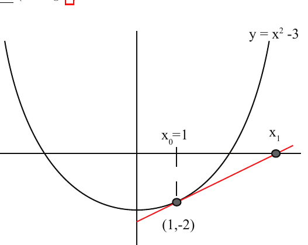
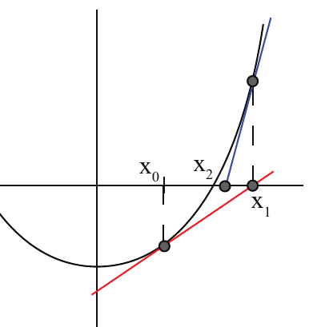
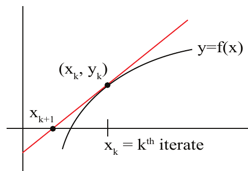
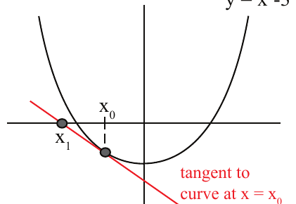
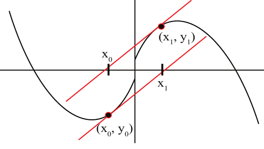
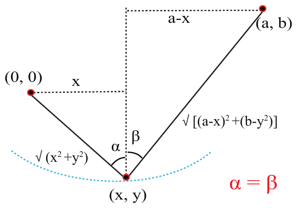

# MIT OCW 18.01 Lecture 13 讲义 · 中文译本

> **编号说明（必读）**：本文件名写作 `OCW_18.01_L12_…`，是为与 Bilibili 合集 **BV1mNgm66EZu · P12**（12-牛顿迭代法）对齐。对应的官方 PDF 实为 Fall 2006 **`lec13.pdf`（Lecture 13: Newton’s Method and Other Applications）**。OCW 课程日历中的 **Lecture 8** 是 Exam 1，**没有**常规讲义 PDF / 本系列课堂录像；故 Bilibili P12 ↔ OCW Lecture 13。Bilibili P12 视频开场先收完 related rates（警察雷达完整解 + 圆锥水箱，属 lec12 遗留），再讲绳上环与牛顿法——**讲义正文以下按 `lec13.pdf`（Newton’s Method and Other Applications）转写**；课堂 related-rates 收尾与 \(\sqrt{5}\) 演示见同目录 [`MIT1801_L12_课上思路.md`](./MIT1801_L12_课上思路.md)。  
> **来源**：https://ocw.mit.edu/courses/18-01-single-variable-calculus-fall-2006/lec13.pdf  
> **课程**：18.01 Single Variable Calculus，Fall 2006  
> **说明**：英文原文具有权威性；本文件为中文学习转写。引用与条款见 http://ocw.mit.edu/terms 。数学式保留 LaTeX；图为 PDF 页渲染裁切，嵌入于对应正文旁。

---

## Lecture 13: Newton’s Method and Other Applications

（第 13 讲：牛顿法及其他应用）

18.01 Fall 2006

---

## Newton’s Method（牛顿法）

牛顿法是求解形如 \(f(x)=0\) 的方程的强力工具。

### Example 1. \(f(x)=x^{2}-3\)

也就是解 \(x^{2}-3=0\)。我们已经知道解是 \(x=\sqrt{3}\)。牛顿法给出答案的良好数值逼近。该方法使用切线（见图 1）。

目标是找到图像与 \(x\) 轴的交点。从猜测 \(x_{0}=1\) 开始。代回 \(y\) 的方程得 \(y_{0}=1^{2}-3=-2\)，离 0 并不近。

下一个猜测是 \(x_{1}\)：函数在 \(x_{0}\) 处的切线与 \(x\) 轴的交点。切线方程为
\[
y-y_{0}=m(x-x_{0}).
\]
切线与 \(x\) 轴相交时 \(y=0\)，于是
\[
-y_{0}=m(x_{1}-x_{0})\implies -\frac{y_{0}}{m}=x_{1}-x_{0}\implies x_{1}=x_{0}-\frac{y_{0}}{m}.
\]
记住：\(m\) 是 \(y=f(x)\) 在点 \((x_{0},y_{0})\) 处切线的斜率。

用 \(f\) 表示：
\[
y_{0}=f(x_{0}),\qquad m=f'(x_{0}).
\]
因此
\[
x_{1}=x_{0}-\frac{f(x_{0})}{f'(x_{0})}.
\]

本例 \(f(x)=x^{2}-3\)，\(f'(x)=2x\)。于是
\[
x_{1}=x_{0}-\frac{x_{0}^{2}-3}{2x_{0}}=x_{0}-\frac12 x_{0}+\frac{3}{2x_{0}}=\frac12 x_{0}+\frac{3}{2x_{0}}.
\]
核心想法是重复（迭代）这一过程：
\[
x_{2}=\frac12 x_{1}+\frac{3}{2x_{1}},\qquad
x_{3}=\frac12 x_{2}+\frac{3}{2x_{2}},
\]
等等。该手续对 \(\sqrt{3}\) 的逼近极为出色。

| \(x\) | \(y\) | 精度：\(\lvert y-\sqrt{3}\rvert\) |
|:---:|:---:|:---:|
| \(x_{0}\) | \(1\) | — |
| \(x_{1}\) | \(2\) | \(3\times10^{-1}\) |
| \(x_{2}\) | \(7/4\) | \(2\times10^{-2}\) |
| \(x_{3}\) | \(7/8+6/7\) | \(10^{-4}\) |
| \(x_{4}\) | \(18817/10864\) | \(3\times10^{-9}\) |

注意：每迭代一次，准确位数大约翻倍。

### Summary（小结）

牛顿法如图 3 所示，可概括为
\[
x_{k+1}=x_{k}-\frac{f(x_{k})}{f'(x_{k})}.
\]

Example 1 的特例：
\[
f(x)=x^{2}-3,\qquad
x_{k+1}=x_{k}-\frac{f(x_{k})}{f'(x_{k})}=\frac12 x_{k}+\frac{3}{2x_{k}}.
\]
定义
\[
\bar{x}=\lim_{k\to\infty}x_{k}\quad(x_{k}\to\bar{x}\ \text{当}\ k\to\infty).
\]
在 Example 1 中，对迭代式取 \(k\to\infty\) 极限：
\[
\bar{x}=\frac12\bar{x}+\frac{3}{2\bar{x}}\implies\bar{x}-\frac12\bar{x}=\frac{3}{2\bar{x}}\implies\frac12\bar{x}=\frac{3}{2\bar{x}}\implies\bar{x}^{2}=3,
\]
正是我们所希望的：\(\bar{x}=\sqrt{3}\)。

### Warning 1. 牛顿法可能找到「意外」的根

例如取 \(x_{0}=-1\)，则 \(x_{k}\to-\sqrt{3}\) 而非 \(+\sqrt{3}\)。这种收敛到意外根的情形见图 4。

### Warning 2. 牛顿法可能完全失败

这种失败见图 5。此时 \(x_{2}=x_{0}\)，\(x_{3}=x_{1}\)，如此反复，进入循环，永不收敛到单一值。

---

## Ring on a String（绳上环）

考虑一根绳，两端固定在 \((0,0)\) 与 \((a,b)\)，其上有一枚可自由滑动的环（见图 6）。求环的位置 \((x,y)\)。

**物理原理** 环停在最低高度（最低势能），故问题是：在「\((x,y)\) 在绳上」的约束下最小化 \(y\)。

**约束** 绳长 \(L\) 固定：
\[
\sqrt{x^{2}+y^{2}}+\sqrt{(x-a)^{2}+(y-b)^{2}}=L.
\]

函数 \(y=y(x)\) 由上述约束方程隐式确定。我们在黑板上描出了约束曲线（环的可能位置）。该曲线是以 \((0,0)\) 与 \((a,b)\) 为焦点的椭圆，但知道它是椭圆**并不能**帮助我们找到最低点。

悬挂环的实验表明最低点在中间某处。由于约束曲线两端高于中间，最低点是临界点（\(y'(x)=0\) 的点）。课上也用在最低点画水平切线做了物理演示。

为找临界点，对约束方程关于 \(x\) 隐式求导：
\[
\frac{x+yy'}{\sqrt{x^{2}+y^{2}}}+\frac{x-a+(y-b)y'}{\sqrt{(x-a)^{2}+(y-b)^{2}}}=0.
\]
在临界点 \(y'=0\)，方程可改写为
\[
\frac{x}{\sqrt{x^{2}+y^{2}}}=\frac{a-x}{\sqrt{(x-a)^{2}+(y-b)^{2}}}.
\]

由图 6，上一式的几何含义是
\[
\sin\alpha=\sin\beta,
\]
其中 \(\alpha,\beta\) 分别是绳左、右两段与**铅垂线**的夹角。

### Physical and geometric conclusions（物理与几何结论）

角 \(\alpha\) 与 \(\beta\) 相等。用向量计算重力在绳两半段上引起的力，可知两半段张力相等——物理平衡。（另一视角：等角性质表达椭圆的几何性质：设椭圆为镜面。从焦点 \((0,0)\) 发出的光线按「入射角等于反射角」反射，因而直达另一焦点 \((a,b)\)。）

### Formulae for \(x\) and \(y\)（\(x\) 与 \(y\) 的公式）

我们尚未求出 \((x,y)\) 的位置。下面将证明
\[
x=\frac{a}{2}\Bigl(1-\frac{b}{\sqrt{L^{2}-a^{2}}}\Bigr),\qquad
y=\frac12\Bigl(b-\sqrt{L^{2}-a^{2}}\Bigr).
\]

因为 \(\alpha=\beta\)，
\[
x=\sqrt{x^{2}+y^{2}}\,\sin\alpha,\qquad
a-x=\sqrt{(x-a)^{2}+(y-b)^{2}}\,\sin\alpha.
\]
两式相加：
\[
a=\Bigl(\sqrt{x^{2}+y^{2}}+\sqrt{(x-a)^{2}+(y-b)^{2}}\Bigr)\sin\alpha=L\sin\alpha\implies\sin\alpha=\frac{a}{L}.
\]

竖直直角边（注意 \(y<0\)）：
\[
-y=\sqrt{x^{2}+y^{2}}\,\cos\alpha,\qquad
b-y=\sqrt{(x-a)^{2}+(y-b)^{2}}\,\cos\beta.
\]
相加并利用 \(\alpha=\beta\)：
\[
b-2y=L\cos\alpha\implies y=\frac12\bigl(b-L\cos\alpha\bigr).
\]
由 \(\sin\alpha=a/L\) 得
\[
L\cos\alpha=L\sqrt{1-\sin^{2}\alpha}=\sqrt{L^{2}-a^{2}},
\]
于是
\[
y=\frac12\Bigl(b-\sqrt{L^{2}-a^{2}}\Bigr).
\]

最后求 \(x\)：用相似直角三角形
\[
\tan\alpha=\frac{x}{-y}=\frac{a-x}{b-y}\implies x(b-y)=(-y)(a-x)\implies(b-2y)x=-ay.
\]
因此
\[
x=\frac{-ay}{b-2y}=\frac{a}{2}\Bigl(1-\frac{b}{\sqrt{L^{2}-a^{2}}}\Bigr).
\]
这样就得到了用 \(a,b,L\) 表示的 \(x,y\) 公式。

课上省略了 \(x,y\) 公式的推导——既长，而且临界点计算已经立刻给出了我们从问题中得到的全部物理直觉与理解（平衡条件）。

**Final Remark.** 在 18.02 中，你将学会用 **Lagrange multipliers（拉格朗日乘数）** 处理任意多变量的约束 max/min 问题。
