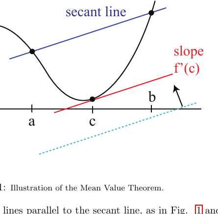
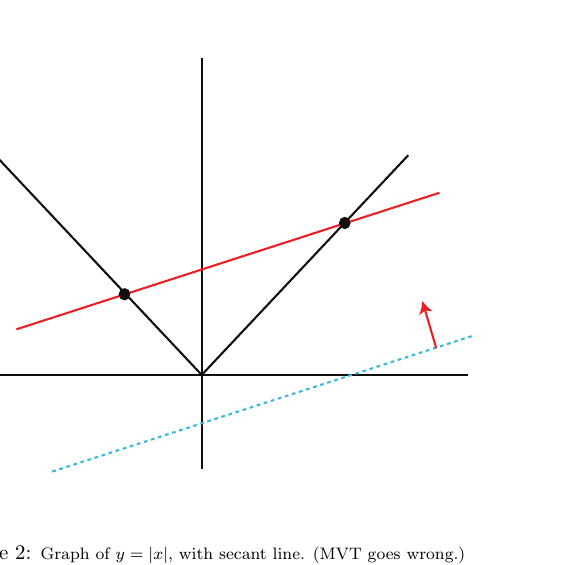
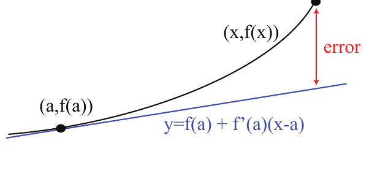

# MIT OCW 18.01 Lecture 14 讲义 · 中文译本

> **编号说明（必读）**：本文件名写作 `OCW_18.01_L13_…`，是为与 Bilibili 合集 **BV1mNgm66EZu · P13**（13-中值定理与牛顿法精度）对齐。对应的官方 PDF 实为 Fall 2006 **`lec14.pdf`（Lecture 14: Mean Value Theorem and Inequalities）**。OCW 课程日历中的 **Lecture 8** 是 Exam 1，**没有**常规讲义 PDF / 本系列课堂录像；故 Bilibili P13 ↔ OCW Lecture 14。Bilibili P13 视频开场先收完牛顿法精度与失败模式（属 lec13 延续），再讲中值定理与 \(e^{x}\) 不等式——**讲义正文以下按 `lec14.pdf`（Mean Value Theorem and Inequalities）转写**；课堂牛顿精度与行程口语数据见同目录 [`MIT1801_L13_课上思路.md`](./MIT1801_L13_课上思路.md)。  
> **来源**：https://ocw.mit.edu/courses/18-01-single-variable-calculus-fall-2006/lec14.pdf  
> **课程**：18.01 Single Variable Calculus，Fall 2006  
> **说明**：英文原文具有权威性；本文件为中文学习转写。引用与条款见 http://ocw.mit.edu/terms 。数学式保留 LaTeX；图为 PDF 页渲染裁切，嵌入于对应正文旁。

---

## Lecture 14: Mean Value Theorem and Inequalities

（第 14 讲：中值定理与不等式）

18.01 Fall 2006

---

## Mean-Value Theorem（中值定理）

中值定理（Mean-Value Theorem，简称 **MVT**）是微积分的基石。它说：

> 若 \(f\) 在 \(a<x<b\) 上可导（differentiable），且在 \(a\le x\le b\) 上连续（continuous），则
> \[
> \frac{f(b)-f(a)}{b-a}=f'(c)
> \quad\text{（对某个 }c,\ a<c<b\text{）}.
> \]

这里，\(\dfrac{f(b)-f(a)}{b-a}\) 是**割线（secant line）**的斜率，而 \(f'(c)\) 是**切线（tangent line）**的斜率。

**几何证明（Geometric Proof）** 取平行于割线的（虚）线，如图 1，从图像下方往上平移，直到其中一条首次碰到图像。也可以从图像上方的虚线开始往下移，直到碰到为止。

若函数不可导，这一做法会失效。例如对 \(f(x)=\lvert x\rvert\)：无论虚线斜率如何，它总是首先在 \(x=0\) 碰到图像，而 \(f'(0)\) 无定义（见图 2）。

---

## Interpretation of the Mean Value Theorem（中值定理的解释）

你从波士顿（Boston）到芝加哥（Chicago）（假定全程 1000 英里）恰好用了 3 小时。则在两城之间的某个时刻，你的车速必定恰好是
\[
\frac{1000}{3}\ \mathrm{mph}.
\]

设 \(f(t)=\) 距波士顿的路程，则
\[
f(3)=1000,\quad f(0)=0,\quad a=0,\quad b=3,
\]
\[
\frac{1000}{3}=\frac{f(b)-f(a)}{b-a}=f'(c),
\]
其中 \(f'(c)\) 是某一时刻 \(c\) 的速度。

---

## Versions of the Mean Value Theorem（中值定理的几种写法）

第二种写法：
\[
f(b)-f(a)=f'(c)(b-a),
\]
\[
f(b)=f(a)+f'(c)(b-a)
\quad\text{（对某个 }c,\ a<c<b\text{）}.
\]

第三种写法：把 \(b\) 改名为 \(x\)：
\[
f(x)=f(a)+f'(c)(x-a)
\quad\text{对某个 }c,\ a<c<x.
\]

定理并不告诉你 \(c\) 是什么。它依赖于 \(f\)、\(a\) 和 \(x\)。

这一写法应与**线性近似（linear approximation）**对照（见图 3）：
\[
f(x)\approx f(a)+f'(a)(x-a)\qquad(x\text{ 靠近 }a).
\]

线性近似中的切线有确定斜率 \(f'(a)\)。相比之下，MVT 公式是**精确**公式；它把「不具体」藏进了斜率 \(f'(c)\)——可以是 \(a\) 与 \(x\) 之间任意一点处 \(f\) 的斜率。

---

## Uses of the Mean Value Theorem（中值定理的用途）

**关键结论**（来自 MVT 的理论推论）：

1. 若 \(f'(x)>0\)，则 \(f\) 递增（increasing）。
2. 若 \(f'(x)<0\)，则 \(f\) 递减（decreasing）。
3. 若对所有 \(x\) 有 \(f'(x)=0\)，则 \(f\) 为常数（constant）。

**递增 / 递减的定义**  
递增：\(a<b\Rightarrow f(a)<f(b)\)。递减：\(a<b\Rightarrow f(a)>f(b)\)。（注：英文 PDF 原稿「Decreasing」一行误写成与递增相同的 \(f(a)<f(b)\)；此处按数学定义更正。）

**证明**

**结论 1 的证明**  
\[
a<b,\qquad f(b)=f(a)+f'(c)(b-a).
\]
因 \(f'(c)\) 与 \(b-a\) 皆为正，
\[
f(b)=f(a)+f'(c)(b-a)>f(a).
\]
（结论 2 的证明与 1 类似，故略。）

**结论 3 的证明**  
\[
f(b)=f(a)+f'(c)(b-a)=f(a)+0\cdot(b-a)=f(a).
\]

结论 1、2、3 看似显然，但并不显然。回想导数的定义：它涉及无穷小。这些无穷小与函数的非无穷小行为是否有关，并非理所当然。

---

## Inequalities（不等式）

基本性质「\(f'>0\Rightarrow f\) 递增」可用来推出许多其他不等式。

### Example. \(e^{x}\)

1. \(e^{x}>0\)
2. \(e^{x}>1\)（当 \(x>0\)）
3. \(e^{x}>1+x\)

**证明** 性质 1（\(e^{x}>0\)）当作已知。其余两个如下。

**性质 2 的证明** 定义 \(f_{1}(x)=e^{x}-1\)。则 \(f_{1}(0)=e^{0}-1=0\)，且 \(f_{1}'(x)=e^{x}>0\)（由性质 1）。故 \(f_{1}\) 递增，从而当 \(x>0\) 时 \(f_{1}(x)>f_{1}(0)\)，即
\[
e^{x}>1\quad(x>0).
\]

**性质 3 的证明** 令 \(f_{2}(x)=e^{x}-(1+x)\)。则
\[
f_{2}'(x)=e^{x}-1=f_{1}(x)>0\quad(\text{若 }x>0).
\]
故当 \(x>0\) 时 \(f_{2}(x)>0\)，亦即
\[
e^{x}>1+x.
\]

类似地，\(e^{x}>1+x+\dfrac{x^{2}}{2}\)（用 \(f_{3}(x)=e^{x}-\bigl(1+x+\dfrac{x^{2}}{2}\bigr)\) 证明）。可以继续下去：
\[
e^{x}>1+x+\frac{x^{2}}{2}+\frac{x^{3}}{3!}\quad(x>0).
\]
最终会得到
\[
e^{x}=1+x+\frac{x^{2}}{2}+\frac{x^{3}}{3!}+\cdots
\quad\text{（无穷级数）}.
\]
我们将在课程末尾讲到 Taylor 级数时再讨论这一点。
