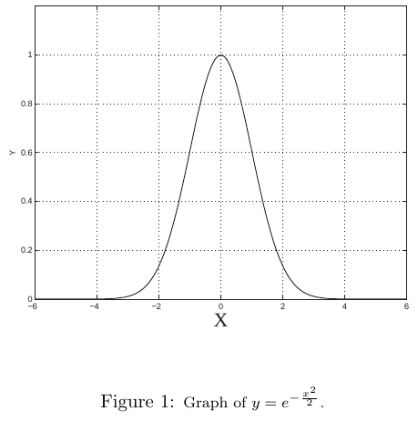
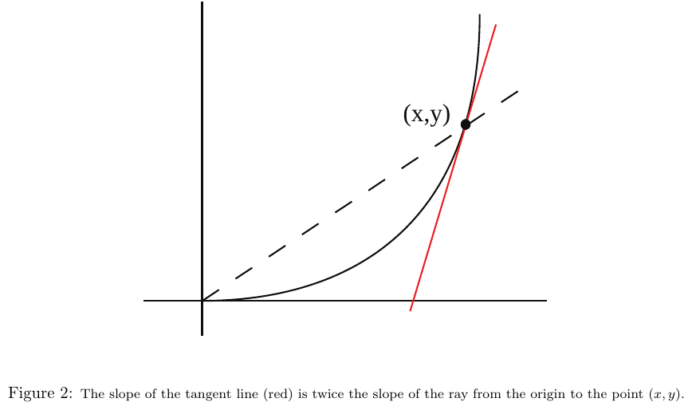
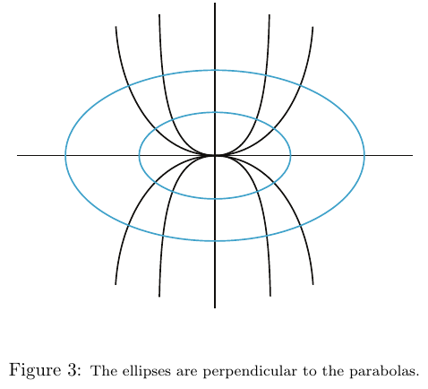

# MIT OCW 18.01 Lecture 16 讲义 · 中文译本

> **编号说明（必读）**：本文件名写作 `OCW_18.01_L15_…`，是为与 Bilibili 合集 **BV1mNgm66EZu · P15**（15-分离变量解微分方程）对齐。对应的官方 PDF 实为 Fall 2006 **`lec16.pdf`（Lecture 16: Differential Equations and Separation of Variables）**。OCW 课程日历中的 **Lecture 8** 是 Exam 1，**没有**常规讲义 PDF / 本系列课堂录像；故 Bilibili P15 ↔ OCW Lecture 16。课堂口播与讲义椭圆方程写法、Exam Review 朗读等差异见同目录 [`MIT1801_L15_课上思路.md`](./MIT1801_L15_课上思路.md) §6。  
> **来源**：https://ocw.mit.edu/courses/18-01-single-variable-calculus-fall-2006/lec16.pdf  
> **课程**：18.01 Single Variable Calculus，Fall 2006  
> **说明**：英文原文具有权威性；本文件为中文学习转写。引用与条款见 http://ocw.mit.edu/terms 。数学式保留 LaTeX；图为 PDF 页渲染裁切，嵌入于对应正文旁。

---

## Lecture 16: Differential Equations and Separation of Variables

（第 16 讲：微分方程与分离变量）

18.01 Fall 2006

---

## Ordinary Differential Equations（常微分方程，ODEs）

### Example 1.

\[
\frac{dy}{dx}=f(x).
\]

**解：** \(y=\displaystyle\int f(x)\,dx\)。这类方程我们视为**已经解决**。

### Example 2.

\[
\Bigl(\frac{d}{dx}+x\Bigr)y=0
\quad\text{或}\quad
\frac{dy}{dx}+xy=0.
\]

（\(\dfrac{d}{dx}+x\) 在量子力学中称为**湮灭算符（annihilation operator）**。）

除了积分之外，目前我们只有一种求解方法，即**换元（substitution）**。解出 \(\dfrac{dy}{dx}\) 得
\[
\frac{dy}{dx}=-xy.
\]

关键一步是**分离变量（separate variables）**：
\[
\frac{dy}{y}=-x\,dx.
\]
注意：所有 \(y\)-依赖在左边，所有 \(x\)-依赖在右边。

接着对两边取反导数：
\[
\int\frac{dy}{y}=-\int x\,dx,
\]
\[
\ln|y|=-\frac{x^{2}}{2}+c
\quad\text{（只需一个常数 }c\text{）}.
\]
指数化：
\[
|y|=e^{c}\,e^{-x^{2}/2},
\]
\[
y=ae^{-x^{2}/2}\qquad\bigl(a=\pm e^{c}\bigr).
\]

尽管 \(e^{c}\neq0\)，但依初值条件，\(a=0\) 以及一切 \(a\neq0\) 都可能。例如：若 \(y(0)=1\)，则 \(y=e^{-x^{2}/2}\)；若 \(y(0)=a\)，则 \(y=ae^{-x^{2}/2}\)（见图 1）。

**一般情形：**
\[
\frac{dy}{dx}=f(x)g(y)
\]
\[
\frac{dy}{g(y)}=f(x)\,dx,
\]
也可写成
\[
h(y)\,dy=f(x)\,dx,\qquad h(y)=\frac{1}{g(y)}.
\]

于是得到 \(y\) 的**隐式公式（implicit formula）**：
\[
H(y)=F(x)+c,
\]
其中 \(H(y)=\displaystyle\int h(y)\,dy\)，\(F(x)=\displaystyle\int f(x)\,dx\)，且 \(H'=h\)，\(F'=f\)，以及
\[
y=H^{-1}\bigl(F(x)+c\bigr)
\]
（\(H^{-1}\) 是反函数。）

在上一个例子中：
\[
\begin{align*}
f(x)&=-x,& F(x)&=-\frac{x^{2}}{2},\\
g(y)&=y,& h(y)&=\frac{1}{g(y)}=\frac1y,& H(y)&=\ln|y|.
\end{align*}
\]

---

### Example 3（几何例子）.

\[
\frac{dy}{dx}=2\Bigl(\frac{y}{x}\Bigr).
\]

求一条曲线，使得切线斜率等于从 \((0,0)\) 到 \((x,y)\) 的射线斜率的两倍（见图 2）。

分离变量：
\[
\frac{dy}{y}=\frac{2\,dx}{x}.
\]
取反导数：
\[
\ln|y|=2\ln|x|+c.
\]
指数化（记住 \(e^{2\ln|x|}=x^{2}\)）：
\[
|y|=e^{c}\,x^{2}.
\]
因此
\[
y=ax^{2}.
\]

再次，\(a<0\)、\(a>0\) 与 \(a=0\) 均可。可能的解例如：
\[
\begin{align*}
y&=x^{2}&&(a=1),\\
y&=2x^{2}&&(a=2),\\
y&=-x^{2}&&(a=-1),\\
y&=0\cdot x^{2}=0&&(a=0),\\
y&=-2x^{2}&&(a=-2),\quad\text{（PDF 原文误印为 }y=-2y^{2}\text{）}\\
y&=100x^{2}&&(a=100).
\end{align*}
\]

---

### Example 4.

求与 Example 3 中抛物线**垂直（perpendicular）**的曲线。

我们知道它们的斜率为
\[
\frac{dy}{dx}=\frac{-1}{\text{抛物线的斜率}}=\frac{-x}{2y}.
\]

分离变量：
\[
y\,dy=-\frac{x}{2}\,dx.
\]

取反导数：
\[
\frac{y^{2}}{2}=-\frac{x^{2}}{4}+c
\quad\Longrightarrow\quad
\frac{x^{2}}{4}+\frac{y^{2}}{2}=c,
\]
这是一族**椭圆（ellipses）**的方程。对这些椭圆，\(x\)-半长轴与 \(y\)-半短轴之比是 \(\sqrt{2}\)（见图 3）。

分离变量给出 \(y\) 的隐式公式，但本例可解出 \(y\)：
\[
y=\pm\sqrt{2\Bigl(c-\frac{x^{2}}{4}\Bigr)}.
\]

---

## Exam Review（考试复习）

Exam 2 会比 Exam 1 更难——预先警告！Exam 2 覆盖的主题列表如下：

1. 线性与/或二次近似（Linear and/or quadratic approximations）
2. 作图 \(y=f(x)\)（Sketches of \(y=f(x)\)）
3. 最值问题（Maximum/minimum problems）
4. 相关变化率（Related rates）
5. 反导数；分离变量（Antiderivatives. Separation of variables）
6. 中值定理（Mean value theorem）

关于上述各主题的更详细说明见 Exam 2 复习讲义（Exam 2 review sheet）。
