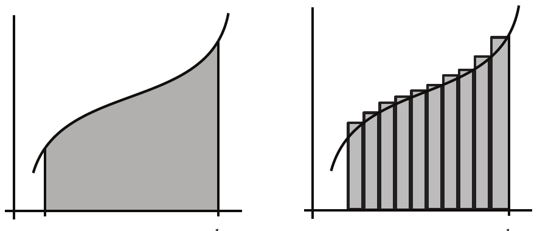
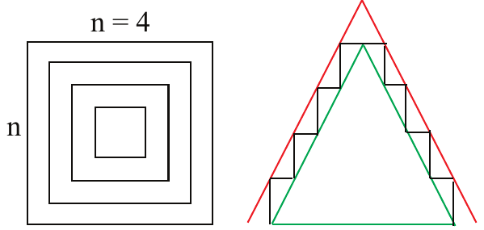
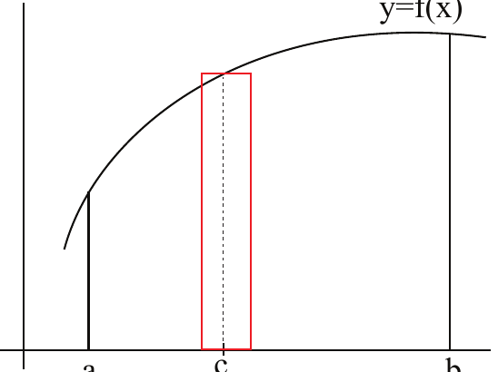

# MIT OCW 18.01 Lecture 18 讲义 · 中文译本

> **编号说明（必读）**：本文件名写作 `OCW_18.01_L16_…`，是为与 Bilibili 合集 **BV1mNgm66EZu · P16**（16-定积分：面积与累积）对齐。对应的官方 PDF 实为 Fall 2006 **`lec18.pdf`（Lecture 18: Definite Integrals）**。OCW 课程日历中的 **Lecture 8** 是 Exam 1、**Lecture 17** 是 Exam 2，**都没有**常规讲义 PDF / 本系列课堂录像；故对 \(n\ge16\) 有 Bilibili **P16 ↔ OCW Lecture 18**（Pn ≈ lec\((n+2)\)；更早仅跳过 Exam 1 时为 Pn ↔ lec\((n+1)\)）。课堂口播与讲义在 \(A'(b)=f(b)\) 提示、\(f=x\) 求法、借款单利 vs 连续复利等处的差异见同目录 [`MIT1801_L16_课上思路.md`](./MIT1801_L16_课上思路.md) §6。  
> **来源**：https://ocw.mit.edu/courses/18-01-single-variable-calculus-fall-2006/lec18.pdf  
> **课程**：18.01 Single Variable Calculus，Fall 2006  
> **说明**：英文原文具有权威性；本文件为中文学习转写。引用与条款见 http://ocw.mit.edu/terms 。数学式保留 LaTeX；图为 PDF 页渲染裁切，嵌入于对应正文旁。

---

## Lecture 18: Definite Integrals

（第 18 讲：定积分）

18.01 Fall 2006

---

积分用于计算**累积总量（cumulative totals）**、**平均值（averages）**、**面积（areas）**。

### Area under a curve（曲线下的面积）

（见图 1。）

1. 把区域分割成矩形（Divide region into rectangles）
2. 把这些矩形的面积加起来（Add up area of rectangles）
3. 取矩形变薄时的极限（Take limit as rectangles become thin）

**Figure 1：** (i) Area under a curve（曲线下的面积）；(ii) sum of areas under rectangles（矩形面积之和）

---

### Example 1.

\(f(x)=x^{2}\)，\(a=0\)，\(b\) 任意。

1. 分成 \(n\) 个区间  
   长度 \(b/n=\) 矩形的底边
2. 高度：
   - 第 1 块：\(x=\dfrac{b}{n}\)，高度 \(\Bigl(\dfrac{b}{n}\Bigr)^{2}\)
   - 第 2 块：\(x=\dfrac{2b}{n}\)，高度 \(\Bigl(\dfrac{2b}{n}\Bigr)^{2}\)

矩形面积之和：
\[
\frac{b}{n}\Bigl(\frac{b}{n}\Bigr)^{2}
+\frac{b}{n}\Bigl(\frac{2b}{n}\Bigr)^{2}
+\frac{b}{n}\Bigl(\frac{3b}{n}\Bigr)^{2}
+\cdots
+\frac{b}{n}\Bigl(\frac{nb}{n}\Bigr)^{2}
=\frac{b^{3}}{n^{3}}\bigl(1^{2}+2^{2}+3^{2}+\cdots+n^{2}\bigr).
\]

![Figure 2：\(f(x)=x^{2}\) 在 \([0,b]\) 上方的面积](ocw_figs/fig2_x_squared_rectangles.png)

**Figure 2：** Area under \(f(x)=x^{2}\) above \([0,b]\)。

我们现在用一些**三维几何**来估计这个和。考虑如图 3 所示的**阶梯金字塔（staircase pyramid）**。

**Figure 3：** Staircase pyramid: left (top view) and right (side view)

- 第 1 层：底 \(n\times n\)，代表体积 \(n^{2}\)。
- 第 2 层：\((n-1)\times(n-1)\)，代表体积 \((n-1)^{2}\)，等等。

因此，阶梯金字塔的总体积是 \(n^{2}+(n-1)^{2}+\cdots+1\)。

接下来，该体积**大于**内接棱锥（inner prism / pyramid）的体积：
\[
1^{2}+2^{2}+\cdots+n^{2}
>\frac13(\text{base})(\text{height})
=\frac13 n^{2}\cdot n
=\frac13 n^{3},
\]
并且**小于**外接棱锥（outer prism）的体积：
\[
1^{2}+2^{2}+\cdots+n^{2}
<\frac13(n+1)^{2}(n+1)
=\frac13(n+1)^{3}.
\]

综合起来：
\[
\frac13
=\frac{\tfrac13 n^{3}}{n^{3}}
<\frac{1^{2}+2^{2}+\cdots+n^{2}}{n^{3}}
<\frac13\cdot\frac{(n+1)^{3}}{n^{3}}.
\]
因此
\[
\lim_{n\to\infty}\frac{b^{3}}{n^{3}}\bigl(1^{2}+2^{2}+3^{2}+\cdots+n^{2}\bigr)
=\frac13 b^{3},
\]
而 \(x^{2}\) 从 \(0\) 到 \(b\) 下方的面积是 \(\dfrac{b^{3}}{3}\)。

---

### Example 2.

\(f(x)=x\)；\(x\) 在 \([0,b]\) 上方的面积。类似 Example 1 但更容易的推理给出面积和：
\[
\frac{b^{2}}{n^{2}}\bigl(1+2+3+\cdots+n\bigr)
\to\frac12 b^{2}\qquad(n\to\infty).
\]
这就是图 4 中三角形的面积。

![Figure 4：\(f(x)=x\) 在 \([0,b]\) 上方的面积](ocw_figs/fig4_triangle_y_eq_x.png)

**Figure 4：** Area under \(f(x)=x\) above \([0,b]\)。

---

### Pattern（规律）

\[
\frac{d}{db}\Bigl(\frac{b^{3}}{3}\Bigr)=b^{2},
\qquad
\frac{d}{db}\Bigl(\frac{b^{2}}{2}\Bigr)=b.
\]

曲线下的面积 \(A(b)\) 应当满足 \(A'(b)=f(b)\)。

---

## General Picture（一般图像）

**Figure 5：** One rectangle from a Riemann Sum

- 分成 \(n\) 段相等小段，长度 \(\Delta x=\dfrac{b-a}{n}\)
- 在每个小区间内任取 \(c_{i}\)；用 \(f(c_{i})\) 作为矩形的高
- 面积和：\(f(c_{1})\Delta x+f(c_{2})\Delta x+\cdots+f(c_{n})\Delta x\)

用求和记号（summation notation）：
\[
\sum_{i=1}^{n}f(c_{i})\Delta x
\quad\leftarrow\text{称为 **Riemann sum（黎曼和）**}.
\]

**定义（Definition）：**
\[
\lim_{n\to\infty}\sum_{i=1}^{n}f(c_{i})\Delta x
=\int_{a}^{b}f(x)\,dx
\quad\leftarrow\text{称为 **definite integral（定积分）**}.
\]

这个定积分表示曲线 \(y=f(x)\) 在 \([a,b]\) 上方的面积。

---

### Example 3.（积分用于面积以外的量）

学生向父母借款。  
\(P=\) 本金（美元），\(t=\) 时间（年），\(r=\) 利率（例如 \(6\%\) 即 \(r=0.06/\mathrm{year}\)）。  
经过时间 \(t\) 后，你欠
\[
P(1+rt)=P+Prt.
\]

积分可如下表示**借入总量**。考虑函数 \(f(t)\)——「借款函数」，单位为美元/年。例如若每月借 \(\$1000\)，则 \(f(t)=12{,}000/\mathrm{year}\)。允许 \(f\) 随时间变化。  
设 \(\Delta t=\dfrac1{12}\) 年 \(=1\) 个月，
\[
t_{i}=\frac{i}{12},\qquad i=1,\ldots,12.
\]

\(f(t_{i})\) 是第 \(i\) 个月的借款速率，故该月借入金额为 \(f(t_{i})\Delta t\)。总量为
\[
\sum_{i=1}^{12}f(t_{i})\Delta t.
\]
当 \(\Delta t\to0\) 时，有
\[
\int_{0}^{1}f(t)\,dt,
\]
它表示一年内借入的总量（由美元/年经积分得到美元）。

积分也可表示**欠款总量**。欠多少取决于利率。对在时刻 \(t_{i}\) 借入的金额，你欠
\[
f(t_{i})\bigl(1+r(1-t_{i})\bigr)\Delta t.
\]
年底因借款而欠的总量为
\[
\int_{0}^{1}f(t)\bigl(1+r(1-t)\bigr)\,dt.
\]
