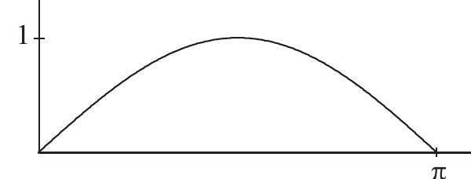
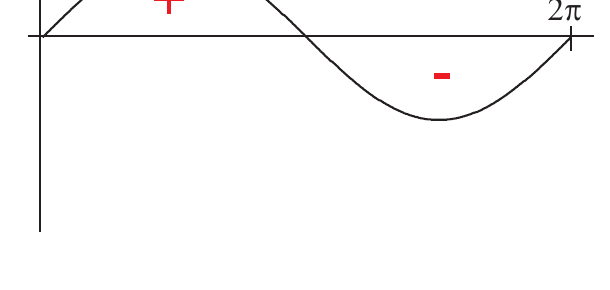
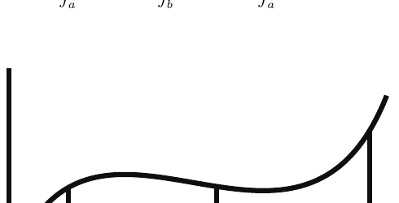

# MIT OCW 18.01 Lecture 19 讲义 · 中文译本

> **编号说明（必读）**：本文件名写作 `OCW_18.01_L17_…`，是为与 Bilibili 合集 **BV1mNgm66EZu · P17**（17-微积分基本定理）对齐。对应的官方 PDF 实为 Fall 2006 **`lec19.pdf`（Lecture 19: First Fundamental Theorem of Calculus）**。OCW 课程日历中的 **Lecture 8** 是 Exam 1、**Lecture 17** 是 Exam 2，**都没有**常规讲义 PDF / 本系列课堂录像；故对 \(n\ge16\) 有 Bilibili **P17 ↔ OCW Lecture 19**（Pn ≈ lec\((n+2)\)；更早仅跳过 Exam 1 时为 Pn ↔ lec\((n+1)\)）。课堂口播与讲义在 Example 3 幂次、估值上限（一般 \(b\) vs 固定 \(1\)）、换元例指数、\(\int_{-1}^{1}x^{2}\) 警示等处的差异见同目录 [`MIT1801_L17_课上思路.md`](./MIT1801_L17_课上思路.md) §6。  
> **来源**：https://ocw.mit.edu/courses/18-01-single-variable-calculus-fall-2006/lec19.pdf  
> **课程**：18.01 Single Variable Calculus，Fall 2006  
> **说明**：英文原文具有权威性；本文件为中文学习转写。引用与条款见 http://ocw.mit.edu/terms 。数学式保留 LaTeX；图为 PDF 页渲染裁切，嵌入于对应正文旁。

---

## Lecture 19: First Fundamental Theorem of Calculus

（第 19 讲：微积分第一基本定理）

18.01 Fall 2006

---

### Fundamental Theorem of Calculus (FTC 1)
（微积分基本定理 · 第一型）

若 \(f(x)\) 连续且 \(F'(x)=f(x)\)，则
\[
\int_{a}^{b}f(x)\,dx=F(b)-F(a).
\]

**Notation（记号）：**
\[
F(x)\Big|_{a}^{b}
=F(x)\Big|_{x=a}^{x=b}
=F(b)-F(a).
\]

---

### Example 1.

\(F(x)=\dfrac{x^{3}}{3}\)，\(F'(x)=x^{2}\)；
\[
\int_{a}^{b}x^{2}\,dx
=\frac{x^{3}}{3}\Big|_{a}^{b}
=\frac{b^{3}}{3}-\frac{a^{3}}{3}.
\]

---

### Example 2. Area under one hump of \(\sin x\)
（\(\sin x\) 一个拱下方的面积；见图 1。）

\[
\int_{0}^{\pi}\sin x\,dx
=-\cos x\Big|_{0}^{\pi}
=-\cos\pi-(-\cos0)
=-(-1)-(-1)
=2.
\]

**Figure 1：** Graph of \(f(x)=\sin x\) for \(0\le x\le\pi\).

---

### Example 3.

\[
\int_{0}^{1}x^{5}\,dx
=\frac{x^{6}}{6}\Big|_{0}^{1}
=\frac{1}{6}-0
=\frac{1}{6}.
\]

---

## Intuitive Interpretation of FTC
（FTC 的直观解释）

\(x(t)\) 是位置；\(v(t)=x'(t)=\dfrac{dx}{dt}\) 是速度（speed）或 \(x\) 的变化率。

\[
\int_{a}^{b}v(t)\,dt=x(b)-x(a)\qquad\text{（FTC 1）}
\]

- **R.H.S.（右边）**：从时刻 \(t=a\) 到 \(t=b\)，\(x(t)\) 走了多远（两次里程表读数之差）。
- **L.H.S.（左边）**：表示速度表读数。

\[
\sum_{i=1}^{n}v(t_{i})\Delta t
\quad\text{近似各时间段 }\Delta t\text{ 上走过的距离之和}.
\]

若在第 \(i\) 小段上 \(v(t)\) 接近 \(v(t_{i})\)，上述近似就准确。若 \(v\) **变号**，则把 \(x(t)\) 解释为里程表读数不再成立：设想往返使得 \(x(b)-x(a)=0\)，则正负速度彼此抵消，而里程表计量的是**总路程**而非**净位移**。

### Example 4.

\[
\int_{0}^{2\pi}\sin x\,dx
=-\cos x\Big|_{0}^{2\pi}
=-\cos 2\pi-(-\cos0)
=0.
\]

该积分表示曲线在 \(x\) 轴**上方**的面积之和，再减去轴**下方**的面积。（见图 2。）

**Figure 2：** Graph of \(f(x)=\sin x\) for \(0\le x\le 2\pi\).

---

## Additive property（可加性）

积分有重要的可加性（见图 3）：
\[
\int_{a}^{b}f(x)\,dx+\int_{b}^{c}f(x)\,dx=\int_{a}^{c}f(x)\,dx.
\]

**Figure 3：** Illustration of the additive property of integrals

### New Definition（新定义）

\[
\int_{b}^{a}f(x)\,dx=-\int_{a}^{b}f(x)\,dx.
\]

采用这一定义，是为使基本定理在 \(a<b\) 或 \(b<a\) 时都成立；同时也使可加性对 \(a,b,c\) 的**任意顺序**成立，而不限于图 3 所画的那一种顺序。

---

## Estimation（估值）

若 \(f(x)\le g(x)\)，则
\[
\int_{a}^{b}f(x)\,dx\le\int_{a}^{b}g(x)\,dx
\quad\text{（仅当 }a<b\text{）}.
\]

### Example 5. Estimation of \(e^{x}\)
（对 \(e^{x}\) 的估值）

因为当 \(x\ge0\) 时 \(1\le e^{x}\)，故
\[
\int_{0}^{1}1\,dx\le\int_{0}^{1}e^{x}\,dx.
\]
\[
\int_{0}^{1}e^{x}\,dx=e^{x}\Big|_{0}^{1}=e^{1}-e^{0}=e-1.
\]
从而 \(1\le e-1\)，即 \(e\ge2\)。

### Example 6.

我们先前已证 \(1+x\le e^{x}\)。由此
\[
\int_{0}^{1}(1+x)\,dx\le\int_{0}^{1}e^{x}\,dx=e-1.
\]
\[
\int_{0}^{1}(1+x)\,dx
=\Bigl(x+\frac{x^{2}}{2}\Bigr)\Big|_{0}^{1}
=\frac{3}{2}.
\]
故 \(\dfrac{3}{2}\le e-1\)，即 \(e\ge\dfrac{5}{2}\)。

---

## Change of Variable（变量代换）

若 \(f(x)=g\bigl(u(x)\bigr)\)，则写 \(du=u'(x)\,dx\)，且
\[
\int g(u)\,du
=\int g\bigl(u(x)\bigr)u'(x)\,dx
=\int f(x)\,u'(x)\,dx
\quad\text{（不定积分）}.
\]

对**定积分**：
\[
\int_{x_{1}}^{x_{2}}f(x)\,u'(x)\,dx
=\int_{u_{1}}^{u_{2}}g(u)\,du,
\qquad
u_{1}=u(x_{1}),\quad u_{2}=u(x_{2}).
\]

### Example 7.

\[
\int_{1}^{2}\bigl(x^{3}+2\bigr)^{4}x^{2}\,dx.
\]

令 \(u=x^{3}+2\)。则 \(du=3x^{2}\,dx\Rightarrow x^{2}\,dx=\dfrac{du}{3}\)。

\(x_{1}=1\)，\(x_{2}=2\) \(\Rightarrow\) \(u_{1}=1^{3}+2=3\)，\(u_{2}=2^{3}+2=10\)，于是
\[
\int_{1}^{2}\bigl(x^{3}+2\bigr)^{4}x^{2}\,dx
=\int_{3}^{10}u^{4}\cdot\frac{du}{3}
=\frac{u^{5}}{15}\Big|_{3}^{10}
=\frac{10^{5}-3^{5}}{15}.
\]
