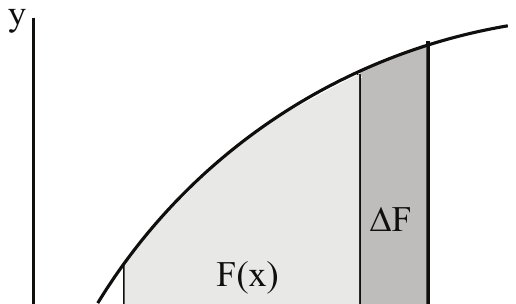
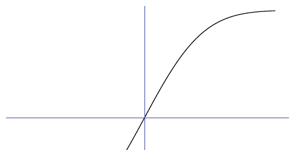

# MIT OCW 18.01 Lecture 20 讲义 · 中文译本

> **编号说明（必读）**：本文件名写作 `OCW_18.01_L18_…`，是为与 Bilibili 合集 **BV1mNgm66EZu · P18**（18-第二基本定理）对齐。对应的官方 PDF 实为 Fall 2006 **`lec20.pdf`（Lecture 20: Second Fundamental Theorem）**。OCW 课程日历中的 **Lecture 8** 是 Exam 1、**Lecture 17** 是 Exam 2，**都没有**常规讲义 PDF / 本系列课堂录像；故对 \(n\ge16\) 有 Bilibili **P18 ↔ OCW Lecture 20**（Pn ≈ lec\((n+2)\)；更早仅跳过 Exam 1 时为 Pn ↔ lec\((n+1)\)）。课堂口播与讲义在开篇次序、Exam 2/MVT 对照、erf 归一化、Li/Fresnel/Bessel 等处的差异见同目录 [`MIT1801_L18_课上思路.md`](./MIT1801_L18_课上思路.md) §6。  
> **来源**：https://ocw.mit.edu/courses/18-01-single-variable-calculus-fall-2006/lec20.pdf  
> **课程**：18.01 Single Variable Calculus，Fall 2006  
> **说明**：英文原文具有权威性；本文件为中文学习转写。引用与条款见 http://ocw.mit.edu/terms 。数学式保留 LaTeX；图为 PDF 页渲染裁切，嵌入于对应正文旁。

---

## Lecture 20: Second Fundamental Theorem

（第 20 讲：第二基本定理）

18.01 Fall 2006

---

### Recall: First Fundamental Theorem of Calculus (FTC 1)
（回顾：微积分第一基本定理）

若 \(f\) 连续且 \(F'=f\)，则
\[
\int_{a}^{b}f(x)\,dx=F(b)-F(a).
\]

亦可写成
\[
\int_{a}^{b}f(x)\,dx
=\int f(x)\,dx\Big|_{x=a}^{x=b}.
\]

一切连续函数都有反导数吗？有。然而……像下面这样的函数呢？
\[
\int e^{-x^{2}}\,dx=\text{??}
\]

是的，这个反导数存在。不，它不是我们见过的函数：它是一个**新函数**。

该新函数由积分定义：
\[
F(x)=\int_{0}^{x}e^{-t^{2}}\,dt.
\]

它具有性质 \(F'(x)=e^{-x^{2}}\)。

其它新函数还包括下列函数的反导数：
\(e^{-x^{2}}\)，\(x^{1/2}e^{-x^{2}}\)，\(\dfrac{\sin x}{x}\)，\(\sin(x^{2})\)，\(\cos(x^{2})\)，……

---

### Second Fundamental Theorem of Calculus (FTC 2)
（微积分第二基本定理）

若 \(F(x)=\displaystyle\int_{a}^{x}f(t)\,dt\) 且 \(f\) 连续，则
\[
F'(x)=f(x).
\]

---

### Geometric Proof of FTC 2
（FTC 2 的几何证明）

用面积解释：\(F(x)\) 等于曲线下从 \(a\) 到 \(x\) 的面积。

\[
\begin{aligned}
\Delta F&=F(x+\Delta x)-F(x),\\
\Delta F&\approx(\text{底})\times(\text{高})\approx(\Delta x)\,f(x)
\qquad\text{（见图 1）},\\
\frac{\Delta F}{\Delta x}&\approx f(x).
\end{aligned}
\]

故
\[
\lim_{\Delta x\to0}\frac{\Delta F}{\Delta x}=f(x).
\]

但按导数定义：
\[
\lim_{\Delta x\to0}\frac{\Delta F}{\Delta x}=F'(x).
\]

**Figure 1：** Geometric Proof of FTC 2.（从 \(a\) 到 \(x\) 的面积为 \(F(x)\)；窄条 \(\Delta F\) 宽 \(\Delta x\)。）

因此
\[
F'(x)=f(x).
\]

---

### Another way to prove FTC 2
（FTC 2 的另一证法）

\[
\begin{aligned}
\frac{\Delta F}{\Delta x}
&=\frac1{\Delta x}\Biggl(
\int_{a}^{x+\Delta x}f(t)\,dt
-\int_{a}^{x}f(t)\,dt
\Biggr)\\
&=\frac1{\Delta x}\int_{x}^{x+\Delta x}f(t)\,dt
\end{aligned}
\]
（即 \(f\) 在区间 \(x\le t\le x+\Delta x\) 上的「平均值」。）

当区间长度 \(\Delta x\to0\) 时，该平均趋于 \(f(x)\)。

---

### Proof of FTC 1 (using FTC 2)
（用 FTC 2 证明 FTC 1）

从 \(F'=f\) 出发（设 \(f\) 连续）。定义 \(G(x)=\displaystyle\int_{a}^{x}f(t)\,dt\)。由 FTC 2，\(G'(x)=f(x)\)。于是
\[
(F-G)'=F'-G'=f-f=0.
\]
故 \(F-G=\text{常数}\)。（回顾：我们曾用中值定理证明这一点。）

从而 \(F(x)=G(x)+c\)。又因 \(G(a)=0\)，
\[
\int_{a}^{b}f(t)\,dt
=G(b)
=G(b)-G(a)
=\bigl[F(b)-c\bigr]-\bigl[F(a)-c\bigr]
=F(b)-F(a),
\]
此即 FTC 1。

**Remark（注）。** 上述证明中 \(G\) 是定积分，而 \(F\) 可以是任一反导数。以 \(f(x)=\sin x\) 为例说明。在 FTC 1 的证明中取 \(a=0\)，
\[
G(x)=\int_{0}^{x}\cos t\,dt=\sin t\Big|_{0}^{x}=\sin x,\qquad G(0)=0.
\]

若例如 \(F(x)=\sin x+21\)，则 \(F'(x)=\cos x\)，且
\[
\int_{a}^{b}\sin x\,dx
=F(b)-F(a)
=(\sin b+21)-(\sin a+21)
=\sin b-\sin a.
\]

形如 \(F(x)=G(x)+c\) 的每一个函数都适用于 FTC 1。

---

### Examples of “new” functions
（「新」函数的例子）

**误差函数（error function）** 常用于统计与概率，定义为
\[
\mathrm{erf}(x)=\frac{2}{\sqrt{\pi}}\int_{0}^{x}e^{-t^{2}}\,dt,
\]
且 \(\displaystyle\lim_{x\to\infty}\mathrm{erf}(x)=1\)（见图 2）。

**Figure 2：** Graph of the error function.（过原点的奇函数型 S 形曲线，\(x\to\pm\infty\) 时趋于 \(\pm1\)。）

另一类「新」函数称为**对数积分（logarithmic integral）**：
\[
\mathrm{Li}(x)=\int_{2}^{x}\frac{dt}{\ln t}.
\]

该函数给出小于 \(x\) 的素数个数的近似。一种常见加密技术是把银行账号等敏感信息编码后经不安全信道传送；解码需要一个秘密素数。密码学家若要知道该秘密有多安全，需要大致知道有多少个 200 位素数。可通过对下列积分估值得知：
\[
\int_{10^{200}}^{10^{201}}\frac{dt}{\ln t}.
\]

我们知道
\[
\ln(10^{200})=200\ln10\approx200\times2.3=460,
\qquad
\ln(10^{201})=201\ln10\approx462.
\]

我们将近似到一位有效数字：对 \(10^{200}\le t\le10^{201}\)，取 \(\ln t\approx500\)。于是 200 位素数的个数大约是[^1]
\[
\int_{10^{200}}^{10^{201}}\frac{dt}{\ln t}
\approx\int_{10^{200}}^{10^{201}}\frac{dt}{500}
=\frac1{500}\bigl(10^{201}-10^{200}\bigr)
\approx\frac{9\cdot10^{200}}{500}
\approx10^{198}.
\]

200 位素数**非常多**。黑客碰巧找到打开你银行账号所需的那个 200 位素数的概率极低。

另一组「新」函数是光学中出现的 **Fresnel 函数**：
\[
C(x)=\int_{0}^{x}\cos(t^{2})\,dt,
\qquad
S(x)=\int_{0}^{x}\sin(t^{2})\,dt.
\]

**Bessel 函数**常出现在圆对称问题中：
\[
J_{0}(x)=\frac{1}{2\pi}\int_{0}^{\pi}\cos(x\sin\theta)\,d\theta.
\]

作业中要求你求 \(C'(x)\)。这很容易！
\[
C'(x)=\cos(x^{2}).
\]

下次课我们将用 FTC 2，从第一性原理讨论函数
\[
L(x)=\int_{1}^{x}\frac{dt}{t}.
\]

[^1]: 上述近似中的中间等号用到一个非常基本且有用的事实
\[
\int_{a}^{b}c\,dx=c(b-a).
\]
可把它想成底为 \(b-a\)、高为 \(c\) 的矩形面积。上面的计算中 \(a=10^{200}\)，\(b=10^{201}\)，\(c=\dfrac1{500}\)。
