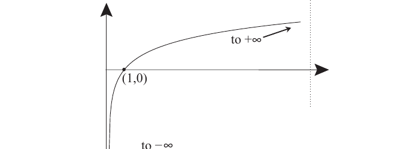
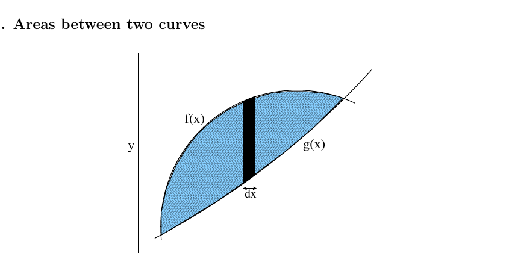
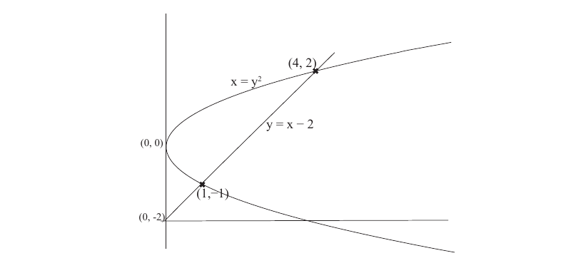
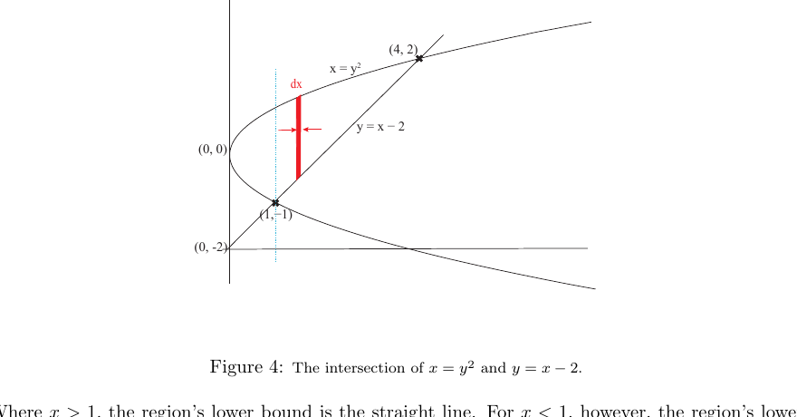
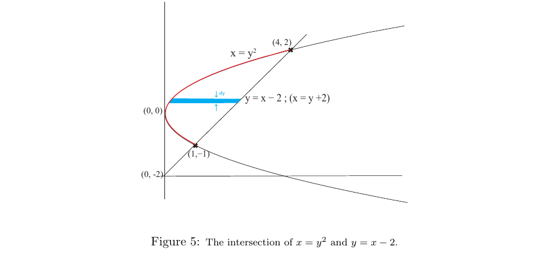
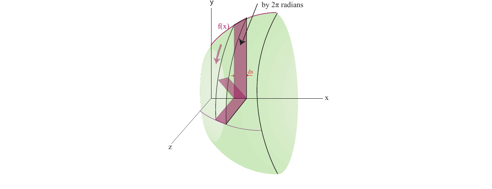
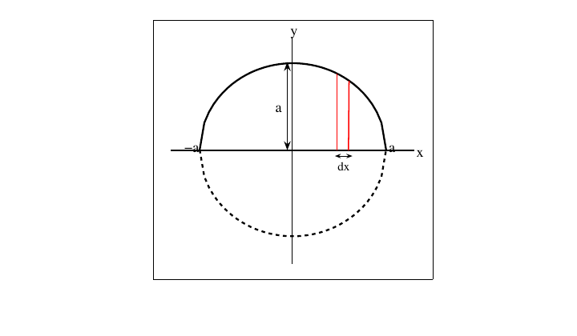

# MIT OCW 18.01 Lecture 21 讲义 · 中文译本

> **编号说明（必读）**：本文件名写作 `OCW_18.01_L19_…`，是为与 Bilibili 合集 **BV1mNgm66EZu · P19**（19-对数与几何面积应用）对齐。对应的官方 PDF 实为 Fall 2006 **`lec21.pdf`（Lecture 21: Applications to Logarithms and Geometry）**。OCW 课程日历中的 **Lecture 8** 是 Exam 1、**Lecture 17** 是 Exam 2，**都没有**常规讲义 PDF / 本系列课堂录像；故对 \(n\ge16\) 有 Bilibili **P19 ↔ OCW Lecture 21**（Pn ≈ lec\((n+2)\)；更早仅跳过 Exam 1 时为 Pn ↔ lec\((n+1)\)）。课堂口播与讲义在端点证明、指数重建、旋转体/球体积、开场平均值更正等处的差异见同目录 [`MIT1801_L19_课上思路.md`](./MIT1801_L19_课上思路.md) §6。  
> **来源**：https://ocw.mit.edu/courses/18-01-single-variable-calculus-fall-2006/lec21.pdf  
> **课程**：18.01 Single Variable Calculus，Fall 2006  
> **说明**：英文原文具有权威性；本文件为中文学习转写。引用与条款见 http://ocw.mit.edu/terms 。数学式保留 LaTeX；图为 PDF 页渲染裁切，嵌入于对应正文旁。

---

## Lecture 21: Applications to Logarithms and Geometry

（第 21 讲：对数与几何应用）

18.01 Fall 2006

---

### Application of FTC 2 to Logarithms
（FTC 2 对对数的应用）

像 Fresnel 的 \(C(x)\)、\(S(x)\) 这类由积分定义的函数，用起来几乎与初等函数一样方便：可以画图、可以制表。作业里会要求你做一两个这样的例子。为了习惯使用定积分与 FTC 2，我们详细讨论由积分产生的、相对「新」的最简单函数——对数。

回顾
\[
\int x^{n}\,dx=\frac{x^{n+1}}{n+1}+c,
\]
**除了** \(n=-1\)。因此 \(1/x\) 的反导数不是幂函数，而是别的东西。于是定义
\[
L(x)=\int_{1}^{x}\frac{dt}{t}.
\]
（这个函数其实就是对数。回想我们先前对对数的路径相当曲折：先分析 \(a^{x}\)，再定义数 \(e\)，最后把对数定义为 \(e^{x}\) 的反函数。用这个积分公式的直接路径会更容易。）

\(L(x)\) 的全部基本性质都直接来自其定义。注意 \(L\) 定义在 \(0<x<\infty\)。（我们不把定义延伸过 \(x=0\)，因为 \(1/t\) 在 \(t=0\) 处无穷。）其次，微积分第二基本定理（FTC 2）给出
\[
L'(x)=\frac{1}{x}.
\]
又因积分下限取为 1，
\[
L(1)=\int_{1}^{1}\frac{dt}{t}=0.
\]

因此 \(L\) 递增，并在 \(x=1\) 处穿过 \(x\) 轴：\(0<x<1\) 时 \(L(x)<0\)，\(x>1\) 时 \(L(x)>0\)。再求导一次，
\[
L''(x)=-\frac{1}{x^{2}}.
\]
故 \(L\) 下凹。

\(L(x)\) 的关键性质（表明它确实是对数）是它把乘法变成加法：

**Claim 1.** \(L(ab)=L(a)+L(b)\)

**证明：** 由 \(L(ab)\) 与 \(L(a)\) 的定义，
\[
L(ab)=\int_{1}^{ab}\frac{dt}{t}=\int_{1}^{a}\frac{dt}{t}+\int_{a}^{ab}\frac{dt}{t}=L(a)+\int_{a}^{ab}\frac{dt}{t}.
\]

对 \(\displaystyle\int_{a}^{ab}\frac{dt}{t}\) 作代换 \(t=au\)。则
\[
dt=a\,du;\qquad a<t<ab\ \Longrightarrow\ 1<u<b.
\]
因此
\[
\int_{a}^{ab}\frac{dt}{t}=\int_{u=1}^{u=b}\frac{a\,du}{au}=\int_{1}^{b}\frac{du}{u}=L(b).
\]
这就确认了 \(L(ab)=L(a)+L(b)\)。

另外两个性质——端点行为——补全图像的整体图景。

**Claim 2.** 当 \(x\to\infty\) 时 \(L(x)\to\infty\)。

**证明：** 只需证 \(L(2^{n})\to\infty\)（\(n\to\infty\)），因为 \(L\) 递增会填满各 \(2\) 的幂之间的值。
\[
\begin{aligned}
L(2^{n})&=L(2\cdot 2^{n-1})=L(2)+L(2^{n-1})\\
&=L(2)+L(2)+\cdots+L(2)\quad\text{（共 \(n\) 次）}.
\end{aligned}
\]
故 \(L(2^{n})=nL(2)\to\infty\)（更熟悉的写法：\(\ln 2^{n}=n\ln 2\)）。

**Claim 3.** 当 \(x\to 0^{+}\) 时 \(L(x)\to-\infty\)。

**证明：** \(0=L(1)=L\bigl(x\cdot\frac1x\bigr)=L(x)+L(1/x)\) ⇒ \(L(x)=-L(1/x)\)。当 \(x\to 0^{+}\) 时 \(1/x\to+\infty\)，由 Claim 2 有 \(L(1/x)\to\infty\)。故
\[
L(x)=-L(1/x)\to-\infty,\qquad x\to 0^{+}.
\]

于是 \(L(x)\) 在 \(0<x<\infty\) 上从 \(-\infty\) 递增到 \(\infty\)，在 \(x=1\) 穿过 \(x\) 轴；下凹；图像如图 1。

**Figure 1：** Graph of \(y=\ln(x)\).（过 \((1,0)\)；\(x\to0^{+}\) 趋向 \(-\infty\)，\(x\to+\infty\) 趋向 \(+\infty\)。）

这就给出指数与对数函数的另一条路径。从 \(L(x)\) 出发：用 \(\ln x=L(x)\) 定义对数；定义 \(e\) 为满足 \(L(e)=1\) 的数；定义 \(e^{x}\) 为 \(L\) 的反函数；定义 \(a^{x}=e^{xL(a)}\)。

---

### Application of FTCs to Geometry (Volumes and Areas)
（FTC 对几何的应用：体积与面积）

#### 1. Areas between two curves
（两曲线之间的面积）

**Figure 2：** Finding the area between two curves.（上曲线 \(f\)、下曲线 \(g\)；竖条宽 \(dx\)；交点 \(a,b\)。）

参见图 2。先求交点 \(a\) 与 \(b\)。两曲线之间的面积为
\[
A=\int_{a}^{b}\bigl(f(x)-g(x)\bigr)\,dx.
\]

**Example 1.** 求 \(x=y^{2}\) 与 \(y=x-2\) 之间区域的面积。

**Figure 3：** The intersection of \(x=y^{2}\) and \(y=x-2\).（交点 \((1,-1)\)、\((4,2)\)。）

先画图并求交点（见图 3）：
\[
\begin{aligned}
y+2&=x=y^{2},\\
y^{2}-y-2&=0,\\
(y-2)(y+1)&=0.
\end{aligned}
\]
交于 \(y=-1,2\)。代回得 \(x=1\) 与 \(x=4\)。故曲线交于 \((1,-1)\) 与 \((4,2)\)（见图 3）。

求这两条曲线之间面积有两种办法：难的与容易的。

**Hard Way: Vertical Slices（笨办法：竖直切片）**

若竖直切开两曲线之间的区域，需要考虑两个不同子区域。

**Figure 4：** The intersection of \(x=y^{2}\) and \(y=x-2\).（竖条 \(dx\)；\(x=1\) 处分界。）

当 \(x>1\) 时，区域下界是直线；当 \(x<1\) 时，下界是侧向抛物线的下半支。对每个子区域，用「上曲线减下曲线」积分：
\[
A=\int_{0}^{1}\bigl(\sqrt{x}-(-\sqrt{x})\bigr)\,dx
+\int_{1}^{4}\bigl(\sqrt{x}-(x-2)\bigr)\,dx
=\int(y_{\mathrm{top}}-y_{\mathrm{bottom}})\,dx.
\]

**Easy Way: Horizontal Slices（容易办法：水平切片）**

这里不是上减下，而是**右减左**。

**Figure 5：** The intersection of \(x=y^{2}\) and \(y=x-2\).（横条 \(dy\)；左 \(x=y^{2}\)，右 \(x=y+2\)。）

\[
\begin{aligned}
A&=\int(x_{\mathrm{right}}-x_{\mathrm{left}})\,dy
=\int_{y=-1}^{y=2}\bigl((y+2)-y^{2}\bigr)\,dy\\
&=\Bigl[\frac{y^{2}}{2}+2y-\frac{y^{3}}{3}\Bigr]_{-1}^{2}
=\Bigl(\frac42+4-\frac83\Bigr)-\Bigl(\frac12-2+\frac13\Bigr)
=\frac92.
\end{aligned}
\]

---

#### 2. Volumes of solids of revolution
（旋转体的体积）

把 \(f(x)\) 绕 \(x\) 轴旋转（穿出纸面），得到：

**Figure 6：** A solid of revolution: the purple slice is rotated by \(\pi/4\) and \(\pi/2\).（把 \(xy\) 平面上的截面旋转 \(2\pi\) 弧度；条宽 \(dx\)。）

我们要弄清该立体「一片」的体积。可把每片近似为宽 \(dx\)、半径 \(y\)、截面积 \(\pi y^{2}\) 的圆盘。于是一片体积
\[
dV=\pi y^{2}\,dx
\qquad\text{（绕 \(x\) 轴的旋转体）}.
\]
再对 \(x\) 积分，即得旋转体总体积。

**Example 2.** 求半径为 \(a\) 的球（ball）的体积。

**Figure 7：** A ball of radius \(a\).（上半圆 \(y=\sqrt{a^{2}-x^{2}}\)；竖条 \(dx\)。）

上半圆方程为
\[
y=\sqrt{a^{2}-x^{2}}.
\]
把曲线上半部绕 \(x\) 轴旋转，得到半径 \(a\) 的球。注意 \(x\) 从 \(-a\) 到 \(+a\)。合起来：
\[
\begin{aligned}
V&=\int\pi y^{2}\,dx
=\int_{x=-a}^{x=a}\pi(a^{2}-x^{2})\,dx
=\Bigl[\pi a^{2}x-\frac{\pi x^{3}}{3}\Bigr]_{-a}^{a}\\
&=\Bigl(\pi a^{3}-\frac{\pi a^{3}}{3}\Bigr)-\Bigl(-\pi a^{3}+\frac{\pi a^{3}}{3}\Bigr)
=\frac{4}{3}\pi a^{3}.
\end{aligned}
\]

常可利用对称进一步简化。上例中曲线关于 \(y\) 轴对称，故
\[
V=\int_{-a}^{a}\pi(a^{2}-x^{2})\,dx
=2\int_{0}^{a}\pi(a^{2}-x^{2})\,dx
=2\Bigl[\pi a^{2}x-\frac{\pi x^{3}}{3}\Bigr]_{0}^{a}.
\]
（节省在于：下限 \(0\) 比 \(-a\) 更好算。）同一答案：
\[
V=2\Bigl(\pi a^{3}-\frac{\pi}{3}a^{3}\Bigr)=\frac{4}{3}\pi a^{3}.
\]
