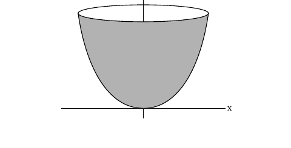
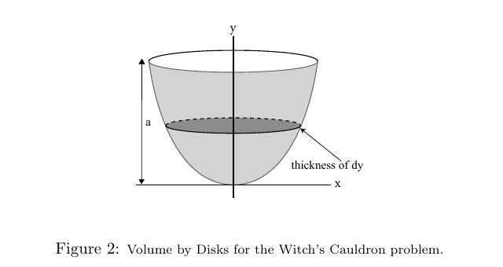
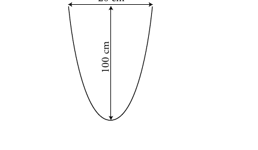
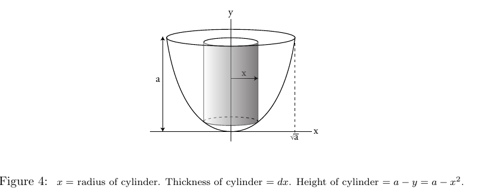
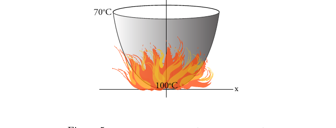
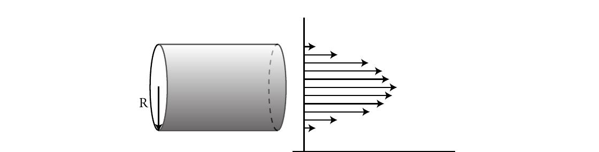
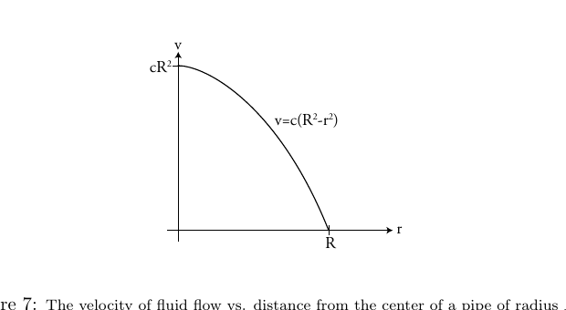
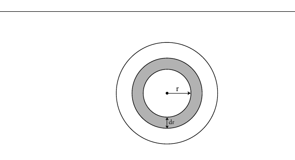
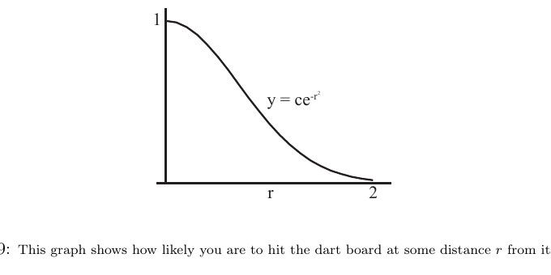

# MIT OCW 18.01 Lecture 22 讲义 · 中文译本

> **编号说明（必读）**：本文件名写作 `OCW_18.01_L20_…`，是为与 Bilibili 合集 **BV1mNgm66EZu · P20**（20-圆盘法与柱壳法求体积）对齐。对应的官方 PDF 实为 Fall 2006 **`lec22.pdf`（Lecture 22: Volumes by Disks and Shells）**。OCW 课程日历中的 **Lecture 8** 是 Exam 1、**Lecture 17** 是 Exam 2，**都没有**常规讲义 PDF / 本系列课堂录像；故对 \(n\ge16\) 有 Bilibili **P20 ↔ OCW Lecture 22**（Pn ≈ lec\((n+2)\)；更早仅跳过 Exam 1 时为 Pn ↔ lec\((n+1)\)）。课堂口播与讲义在球体积例、大锅圆盘法编排、沸腾全程、管流/飞镖靶等处的差异见同目录 [`MIT1801_L20_课上思路.md`](./MIT1801_L20_课上思路.md) §6。  
> **来源**：https://ocw.mit.edu/courses/18-01-single-variable-calculus-fall-2006/lec22.pdf  
> **课程**：18.01 Single Variable Calculus，Fall 2006  
> **说明**：英文原文具有权威性；本文件为中文学习转写。引用与条款见 http://ocw.mit.edu/terms 。数学式保留 LaTeX；图为 PDF 页渲染裁切，嵌入于对应正文旁。

---

## Lecture 22: Volumes by Disks and Shells

（第 22 讲：用圆盘法与柱壳法求体积）

18.01 Fall 2006

---

### Disks and Shells
（圆盘与柱壳）

我们通过一个例子说明求体积的两种方法。

**Example 1. A witch’s cauldron**（女巫的大锅）

**Figure 1：** \(y = x^{2}\) rotated around the \(y\)-axis.（抛物线绕 \(y\) 轴旋转所得大锅状立体。）

#### Method 1: Disks（方法 1：圆盘法）

**Figure 2：** Volume by Disks for the Witch’s Cauldron problem.（水平圆盘，厚度 \(dy\)；高度标 \(a\)。）

图 2 中圆盘的面积为 \(\pi x^{2}\)。圆盘厚度为 \(dy\)，体积 \(dV=\pi x^{2}\,dy\)。大锅体积 \(V\) 为
\[
V=\int_{0}^{a}\pi x^{2}\,dy
\quad\text{（代入 \(y=x^{2}\)）}
\]
\[
V=\int_{0}^{a}\pi y\,dy=\pi\frac{y^{2}}{2}\Big|_{0}^{a}=\frac{\pi a^{2}}{2}.
\]

若 \(a=1\) 米，则 \(V=\dfrac{\pi}{2}a^{2}\) 给出
\[
V=\frac{\pi}{2}\,\mathrm{m}^{3}=\frac{\pi}{2}(100\,\mathrm{cm})^{3}=\frac{\pi}{2}10^{6}\,\mathrm{cm}^{3}\approx 1600\,\text{升}
\quad\text{（一口巨大的锅）}.
\]

**Warning about units.**（关于单位的警告。）

若 \(a=100\,\mathrm{cm}\)，则
\[
V=\frac{\pi}{2}(100)^{2}=\frac{\pi}{2}10^{4}\,\mathrm{cm}^{3}=\frac{\pi}{2}10\sim 16\,\text{升}.
\]
但 \(100\,\mathrm{cm}=1\,\mathrm{m}\)。为何答案不同？悖论的化解藏在方程
\[
y=x^{2}
\]
里。在顶部，\(100=x^{2}\Rightarrow x=10\,\mathrm{cm}\)。于是第二口锅看起来如图 3。相比之下，当

**Figure 3：** The skinny cauldron.（高 \(100\,\mathrm{cm}\)、顶宽 \(20\,\mathrm{cm}\) 的细锅。）

\(a=1\,\mathrm{m}\) 时，顶部宽十倍：\(1=x^{2}\) 即 \(x=1\,\mathrm{m}\)。我们的方程 \(y=x^{2}\) **不是尺度不变的（not scale-invariant）**。所描述的形状依赖于所用单位。

#### Method 2: Shells（方法 2：柱壳法）

这其实应该叫做**圆柱法（cylinder method）**。

**Figure 4：** \(x =\) radius of cylinder. Thickness of cylinder \(= dx\). Height of cylinder \(= a - y = a - x^{2}\).（半径 \(x\)、厚 \(dx\)、高 \(a-x^{2}\)；右端 \(\sqrt{a}\)。）

薄壳/圆柱的高度为 \(a-x^{2}\)，周长 \(2\pi x\)，厚度 \(dx\)。
\[
\begin{aligned}
dV&=(a-x^{2})(2\pi x)\,dx\\
V&=\int_{x=0}^{x=\sqrt{a}}(a-x^{2})(2\pi x)\,dx
=2\pi\int_{0}^{\sqrt{a}}(ax-x^{3})\,dx\\
&=2\pi\Bigl[\frac{a x^{2}}{2}-\frac{x^{4}}{4}\Bigr]_{0}^{\sqrt{a}}
=2\pi\Bigl(\frac{a^{2}}{2}-\frac{a^{2}}{4}\Bigr)
=2\pi\cdot\frac{a^{2}}{4}
=\frac{\pi a^{2}}{2}
\quad\text{（与前面相同）}.
\end{aligned}
\]

---

### Example 2. The boiling cauldron
（沸腾的大锅）

现在把这口锅装满水，在底下点火把水烧开（\(100^{\circ}\mathrm{C}\)）。假设天气很冷：锅外空气温度为 \(0^{\circ}\mathrm{C}\)。要把水从 \(0^{\circ}\mathrm{C}\) 加热到 \(100^{\circ}\mathrm{C}\)，需要多少能量？

**Figure 5：** The boiling cauldron (\(y = a = 1\) meter).（底 \(100^{\circ}\mathrm{C}\)、顶 \(70^{\circ}\mathrm{C}\)；下方有火。）

假设温度在锅顶与锅底（\(y=0\)）之间线性下降：
\[
T=100-30y\qquad\text{（摄氏度）}.
\]
用**圆盘法**，因为每一水平圆盘上水温恒定。所需总热量
\[
\begin{aligned}
H&=\int_{0}^{1}T(\pi x^{2})\,dy
\quad\text{（单位：(度)·(立方米)）}\\
&=\int_{0}^{1}(100-30y)(\pi y)\,dy\\
&=\pi\int_{0}^{1}(100y-30y^{2})\,dy
=\pi\bigl(50y^{2}-10y^{3}\bigr)\Big|_{0}^{1}
=40\pi\quad\text{(deg.)·m}^{3}.
\end{aligned}
\]

这是多少卡路里？
\[
\text{# of calories}
=\frac{1\,\mathrm{cal}}{\mathrm{cm}^{3}\cdot\mathrm{deg}}
\cdot(40\pi)
\cdot\Bigl(\frac{100\,\mathrm{cm}}{1\,\mathrm{m}}\Bigr)^{3}
=(40\pi)(10^{6})\,\mathrm{cal}
=125\times 10^{3}\,\mathrm{kcal}.
\]
一根糖果棒大约 250 kcal，故约
\[
\text{# of calories}
=\frac12\text{ candy bar}\times 10^{3}
\approx 500\text{ candy bars}.
\]
也就是说，烧开这锅水大约需要 500 根糖果棒的能量。

---

### Example 3. Pipe flow
（管流）

Poiseuille 最早研究管道（动脉、毛细血管）中的流体流动。他得出管内流速剖面为
\[
v=c(R^{2}-r^{2}),
\qquad
v=\text{speed}=\frac{\text{distance}}{\text{time}}.
\]

**Figure 6：** Flow is faster in the center of the pipe. It slows—“sticks”—at the edges (i.e. the inner surface of the pipe).（中心快、管壁「粘住」变慢；半径 \(R\)。）

**Figure 7：** The velocity of fluid flow vs. distance from the center of a pipe of radius \(R\).（\(v=c(R^{2}-r^{2})\)；\(r=0\) 时 \(v=cR^{2}\)，\(r=R\) 时 \(v=0\)。）

通过「环带」（annulus，即 ring）的流量 \(=\)（环带面积）×（流速）：
\[
\text{area of ring}=2\pi r\,dr
\quad\text{（见图 8：周长 \(2\pi r\)，厚度 \(dr\)）}.
\]
\(v\) 类比于柱壳的高度。

**Figure 8：** Cross-section of the pipe.（半径 \(r\)、厚度 \(dr\) 的阴影环带。）

\[
\begin{aligned}
\text{total flow through pipe}
&=\int_{0}^{R}v(2\pi r\,dr)
=c\int_{0}^{R}(R^{2}-r^{2})2\pi r\,dr\\
&=2\pi c\int_{0}^{R}(R^{2}r-r^{3})\,dr
=2\pi c\Bigl[\frac{R^{2}r^{2}}{2}-\frac{r^{4}}{4}\Bigr]_{0}^{R}
=\frac{\pi}{2}c R^{4}.
\end{aligned}
\]
注意流量与 \(R^{4}\) 成正比。这意味着粗管道有巨大优势。

---

### Example 4. Dart board
（飞镖靶）

你瞄准靶心，但准头并不总完美。在半径 \(r\) 处的命中数 \(N\) 与 \(e^{-r^{2}}\) 成正比：
\[
N=ce^{-r^{2}}.
\]
图像如下：

**Figure 9：** This graph shows how likely you are to hit the dart board at some distance \(r\) from its center.（\(y=ce^{-r^{2}}\)；随 \(r\) 衰减。）

在给定环带 \(r_{1}<r<r_{2}\) 内的命中数为
\[
c\int_{r_{1}}^{r_{2}}e^{-r^{2}}(2\pi r\,dr).
\]
这个问题我们将在下一讲继续讨论。
