# MIT OCW 18.01 Lecture 23 讲义 · 中文译本

> **编号说明（必读）**：本文件名写作 `OCW_18.01_L21_…`，是为与 Bilibili 合集 **BV1mNgm66EZu · P21**（21-平均值与概率积分）对齐。对应的官方 PDF 实为 Fall 2006 **`lec23.pdf`（Lecture 23: Work, Average Value, Probability）**。OCW 课程日历中的 **Lecture 8** 是 Exam 1、**Lecture 17** 是 Exam 2，**都没有**常规讲义 PDF / 本系列课堂录像；故对 \(n\ge16\) 有 Bilibili **P21 ↔ OCW Lecture 23**（Pn ≈ lec\((n+2)\)；更早仅跳过 Exam 1 时为 Pn ↔ lec\((n+1)\)）。课堂口播与讲义在飞镖全算、\(Q=\sqrt{\pi}\) 切片体积等处的差异见同目录 [`MIT1801_L21_课上思路.md`](./MIT1801_L21_课上思路.md) §6。  
> **来源**：https://ocw.mit.edu/courses/18-01-single-variable-calculus-fall-2006/lec23.pdf  
> **课程**：18.01 Single Variable Calculus，Fall 2006  
> **说明**：英文原文具有权威性；本文件为中文学习转写。引用与条款见 http://ocw.mit.edu/terms 。数学式保留 LaTeX；图为 PDF 页渲染裁切，嵌入于对应正文旁。

---

## Lecture 23: Work, Average Value, Probability

（第 23 讲：功、平均值与概率）

18.01 Fall 2006

---

### Application of Integration to Average Value
（积分对平均值的应用）

你已经会求一组离散数的平均：
\[
\frac{a_1+a_2}{2}
\quad\text{或}\quad
\frac{a_1+a_2+a_3}{3}.
\]
现在我们要求**连续统（continuum）**上的平均。

![Figure 1：\(y=f(x)\) 在 \([a,b]\) 上的离散逼近](ocw_figs/fig1_discrete_avg.png)

**Figure 1：** Discrete approximation to \(y=f(x)\) on \(a\le x\le b\).（等距采样 \(x_i\)，高度 \(y_i=f(x_i)\)。）

\[
\text{Average}\approx\frac{y_1+y_2+\cdots+y_n}{n},
\]
其中
\[
a=x_0<x_1<\cdots<x_n=b,\qquad
y_i=f(x_i),\qquad
n(\Delta x)=b-a\iff\Delta x=\frac{b-a}{n}.
\]
黎曼和的极限：
\[
\lim_{n\to\infty}(y_1+\cdots+y_n)\frac{b-a}{n}
=\int_a^b f(x)\,dx.
\]
再除以 \(b-a\)，得**连续平均（continuous average）**：
\[
\lim_{n\to\infty}\frac{y_1+\cdots+y_n}{n}
=\frac{1}{b-a}\int_a^b f(x)\,dx.
\]

---

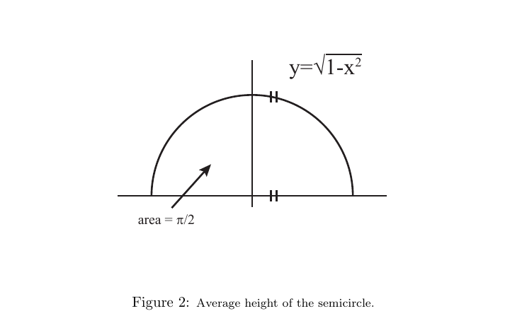

**Figure 2：** Average height of the semicircle.（\(y=\sqrt{1-x^{2}}\)；面积 \(\pi/2\)。）

**Example 1.** 求 \(y=\sqrt{1-x^{2}}\) 在 \(-1\le x\le1\) 上的平均。（见图 2）
\[
\text{Average height}
=\frac{1}{2}\int_{-1}^{1}\sqrt{1-x^{2}}\,dx
=\frac{1}{2}\cdot\frac{\pi}{2}
=\frac{\pi}{4}.
\]

**Example 2.** 常数的平均仍是该常数：
\[
\frac{1}{b-a}\int_a^b 53\,dx=53.
\]

**Example 3.** 求半圆上高度 \(y\) **相对弧长**的平均。（用 \(d\theta\) 而非 \(dx\)。见图 3）

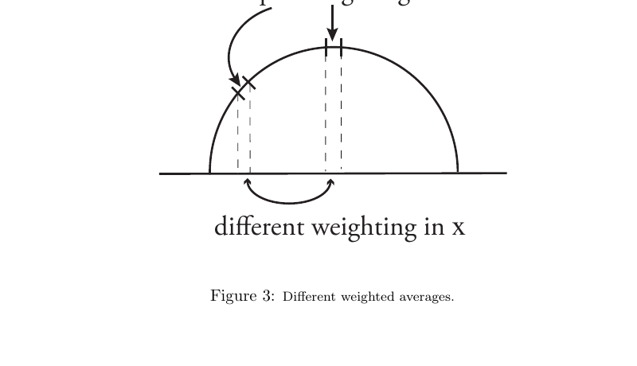

**Figure 3：** Different weighted averages.（等 \(\theta\) 权重 vs 不同 \(x\) 权重。）

\[
y=\sin\theta,\qquad
\text{Average}
=\frac{1}{\pi}\int_0^\pi\sin\theta\,d\theta
=\frac{1}{\pi}\bigl[-\cos\theta\bigr]_0^\pi
=\frac{2}{\pi}.
\]

**Example 4.** 求上堂女巫大锅中水的平均温度。（见图 4）

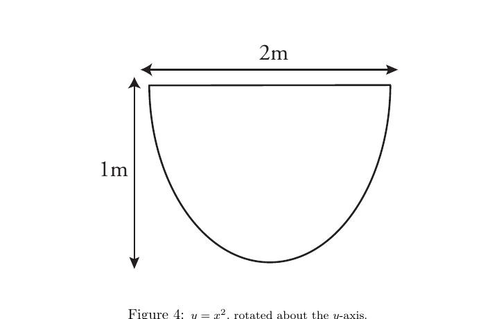

**Figure 4：** \(y=x^{2}\), rotated about the \(y\)-axis.（顶宽 2 m、高 1 m。）

先回忆用圆盘法求旋转体体积：
\[
V=\int_0^1(\pi x^{2})\,dy=\int_0^1\pi y\,dy
=\frac{\pi y^{2}}{2}\Big|_0^1=\frac{\pi}{2}.
\]
回忆 \(T(y)=100-30y\)（\(T(0)=100^{\circ}\)，\(T(1)=70^{\circ}\)）。单位体积平均温度：给高度 \(y\) 处圆盘权重 \(w(y)=\pi y\)，
\[
\frac{\displaystyle\int_0^1 T(y)w(y)\,dy}{\displaystyle\int_0^1 w(y)\,dy}.
\]
分子：
\[
\int_0^1 T\pi y\,dy
=\pi\int_0^1(100-30y)y\,dy
=\pi\bigl(50y^{2}-10y^{3}\bigr)\Big|_0^1
=40\pi.
\]
故平均温度：
\[
\frac{40\pi}{\pi/2}=80^{\circ}\mathrm{C}.
\]
对比相对高度 \(y\) 的平均：
\[
\frac{1}{1}\int_0^1 T\,dy
=\int_0^1(100-30y)\,dy
=\bigl(100y-15y^{2}\bigr)\Big|_0^1
=85^{\circ}\mathrm{C}.
\]
\(T\) 线性；最大 \(100^{\circ}\)、最小 \(70^{\circ}\)，算术平均 \(\dfrac{70+100}{2}=85\)。

答案 \(85^{\circ}\) 与普通平均一致。体积加权平均（对 \(\pi y\,dy\)）更低（\(80^{\circ}\)），因为大锅上部更凉的水更多。

---

### Dart board, revisited
（飞镖靶，再访）

上次说过，瞄准精度服从「正态分布」：\(ce^{-r^{2}}\)。

现在假装——比如说你的小弟弟——傻乎乎地站在靶旁。他被乱飞的飞镖击中的机会有多大？

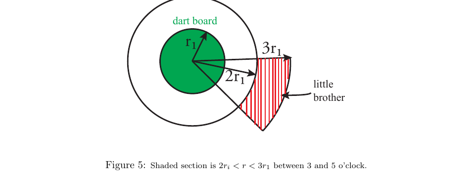

**Figure 5：** Shaded section is \(2r_1<r<3r_1\) between 3 and 5 o’clock.（绿靶半径 \(r_1\)；小弟在 \(2r_1\)–\(3r_1\) 扇区。）

为便于计算，把弟弟近似成图 5 阴影扇区。他并不正对靶心，而在 \(2r_1<r<3r_1\)（\(r_1=\) 靶半径）。也不环绕全周——约占 3 点到 5 点，即环的 \(\dfrac16\)。

记住
\[
\boxed{\text{probability}=\dfrac{\text{part}}{\text{whole}}.}
\]

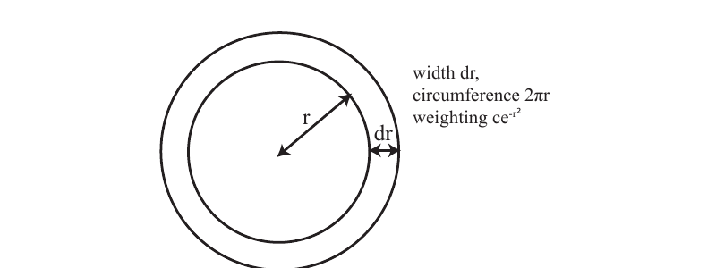

**Figure 6：** Integrating over rings.（宽 \(dr\)、周长 \(2\pi r\)、权重 \(ce^{-r^{2}}\)。）

环的权重为 \(ce^{-r^{2}}(2\pi r)\,dr\)（见图 6）。击中弟弟的概率：
\[
\frac{\dfrac16\displaystyle\int_{2r_1}^{3r_1}ce^{-r^{2}}2\pi r\,dr}
{\displaystyle\int_0^{\infty}ce^{-r^{2}}2\pi r\,dr}.
\]
其中 \(\dfrac16=\dfrac{5-3}{12}\) 近似弟弟所占周长比例。（注：\(e^{-r^{2}}=e^{(-r^{2})}\)，不是 \((e^{-r})^{2}\)。）

\[
\int_a^b r e^{-r^{2}}\,dr
=-\frac12 e^{-r^{2}}\Big|_a^b
=-\frac12 e^{-b^{2}}+\frac12 e^{-a^{2}},
\qquad
\frac{d}{dr}e^{-r^{2}}=-2r e^{-r^{2}}.
\]
分母：
\[
\int_0^{\infty}e^{-r^{2}}r\,dr
=-\frac12 e^{-r^{2}}\Big|_0^{R\to\infty}
=-\frac12 e^{-R^{2}}+\frac12 e^{0}
=\frac12
\]
（\(e^{-R^{2}}\to0\) 当 \(R\to\infty\)）。

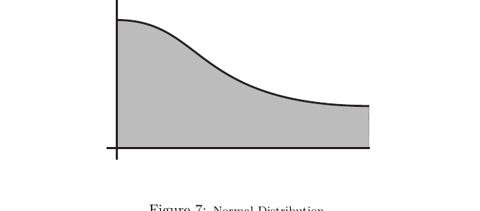

**Figure 7：** Normal Distribution.（钟形曲线下方面积。）

\[
\begin{aligned}
\text{Probability}
&=\frac{\dfrac16\int_{2r_1}^{3r_1}ce^{-r^{2}}2\pi r\,dr}
{\int_0^{\infty}ce^{-r^{2}}2\pi r\,dr}
=\frac{\dfrac16\int_{2r_1}^{3r_1}e^{-r^{2}}r\,dr}
{\int_0^{\infty}e^{-r^{2}}r\,dr}
=\frac13\int_{2r_1}^{3r_1}e^{-r^{2}}r\,dr
=\frac{-e^{-r^{2}}}{6}\Big|_{2r_1}^{3r_1}\\[6pt]
&=\frac{-e^{-9r_1^{2}}+e^{-4r_1^{2}}}{6}.
\end{aligned}
\]

假设投镖者大约一半时间落在靶内 \(0\le r\le r_1\)（据对 7 岁儿童的个人经验，这很现实）：
\[
P(0\le r\le r_1)=\frac12
=\int_0^{r_1}2e^{-r^{2}}r\,dr
=-e^{-r_1^{2}}+1
\implies e^{-r_1^{2}}=\frac12.
\]
于是
\[
e^{-9r_1^{2}}=\bigl(e^{-r_1^{2}}\bigr)^9=\bigl(\tfrac12\bigr)^9\approx0,
\qquad
e^{-4r_1^{2}}=\bigl(e^{-r_1^{2}}\bigr)^4=\bigl(\tfrac12\bigr)^4=\frac1{16}.
\]
故击中小弟弟的概率
\[
\frac{1}{16}\cdot\frac16\approx\frac1{100}.
\]
也就是说，每扔一镖约有 **1%** 机会打到他。

---

### Volume by Slices: An Important Example
（切片求体积：一个重要例子）

计算
\[
Q=\int_{-\infty}^{\infty}e^{-x^{2}}\,dx.
\]

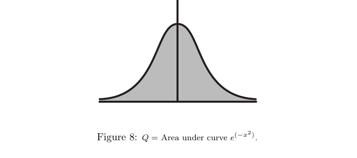

**Figure 8：** \(Q=\) Area under curve \(e^{(-x^{2})}\).（高斯钟形。）

这是整个微积分中最重要的积分之一，在概率与统计中尤其重要。它是反常积分，但不必被那些 \(\infty\) 吓到——此处它们往往比有限限更容易处理。

为求 \(Q\)，先求旋转体体积：在 \(e^{-r^{2}}\)（\(r=\sqrt{x^{2}+y^{2}}\)）下方的体积 \(V\)。用**壳层法**，得到与飞镖问题相同的积分。半径 \(r\) 处壳的周长 \(2\pi r\)、厚 \(dr\)（见图 9），故 \(dV=e^{-r^{2}}2\pi r\,dr\)。在 \(0\le r\le R\)：
\[
\int_0^R e^{-r^{2}}2\pi r\,dr
=-\pi e^{-r^{2}}\Big|_0^R
=-\pi e^{-R^{2}}+\pi.
\]
\(R\to\infty\) 时 \(e^{-R^{2}}\to0\)，
\[
V=\int_0^{\infty}e^{-r^{2}}2\pi r\,dr=\pi
\quad\text{（与飞镖问题相同）}.
\]

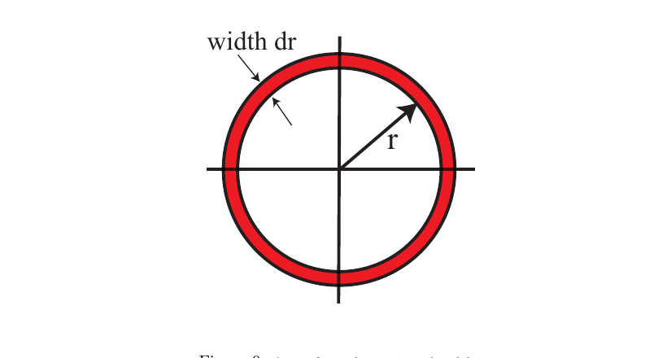

**Figure 9：** Area of annulus or ring, \((2\pi r)\,dr\).（宽 \(dr\)、半径 \(r\)。）

再用第二种方法——**切片法**。沿固定 \(y\) 的平面切片（见图 10）。记截面面积为 \(A(y)\)；厚度 \(dy\)（见图 11），
\[
V=\int_{-\infty}^{\infty}A(y)\,dy.
\]

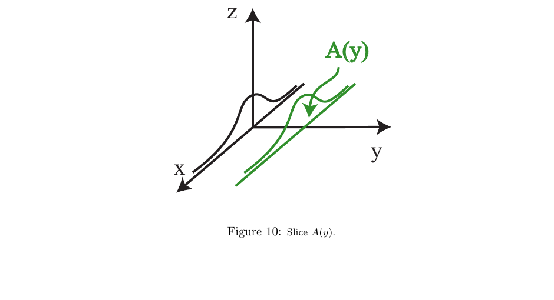

**Figure 10：** Slice \(A(y)\).（固定 \(y\) 的竖直截面。）

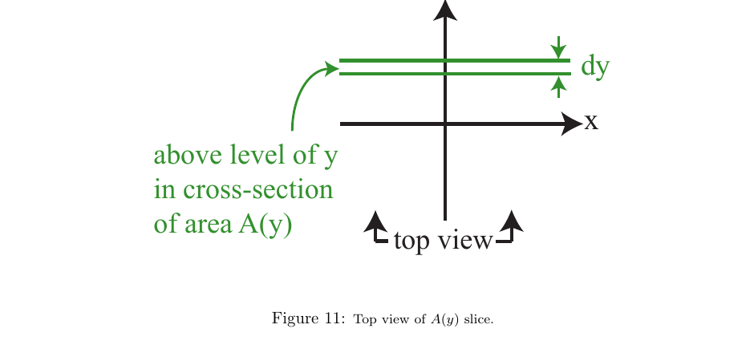

**Figure 11：** Top view of \(A(y)\) slice.（水平条带宽 \(dy\)。）

计算 \(A(y)\)：它是对 \(dx\) 的积分
\[
A(y)
=\int_{-\infty}^{\infty}e^{-r^{2}}\,dx
=\int_{-\infty}^{\infty}e^{-x^{2}-y^{2}}\,dx
=e^{-y^{2}}\int_{-\infty}^{\infty}e^{-x^{2}}\,dx
=e^{-y^{2}}Q.
\]
这里用了 \(r^{2}=x^{2}+y^{2}\)、\(e^{-x^{2}-y^{2}}=e^{-x^{2}}e^{-y^{2}}\)，以及在 \(A(y)\) 切片中 \(y\) 为常数（见图 12）。换言之，
\[
\int_{-\infty}^{\infty}c\,e^{-x^{2}}\,dx
=c\int_{-\infty}^{\infty}e^{-x^{2}}\,dx
\quad\text{（取 \(c=e^{-y^{2}}\)）}.
\]

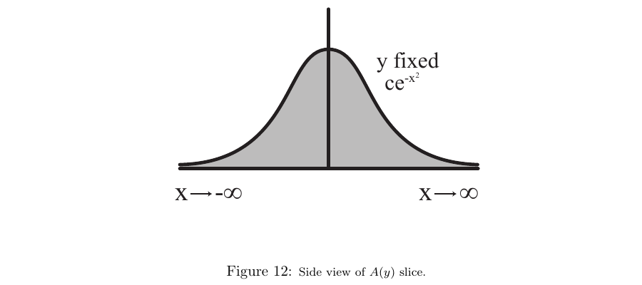

**Figure 12：** Side view of \(A(y)\) slice.（\(y\) 固定；截面轮廓 \(ce^{-x^{2}}\)。）

于是
\[
V=\int_{-\infty}^{\infty}A(y)\,dy
=\int_{-\infty}^{\infty}e^{-y^{2}}Q\,dy
=Q\int_{-\infty}^{\infty}e^{-y^{2}}\,dy
=Q^{2}.
\]
确实
\[
Q=\int_{-\infty}^{\infty}e^{-x^{2}}\,dx
=\int_{-\infty}^{\infty}e^{-y^{2}}\,dy
\]
（变量名无关）。倒读等式：
\[
\pi=V=Q^{2}\implies Q=\sqrt{\pi}.
\]
可改写为
\[
\frac{1}{\sqrt{\pi}}\int_{-\infty}^{\infty}e^{-x^{2}}\,dx=1.
\]
等价的重标度形式（把 \(x\) 换成 \(x/\sqrt{2}\sigma\)）为
\[
\frac{1}{\sqrt{2\pi}\,\sigma}\int_{-\infty}^{\infty}e^{-x^{2}/(2\sigma^{2})}\,dx=1.
\]
该式是概率与统计的核心。概率分布
\[
\frac{1}{\sqrt{2\pi}\,\sigma}\,e^{-x^{2}/(2\sigma^{2})}
\quad(-\infty<x<\infty)
\]
称为**正态分布（normal distribution）**，\(\sigma>0\) 为其**标准差（standard deviation）**。
