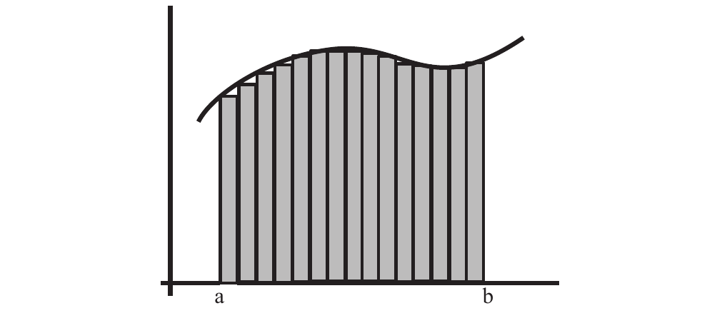
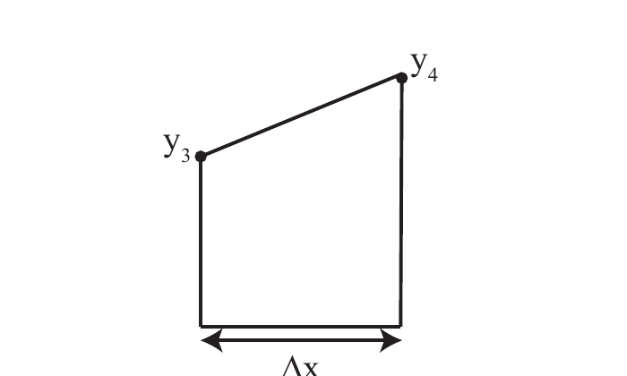
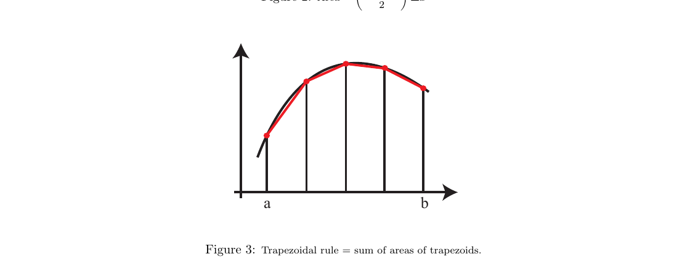
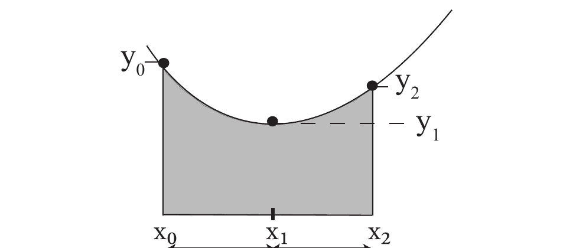
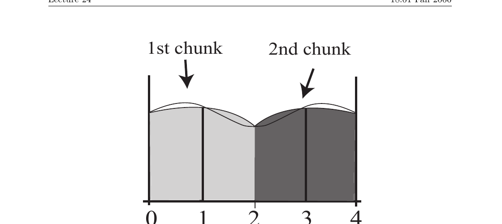

# MIT OCW 18.01 Lecture 24 讲义 · 中文译本

> **编号说明（必读）**：本文件名写作 `OCW_18.01_L22_…`，是为与 Bilibili 合集 **BV1mNgm66EZu · P22**（22-数值积分三大法则）对齐。对应的官方 PDF 实为 Fall 2006 **`lec24.pdf`（Lecture 24: Numerical Integration）**。OCW 课程日历中的 **Lecture 8** 是 Exam 1、**Lecture 17** 是 Exam 2，**都没有**常规讲义 PDF / 本系列课堂录像；故对 \(n\ge16\) 有 Bilibili **P22 ↔ OCW Lecture 24**（Pn ≈ lec\((n+2)\)；更早仅跳过 Exam 1 时为 Pn ↔ lec\((n+1)\)）。课堂口播前半收束飞镖概率、后半三大法则，与讲义（纯数值积分）的差异见同目录 [`MIT1801_L22_课上思路.md`](./MIT1801_L22_课上思路.md) §6。  
> **来源**：https://ocw.mit.edu/courses/18-01-single-variable-calculus-fall-2006/lec24.pdf  
> **课程**：18.01 Single Variable Calculus，Fall 2006  
> **说明**：英文原文具有权威性；本文件为中文学习转写。引用与条款见 http://ocw.mit.edu/terms 。数学式保留 LaTeX；图为 PDF 页渲染裁切，嵌入于对应正文旁。

---

## Lecture 24: Numerical Integration

（第 24 讲：数值积分）

18.01 Fall 2006

---

### Numerical Integration
（数值积分）

我们用**数值积分（numerical integration）**来求形如
\[
\int_a^b(\text{a big mess})
\]
的定积分。当积分没有初等原函数（elementary antiderivative）时，也要求助于数值积分。例如，没有公式给出
\[
\int_0^x\cos(t^{2})\,dt
\quad\text{或}\quad
\int_0^3 e^{-x^{2}}\,dx.
\]
数值积分给出的是**数**，而不是解析表达式。

我们将讨论数值积分的三种技术：**黎曼和（Riemann sums）**、**梯形法则（trapezoidal rule）**，以及 **Simpson 法则（Simpson’s rule）**。

---

### 1. Riemann Sum
（黎曼和）

**Figure 1：** Riemann sum with left endpoints: \((y_0+y_1+\cdots+y_{n-1})\Delta x\).（左端点矩形逼近。）

这里
\[
x_i-x_{i-1}=\Delta x
\quad\text{（或 }x_i=x_{i-1}+\Delta x\text{）},
\]
\[
a=x_0<x_1<x_2<\cdots<x_n=b,
\]
\[
y_0=f(x_0),\ y_1=f(x_1),\ \ldots,\ y_n=f(x_n).
\]

---

### 2. Trapezoidal Rule
（梯形法则）

梯形法则把函数下的区域分成梯形，而不是矩形。梯形面积＝高 × 两平行底边的平均：
\[
\text{Area}=\text{height}\cdot\frac{\text{base 1}+\text{base 2}}{2}
=\frac{y_3+y_4}{2}\,\Delta x
\quad\text{（见图 2）}.
\]

**Figure 2：** \(\text{Area}=\dfrac{y_3+y_4}{2}\,\Delta x\).（宽 \(\Delta x\)、两竖直边 \(y_3,y_4\)。）

**Figure 3：** Trapezoidal rule = sum of areas of trapezoids.（折线连接采样点。）

\[
\begin{aligned}
\text{Total Trapezoidal Area}
&=\Delta x\Biggl(
\frac{y_0+y_1}{2}+\frac{y_1+y_2}{2}+\frac{y_2+y_3}{2}+\cdots+\frac{y_{n-1}+y_n}{2}
\Biggr)\\[4pt]
&=\Delta x\Biggl(
\frac{y_0}{2}+y_1+y_2+\cdots+y_{n-1}+\frac{y_n}{2}
\Biggr).
\end{aligned}
\]

**注：** 梯形法则对两端 \(a\) 与 \(b\) 的处理比黎曼和更对称——它正是**左、右黎曼和的平均**。

---

### 3. Simpson’s Rule
（Simpson 法则）

此法常常比梯形法则精确得多。这里我们用二次式（即抛物线）去贴合图像，而不是水平或倾斜直线。此法要求区间个数为**偶数**。

**Figure 4：** Area under a parabola.（三点 \((x_0,y_0),(x_1,y_1),(x_2,y_2)\)；两格各宽 \(\Delta x\)。）

\[
\text{Area under parabola}
=(\text{base})(\text{weighted average height})
=(2\Delta x)\frac{y_0+4y_1+y_2}{6}.
\]

Simpson 法则用于 \(n\) 个区间（\(n\) 必须为偶数！）：
\[
\begin{aligned}
\text{Area}
&=(2\Delta x)\cdot\frac16\Big[
(y_0+4y_1+y_2)+(y_2+4y_3+y_4)+(y_4+4y_5+y_6)+\cdots+(y_{n-2}+4y_{n-1}+y_n)
\Big].
\end{aligned}
\]

注意系数中的如下模式：
\[
\begin{array}{ccccccc}
1&4&1&&&\\
&&1&4&1&&\\
&&&&1&4&1\\
\hline
1&4&2&4&2&4&1
\end{array}
\]

**Figure 5：** Area given by Simpson’s rule for four intervals.（1st chunk / 2nd chunk。）

Simpson 法则：
\[
\int_a^b f(x)\,dx
\approx
\frac{\Delta x}{3}\bigl(
y_0+4y_1+2y_2+4y_3+2y_4+\cdots+4y_{n-3}+2y_{n-2}+4y_{n-1}+y_n
\bigr).
\]

括号内系数模式：
\[
\begin{aligned}
1\ 4\ 1 &= \text{sum }6,\\
1\ 4\ 2\ 4\ 1 &= \text{sum }12,\\
1\ 4\ 2\ 4\ 2\ 4\ 1 &= \text{sum }18.
\end{aligned}
\]

验算——代入 \(f(x)=1\)（\(n\) 偶数！）：
\[
\frac{\Delta x}{3}\bigl(1+4+2+4+2+\cdots+2+4+1\bigr)
=\frac{\Delta x}{3}\Biggl(
1+1+4\cdot\frac{n}{2}+2\Bigl(\frac{n}{2}-1\Bigr)
\Biggr)
=n\Delta x
\quad(n\text{ even}).
\]

---

### Example 1
（例 1）

用两种数值积分方法（梯形与 Simpson）计算
\[
\int_0^1\frac{1}{1+x^{2}}\,dx.
\]

![Figure 6：\(1/(1+x^{2})\) 在 \([0,1]\) 下的面积](ocw_figs/fig6_one_over_1px2.png)

**Figure 6：** Area under \(\dfrac{1}{1+x^{2}}\) above \([0,1]\).（两格，各宽 \(\Delta x=\tfrac12\)。）

| \(x\) | \(1/(1+x^{2})\) |
|:-----:|:--------------:|
| \(0\) | \(1\) |
| \(\tfrac12\) | \(\tfrac45\) |
| \(1\) | \(\tfrac12\) |

**梯形法则：**
\[
\Delta x\Bigl(\tfrac12 y_0+y_1+\tfrac12 y_2\Bigr)
=\frac12\Bigl(\tfrac12\cdot 1+\tfrac45+\tfrac12\cdot\tfrac12\Bigr)
=\frac12\Bigl(\tfrac12+\tfrac45+\tfrac14\Bigr)
=0.775.
\]

**Simpson 法则：**
\[
\frac{\Delta x}{3}(y_0+4y_1+y_2)
=\frac{1/2}{3}\Bigl(1+4\cdot\tfrac45+\tfrac12\Bigr)
=0.78333\ldots
\]

**精确答案：**
\[
\int_0^1\frac{1}{1+x^{2}}\,dx
=\tan^{-1}x\Big|_0^1
=\tan^{-1}1-\tan^{-1}0
=\frac{\pi}{4}-0
=\frac{\pi}{4}\approx 0.785.
\]

粗略地说，误差 \(\lvert\text{Simpson’s}-\text{Exact}\rvert\) 的量级为 \((\Delta x)^4\)。
