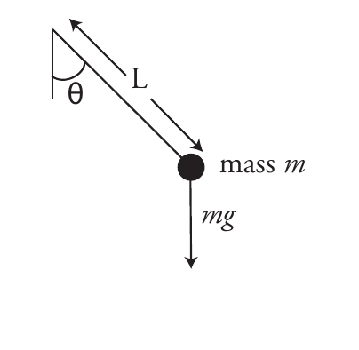
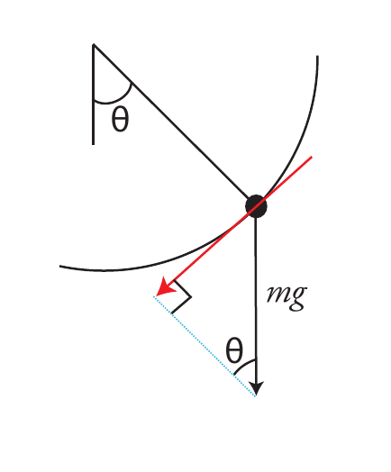
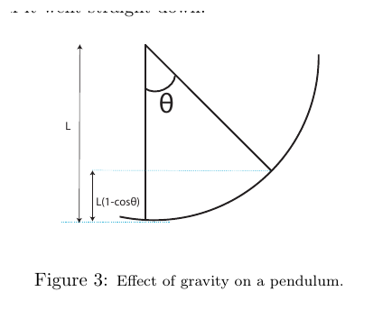

# MIT OCW 18.01 Lecture 25 讲义 · 中文译本

> **编号说明（必读）**：本文件名写作 `OCW_18.01_L23_…`，是为与 Bilibili 合集 **BV1mNgm66EZu · P23**（23-考前复习：体积与数值积分）对齐。对应的官方 PDF 实为 Fall 2006 **`lec25.pdf`（Lecture 25: Exam 3 Review）**。OCW 课程日历中的 **Lecture 8** 是 Exam 1、**Lecture 17** 是 Exam 2，**都没有**常规讲义 PDF / 本系列课堂录像；故对 \(n\ge16\) 有 Bilibili **P23 ↔ OCW Lecture 25**（Pn ≈ lec\((n+2)\)；更早仅跳过 Exam 1 时为 Pn ↔ lec\((n+1)\)）。课堂口播先收束数值例与高斯常数、再发 Exam 清单并答疑，与讲义（清单 + 摆锤功）的差异见同目录 [`MIT1801_L23_课上思路.md`](./MIT1801_L23_课上思路.md) §6。  
> **来源**：https://ocw.mit.edu/courses/18-01-single-variable-calculus-fall-2006/lec25.pdf  
> **课程**：18.01 Single Variable Calculus，Fall 2006  
> **说明**：英文原文具有权威性；本文件为中文学习转写。引用与条款见 http://ocw.mit.edu/terms 。数学式保留 LaTeX；图为 PDF 页渲染裁切，嵌入于对应正文旁。

---

## Lecture 25: Exam 3 Review

（第 25 讲：第三次考试复习）

18.01 Fall 2006

---

### Integration
（积分）

1. **求定积分（Evaluate definite integrals）**。换元（Substitution）、微积分基本定理第一式（first fundamental theorem of calculus, **FTC 1**），（以及提示？）
2. **FTC 2：**
   \[
   \frac{d}{dx}\int_{a}^{x} f(t)\,dt = f(x).
   \]
   若 \(F(x)=\displaystyle\int_{a}^{x} f(t)\,dt\)，求 \(F\) 的图像、估计 \(F\)，并做换元（change variables）。
3. **黎曼和（Riemann sums）**；梯形法则（trapezoidal rule）与 Simpson 法则（Simpson’s rule）。
4. **面积、体积（Areas, volumes）**。
5. **其它累积和（Other cumulative sums）**：平均值（average value）、概率（probability）、功（work）等。

体积问题有两类：

1. **旋转体（solids of revolution）**
2. **其它（用切片做，do by slices）**

这类题里总有某样东西可以先在二维画出来，从而看清那个平面里发生了什么。

旋转体问题中，立体由绕 \(x\) 轴或 \(y\) 轴旋转而成。你必须决定如何切开立体：用**壳层（shells）**还是**圆盘／垫圈（disks / washers）**。换言之，必须决定对 \(dx\) 还是对 \(dy\) 积分。做出选择之后，其余步骤就系统地确定了。例如，考虑绕 \(y\) 轴旋转的形状：

- **壳层（Shells）**：高 \(y_2-y_1\)，周长 \(2\pi x\)，厚 \(dx\)
- **圆盘／垫圈（Disks / washers）**：面积 \(\pi x^{2}\)（或 \(\pi x_2^{2}-\pi x_1^{2}\)），厚 \(dy\)；对 \(dy\) 积分。

---

### Work
（功）

\[
\text{Work} = \text{Force}\cdot\text{Distance}
\quad\text{（功＝力·距离）}
\]

若力是**可变的（variable）**，就需要用积分。

---

### Example 1: Pendulum
（例 1：摆锤）

见图 1。考虑长为 \(L\)、质量为 \(m\)、摆角为 \(\theta\) 的单摆。重力竖直向下为 \(mg\)（\(g=\) 地球表面重力加速度）。

**Figure 1：** Pendulum.（摆锤：臂长 \(L\)、摆角 \(\theta\)、质量 \(m\)、重力 \(mg\)。）

在图 2 中，我们求出沿摆路径切向的重力分量
\[
F = mg\sin\theta.
\]

**Figure 2：** \(F = mg\sin\theta\)（force tangent to path of motion）。（沿运动路径的切向力。）

有没有可能造出永动机（perpetual motion machine）？想一想简单的单摆：重力把摆从 \(\theta_0\) 拉到弧底时做了多少功。

注意 \(F\) 是变化的。这正是本题必须用积分的原因。
\[
W=\int_{0}^{\theta_0}(\text{Force})\cdot(\text{Distance})
=\int_{0}^{\theta_0}(mg\sin\theta)\,(L\,d\theta)
\]
\[
W=-Lmg\cos\theta\Big|_{0}^{\theta_0}
=-Lmg(\cos\theta_0-1)
=mg\bigl[L(1-\cos\theta_0)\bigr].
\]

在图 3 中可见：重力把摆向下移动距离 \(L(1-\cos\theta)\) 所做的功，与竖直下落同一高度时相同。

**Figure 3：** Effect of gravity on a pendulum.（竖直落差 \(L(1-\cos\theta)\)。）

换言之，所需功的大小**只取决于摆下降了多远**；与路径无关。所以没有免费的（能量）午餐，也没有永动机。
