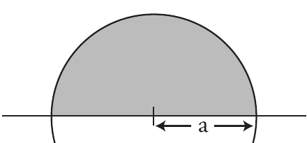
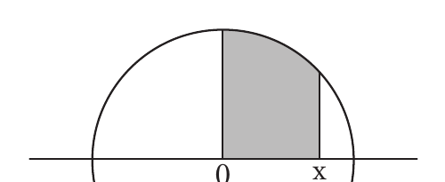

# MIT OCW 18.01 Lecture 26 讲义 · 中文译本

> **编号说明（必读）**：本文件名写作 `OCW_18.01_L24_…`，是为与 Bilibili 合集 **BV1mNgm66EZu · P24**（24-三角积分与换元）对齐。对应的官方 PDF 实为 Fall 2006 **`lec26.pdf`（Lecture 26: Trigonometric Integrals and Substitution）**。OCW 课程日历中的 **Lecture 8** 是 Exam 1、**Lecture 17** 是 Exam 2，**都没有**常规讲义 PDF / 本系列课堂录像；故对 \(n\ge16\) 有 Bilibili **P24 ↔ OCW Lecture 26**（Pn ≈ lec\((n+2)\)；更早仅跳过 Exam 1 时为 Pn ↔ lec\((n+1)\)）。OCW **视频页**或标为 Lecture 27，但笔记文件为 **lec26.pdf**；日历 **Lecture 27 = Exam 3**（讲义末句：下次接 Lecture 28）。课堂口播（Miller 代课：奇/偶 \(\sin^{n}\cos^{m}\) + 高度 \(b\) 圆片面积）与讲义（另含 \(\sec/\tan\) 族、竖直阴影区例）的差异见同目录 [`MIT1801_L24_课上思路.md`](./MIT1801_L24_课上思路.md) §6。  
> **来源**：https://ocw.mit.edu/courses/18-01-single-variable-calculus-fall-2006/lec26.pdf  
> **课程**：18.01 Single Variable Calculus，Fall 2006  
> **说明**：英文原文具有权威性；本文件为中文学习转写。引用与条款见 http://ocw.mit.edu/terms 。数学式保留 LaTeX；图为 PDF 页渲染裁切，嵌入于对应正文旁。

---

## Lecture 26: Trigonometric Integrals and Substitution

（第 26 讲：三角积分与换元）

18.01 Fall 2006

---

### Trigonometric Integrals
（三角积分）

如何积分形如
\[
\int \sin^{n}x\cos^{m}x\,dx
\]
的表达式？（\(n=0,1,2,\ldots\) 且 \(m=0,1,2,\ldots\)）

我们已经知道：
\[
\int\sin x\,dx=-\cos x+c
\qquad\text{以及}\qquad
\int\cos x\,dx=\sin x+c.
\]

---

### Method A
（方法 A）

假设 \(n\) 或 \(m\) **有一个为奇数（odd）**。

**Example 1.** \(\displaystyle\int\sin^{3}x\cos^{2}x\,dx\)。

策略：用 \(\sin^{2}x+\cos^{2}x=1\) 把积分改写成
\[
\int\sin^{3}x\cos^{2}x\,dx=\int f(\cos x)\,\sin x\,dx
\]
的形式。的确，
\[
\int\sin^{3}x\cos^{2}x\,dx
=\int\sin^{2}x\cos^{2}x\sin x\,dx
=\int(1-\cos^{2}x)\cos^{2}x\sin x\,dx.
\]

接着用代换
\[
u=\cos x,\qquad du=-\sin x\,dx.
\]
于是
\[
\int(1-\cos^{2}x)\cos^{2}x\sin x\,dx
=\int(1-u^{2})u^{2}(-du)
=\int(-u^{2}+u^{4})\,du
=-\frac{u^{3}}{3}+\frac{u^{5}}{5}+c
=-\frac13\cos^{3}x+\frac15\cos^{5}x+c.
\]

**Example 2.**
\[
\int\cos^{3}x\,dx
=\int f(\sin x)\,\cos x\,dx
=\int(1-\sin^{2}x)\cos x\,dx.
\]

同样做代换：
\[
u=\sin x,\qquad du=\cos x\,dx,
\]
\[
\int\cos^{3}x\,dx=\int(1-u^{2})\,du
=u-\frac{u^{3}}{3}+c
=\sin x-\frac{\sin^{3}x}{3}+c.
\]

---

### Method B
（方法 B）

此法要求 \(m\) 与 \(n\) **都是偶数（even）**。需要用到倍角公式，例如
\[
\cos^{2}x=\frac{1+\cos 2x}{2}.
\]
（回忆 \(\cos 2x=\cos^{2}x-\sin^{2}x=\cos^{2}x-(1-\cos^{2}x)=2\cos^{2}x-1\)。）

积分得
\[
\int\cos^{2}x\,dx=\int\frac{1+\cos 2x}{2}\,dx
=\frac{x}{2}+\frac{\sin(2x)}{4}+c.
\]

对 \(\sin^{2}x\) 可做类似处理：
\[
\sin^{2}x=\frac{1-\cos(2x)}{2},
\]
\[
\int\sin^{2}x\,dx=\int\frac{1-\cos(2x)}{2}\,dx
=\frac{x}{2}-\frac{\sin(2x)}{4}+c.
\]

对此类问题的完整策略是：不断使用 Method B，直到能使用 Method A（当 \(m\) 或 \(n\) 之一变为奇数时）。

**Example 3.** \(\displaystyle\int\sin^{2}x\cos^{2}x\,dx\)。

两次使用 Method B 得到
\[
\int\Bigl(\frac{1-\cos 2x}{2}\Bigr)\Bigl(\frac{1+\cos 2x}{2}\Bigr)dx
=\int\Bigl(\frac14-\frac14\cos^{2}2x\Bigr)dx
=\int\Bigl(\frac14-\frac18(1+\cos 4x)\Bigr)dx
=\frac{x}{8}-\frac{1}{32}\sin 4x+c.
\]

Example 3 有一条捷径。因为 \(\sin 2x=2\sin x\cos x\)，
\[
\int\sin^{2}x\cos^{2}x\,dx
=\int\Bigl(\frac12\sin 2x\Bigr)^{2}dx
=\int\frac14\cdot\frac{1-\cos 4x}{2}\,dx
\]
——与上面相同。

---

下一族三角积分，今天会开始但讲不完：
\[
\int\sec^{n}x\tan^{m}x\,dx
\quad\text{其中 }n=0,1,2,\ldots\text{ 且 }m=0,1,2,\ldots.
\]

记住
\[
\sec^{2}x=1+\tan^{2}x,
\]
可写成
\[
\frac{1}{\cos^{2}x}=1+\frac{\sin^{2}x}{\cos^{2}x}=\frac{\cos^{2}x+\sin^{2}x}{\cos^{2}x}
\]
来核对。并且
\[
\int\sec^{2}x\,dx=\tan x+c,
\qquad
\int\sec x\tan x\,dx=\sec x+c.
\]

---

为了算 \(\tan x\) 的积分，写成
\[
\int\tan x\,dx=\int\frac{\sin x}{\cos x}\,dx.
\]
令 \(u=\cos x\)，\(du=-\sin x\,dx\)，则
\[
\int\tan x\,dx=\int\frac{\sin x}{\cos x}\,dx=-\int\frac{du}{u}=-\ln|u|+c,
\]
故
\[
\int\tan x\,dx=-\ln|\cos x|+c.
\]
（\(\int\sec x\,dx\) 我们稍后再弄清楚。）

---

现在看 **secant 的偶次幂**（\(n\) 为偶的情形）。
\[
\int\sec^{4}x\,dx
=\int f(\tan x)\,\sec^{2}x\,dx
=\int(1+\tan^{2}x)\sec^{2}x\,dx.
\]

做代换
\[
u=\tan x,\qquad du=\sec^{2}x\,dx:
\]
\[
\int\sec^{4}x\,dx=\int(1+u^{2})\,du
=u+\frac{u^{3}}{3}+c
=\tan x+\frac{\tan^{3}x}{3}+c.
\]

---

当 **tangent 为奇次幂**时（\(m\) 为奇的情形）会怎样？
\[
\int\tan^{3}x\sec x\,dx
=\int f(\sec x)\,d(\sec x)
=\int(\sec^{2}x-1)\sec x\tan x\,dx.
\]
（记住 \(\sec^{2}x-1=\tan^{2}x\)。）

代换：
\[
u=\sec x,\qquad du=\sec x\tan x\,dx.
\]
则
\[
\int\tan^{3}x\sec x\,dx=\int(u^{2}-1)\,du
=\frac{u^{3}}{3}-u+c
=\frac{\sec^{3}x}{3}-\sec x+c.
\]

---

再做一个最终情形：\(n=1\)，\(m=0\)
\[
\int\sec x\,dx=\ln|\tan x+\sec x|+c.
\]

我们靠「高级猜测（advanced guessing）」，也就是「事先知道答案」得到它：
\[
\int\sec x\,dx
=\int\sec x\cdot\frac{\sec x+\tan x}{\sec x+\tan x}\,dx
=\int\frac{\sec^{2}x+\sec x\tan x}{\tan x+\sec x}\,dx.
\]

代换
\[
u=\tan x+\sec x,
\qquad
du=(\sec^{2}x+\sec x\tan x)\,dx,
\]
给出
\[
\int\sec x\,dx=\int\frac{du}{u}=\ln|u|+c=\ln|\tan x+\sec x|+c.
\]

像 \(n=3,\,m=0\)，或更一般地 \(n\) 奇且 \(m\) 偶的情形更复杂，以后再讨论。

---

### Trigonometric Substitution
（三角换元）

会算上述三角积分，对求含平方根的积分很有用。

**Example 4.** \(y=\sqrt{a^{2}-x^{2}}\)。

**Figure 1：** Graph of the circle \(x^{2}+y^{2}=a^{2}\).（圆 \(x^{2}+y^{2}=a^{2}\)；上半圆阴影。）

我们已经知道上半圆盘的面积是
\[
\int_{-a}^{a}\sqrt{a^{2}-x^{2}}\,dx=\frac{\pi a^{2}}{2}.
\]

---

若想求下面这块面积呢？

**Figure 2：** Area to be evaluated is shaded.（从 \(0\) 到横坐标 \(x\)、曲线下的阴影区。）

为此需要计算积分
\[
\int_{t=0}^{t=x}\sqrt{a^{2}-t^{2}}\,dt.
\]

令 \(t=a\sin u\)，\(dt=a\cos u\,du\)。（换元时记住同时改积分限。）

于是
\[
a^{2}-t^{2}=a^{2}-a^{2}\sin^{2}u=a^{2}\cos^{2}u;
\qquad
\sqrt{a^{2}-t^{2}}=a\cos u.
\]

代入积分得
\[
\int_{0}^{x}\sqrt{a^{2}-t^{2}}\,dt
=\int(a\cos u)\,a\cos u\,du
=a^{2}\int_{u=0}^{u=\sin^{-1}(x/a)}\cos^{2}u\,du.
\]

新积分限这样算：
\[
\begin{aligned}
t=0 &\implies a\sin u=0\implies u=0,\\
t=x &\implies a\sin u=x\implies u=\sin^{-1}(x/a).
\end{aligned}
\]

\[
\int_{0}^{x}\sqrt{a^{2}-t^{2}}\,dt
=a^{2}\int_{0}^{\sin^{-1}(x/a)}\cos^{2}u\,du
=a^{2}\Biggl[\frac{u}{2}+\frac{\sin 2u}{4}\Biggr]_{0}^{\sin^{-1}(x/a)}
\]
\[
=\frac{a^{2}\sin^{-1}(x/a)}{2}
+\frac{a^{2}}{4}\Bigl(2\sin\bigl(\sin^{-1}(x/a)\bigr)\cos\bigl(\sin^{-1}(x/a)\bigr)\Bigr).
\]
（记住 \(\sin 2u=2\sin u\cos u\)。）

我们将在下一次课从这里继续（**Lecture 28**，因为 **Lecture 27 是 Exam 3**）。
