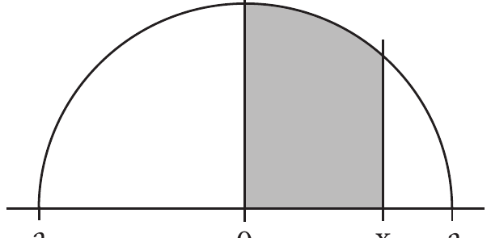
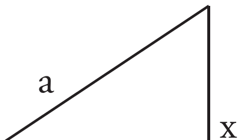
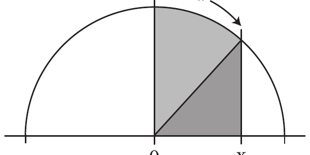
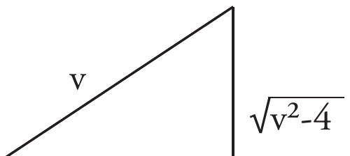

# MIT OCW 18.01 Lecture 28 讲义 · 中文译本

> **编号说明（必读）**：本文件名写作 `OCW_18.01_L25_…`，是为与 Bilibili 合集 **BV1mNgm66EZu · P25**（25-逆代换与配方法）对齐。对应的官方 PDF 实为 Fall 2006 **`lec28.pdf`（Lecture 28: Integration by Inverse Substitution; Completing the Square）**。OCW 课程日历中的 **Lecture 8** 是 Exam 1、**Lecture 17** 是 Exam 2、**Lecture 27** 是 Exam 3，**都没有**常规讲义 PDF / 本系列课堂录像（lec27 为空桩／Exam stub）；故对 \(n\ge16\) 有 Bilibili **P25 ↔ OCW Lecture 28**（Pn ≈ lec\((n+2)\)；跳过空的 lec27）。课堂口播（Miller 代课：先补 \(\sec/\tan\) 族与难例 \(1/(x^{2}\sqrt{1+x^{2}})\)，再配方）与讲义（续完半圆竖直阴影区 + 配方 + 有理函数预告）的差异见同目录 [`MIT1801_L25_课上思路.md`](./MIT1801_L25_课上思路.md) §6。  
> **来源**：https://ocw.mit.edu/courses/18-01-single-variable-calculus-fall-2006/lec28.pdf  
> **课程**：18.01 Single Variable Calculus，Fall 2006  
> **说明**：英文原文具有权威性；本文件为中文学习转写。引用与条款见 http://ocw.mit.edu/terms 。数学式保留 LaTeX；图为 PDF 页渲染裁切，嵌入于对应正文旁。

---

## Lecture 28: Integration by Inverse Substitution; Completing the Square

（第 28 讲：逆代换积分；配方法）

18.01 Fall 2006

---

### Trigonometric Substitutions, continued
（三角换元，续）

**Figure 1：** Find area of shaded portion of semicircle.（求半圆阴影部分的面积；从 \(0\) 到横坐标 \(x\)。）

\[
\int_{0}^{x}\sqrt{a^{2}-t^{2}}\,dt.
\]

令
\[
t=a\sin u,\qquad dt=a\cos u\,du.
\]
则
\[
a^{2}-t^{2}=a^{2}-a^{2}\sin^{2}u=a^{2}\cos^{2}u
\quad\Longrightarrow\quad
\sqrt{a^{2}-t^{2}}=a\cos u
\]
（再也没有平方根了！）

起：\(x=-a\Leftrightarrow u=-\pi/2\)；迄：\(x=a\Leftrightarrow u=\pi/2\)。

\[
\int\sqrt{a^{2}-t^{2}}\,dt
=\int a^{2}\cos^{2}u\,du
=a^{2}\int\frac{1+\cos(2u)}{2}\,du
=a^{2}\Bigl(\frac{u}{2}+\frac{\sin(2u)}{4}\Bigr)+c.
\]

（回忆 \(\displaystyle\cos^{2}u=\frac{1+\cos(2u)}{2}\)。）

我们要把结果用 \(x\) 而不是 \(u\) 表示。当 \(t=0\) 时，\(a\sin u=0\)，故 \(u=0\)；当 \(t=x\) 时，\(a\sin u=x\)，故 \(u=\sin^{-1}(x/a)\)。

\[
\frac{\sin(2u)}{4}=\frac{2\sin u\cos u}{4}=\frac12\sin u\cos u,
\qquad
\sin u=\sin\bigl(\sin^{-1}(x/a)\bigr)=\frac{x}{a}.
\]

---

如何求 \(\cos u=\cos\bigl(\sin^{-1}(x/a)\bigr)\)？答：用直角三角形（Figure 2）。

**Figure 2：** \(\sin u=x/a\)；\(\cos u=\sqrt{a^{2}-x^{2}}/a\)。（斜边 \(a\)，对边 \(x\)，邻边 \(\sqrt{a^{2}-x^{2}}\)。）

由图形可见
\[
\cos u=\frac{\sqrt{a^{2}-x^{2}}}{a}.
\]

最终
\[
\int_{0}^{x}\sqrt{a^{2}-t^{2}}\,dt
=a^{2}\Biggl[\frac{u}{2}+\frac12\sin u\cos u\Biggr]_{0}^{\sin^{-1}(x/a)}
=\frac{a^{2}}{2}\sin^{-1}\Bigl(\frac{x}{a}\Bigr)+\frac{1}{2}\,x\sqrt{a^{2}-x^{2}}.
\]

答案如此复杂时，到达它的路径也必然复杂——复杂性无法回避。

来双检这个答案。Figure 3 中上方阴影扇形的面积是 \(\dfrac12 a^{2}u\)。下方阴影区是高 \(\sqrt{a^{2}-x^{2}}\)、底 \(x\) 的三角形，面积 \(\dfrac12 x\sqrt{a^{2}-x^{2}}\)。

**Figure 3：** Area divided into a sector and a triangle.（面积分为扇形与三角形。）

---

下面是可用三角换元与三角恒等式计算的一批积分：

| 积分 | 代换 | 三角恒等式 |
|---|---|---|
| \(\displaystyle\int\frac{dx}{\sqrt{x^{2}+1}}\) | \(x=\tan u\) | \(\tan^{2}u+1=\sec^{2}u\) |
| \(\displaystyle\int\frac{dx}{\sqrt{x^{2}-1}}\) | \(x=\sec u\) | \(\sec^{2}u-1=\tan^{2}u\) |
| \(\displaystyle\int\frac{dx}{\sqrt{1-x^{2}}}\) | \(x=\sin u\) | \(1-\sin^{2}u=\cos^{2}u\) |

再推广一步。如何计算这样的积分？
\[
\int\frac{dx}{\sqrt{x^{2}+4x}}.
\]
当平方根下同时有一次项与二次项时，**配方（complete the square）**。

\[
x^{2}+4x=(\text{something})^{2}\pm\text{constant}.
\]

本例：
\[
(x+2)^{2}=x^{2}+4x+4
\quad\Longrightarrow\quad
x^{2}+4x=(x+2)^{2}-4.
\]

做代换
\[
v=x+2,\qquad dv=dx.
\]
代入得
\[
\int\frac{dx}{\sqrt{(x+2)^{2}-4}}
=\int\frac{dv}{\sqrt{v^{2}-4}}.
\]

再令
\[
v=2\sec u,\qquad dv=2\sec u\tan u\,du.
\]
\[
\int\frac{dv}{\sqrt{v^{2}-4}}
=\int\frac{2\sec u\tan u\,du}{2\tan u}
=\int\sec u\,du.
\]

---

记住
\[
\int\sec u\,du=\ln|\sec u+\tan u|+c.
\]

最后全部改回用 \(x\) 表示。
\[
v=2\sec u\quad\Longleftrightarrow\quad\cos u=\frac{2}{v}.
\]
按 Figure 4 设立直角三角形，用 \(v\) 表示 \(\tan u\)。

**Figure 4：** \(\sec u=v/2\) 或 \(\cos u=2/v\)。（斜边 \(v\)，邻边 \(2\)，对边 \(\sqrt{v^{2}-4}\)。）

直接从三角形读出
\[
\sec u=\frac{v}{2},\qquad
\tan u=\frac{\sqrt{v^{2}-4}}{2}.
\]
于是
\[
\int\sec u\,du
=\ln\Bigl|\frac{v}{2}+\frac{\sqrt{v^{2}-4}}{2}\Bigr|+c
=\ln\bigl|v+\sqrt{v^{2}-4}\bigr|-\ln 2+c.
\]
后两项可并入另一个常数 \(\tilde c\)。
\[
\int\frac{dx}{\sqrt{x^{2}+4x}}
=\ln\bigl|x+2+\sqrt{x^{2}+4x}\bigr|+\tilde c.
\]

---

给下次留个引子。下一讲将对**所有有理函数**积分。所谓有理函数，指多项式之比：
\[
\frac{P(x)}{Q(x)}.
\]

这样的式子容易积：
\[
\int\Bigl(\frac{1}{x-1}+\frac{3}{x+2}\Bigr)dx
=\ln|x-1|+3\ln|x+2|+c.
\]

若改写成另一种样子，积分就难多了：
\[
\frac{1}{x-1}+\frac{3}{x+2}
=\frac{x+2+3(x-1)}{(x-1)(x+2)}
=\frac{4x-1}{x^{2}+x-2},
\]
\[
\int\frac{4x-1}{x^{2}+x-2}\,dx=\ ???
\]
从 \(\frac{4x-1}{x^{2}+x-2}\) 出发该如何重组？下次再看——需要一点代数。
