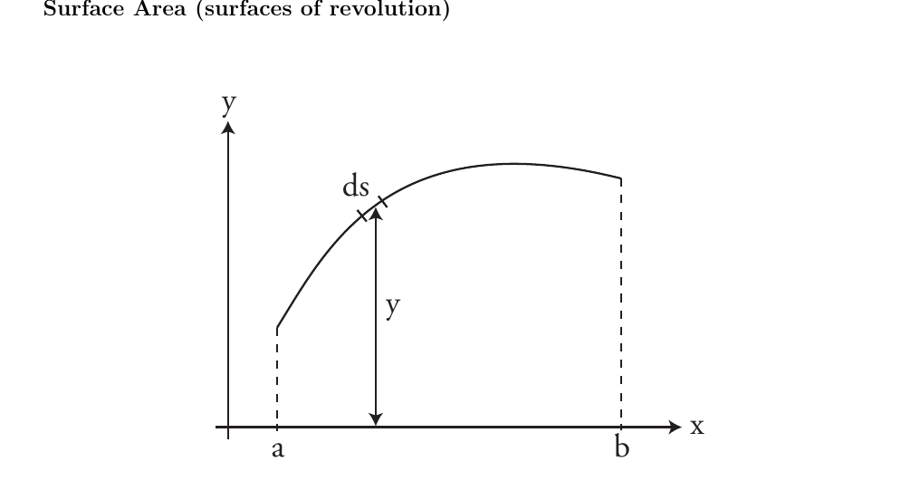
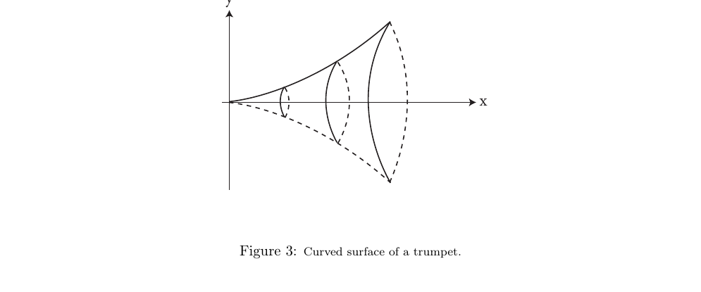
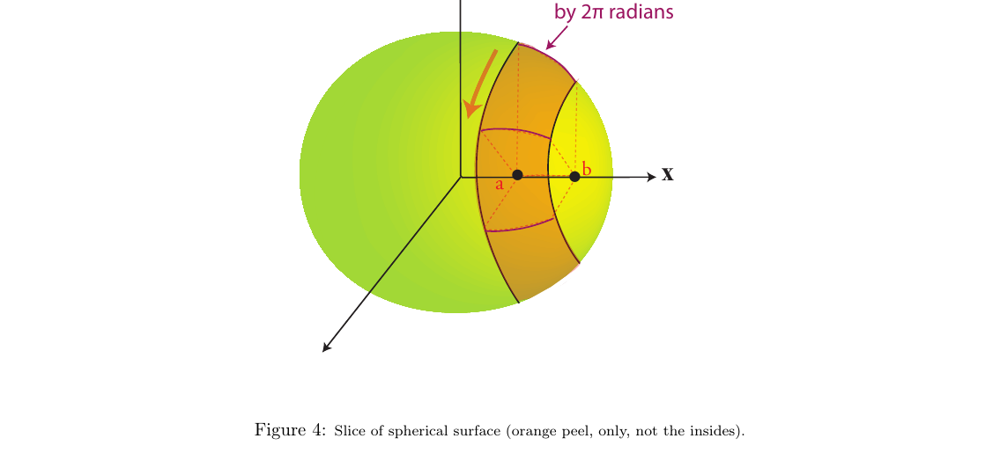

# MIT OCW 18.01 Lecture 31 讲义 · 中文译本

> **编号说明（必读）**：本文件名写作 `OCW_18.01_L28_…`，是为与 Bilibili 合集 **BV1mNgm66EZu · P28**（28-参数方程、弧长与曲面）对齐。对应的官方 PDF 实为 Fall 2006 **`lec31.pdf`（Lecture 31: Parametric Equations, Arclength, Surface Area）**。OCW 课程日历中的 **Lecture 8** 是 Exam 1、**Lecture 17** 是 Exam 2、**Lecture 27** 是 Exam 3，**都没有**常规讲义 PDF / 本系列课堂录像（lec27 为空桩／Exam stub）；故对 \(n\ge16\) 有 Bilibili **P28 ↔ OCW Lecture 31**（Pn ≈ lec\((n+2)\)；跳过空的 lec27）。课堂口播（Jerison：弧长定义／圆与弧度／抛物线／旋转面／球／参数圆）与讲义的差异见同目录 [`MIT1801_L28_课上思路.md`](./MIT1801_L28_课上思路.md) §6。  
> **来源**：https://ocw.mit.edu/courses/18-01-single-variable-calculus-fall-2006/lec31.pdf  
> **课程**：18.01 Single Variable Calculus，Fall 2006  
> **说明**：英文原文具有权威性；本文件为中文学习转写。引用与条款见 http://ocw.mit.edu/terms 。数学式保留 LaTeX；图为 PDF 页渲染裁切，嵌入于对应正文旁。**本文件转写 lec31.pdf 全文（notes pp.1–4；`ocw_pages/page-2.png`…`page-5.png`）**。前一包 `lec30.pdf` 后半 Arc Length／Parametric 的 Figure 1–8（圆、弧度、椭圆等）属同一话题链、视频多有涉及，裁于 `ocw_figs/fig_lec30_*.png`，**不在本文正文转写**（见 README 与 [`MIT1801_L28_课上思路.md`](./MIT1801_L28_课上思路.md) §6）。

---

## Lecture 31: Parametric Equations, Arclength, Surface Area

（第 31 讲：参数方程、弧长与曲面面积）

18.01 Fall 2006

---

### Arclength, continued（弧长，续）

#### Example 1.

考虑参数方程

\[
x=t^{2},\qquad y=t^{3}\qquad\text{for }0\le t\le 1.
\]

消参：

\[
x^{3}=(t^{2})^{3}=t^{6},\qquad y^{2}=(t^{3})^{2}=t^{6}
\implies x^{3}=y^{2}\implies y=x^{2/3},\qquad 0\le x\le 1.
\]

**Figure 1: Infinitesimal Arclength（无穷小弧长）。**

\[
(ds)^{2}=(dx)^{2}+(dy)^{2}.
\]

代入 \(dx=2t\,dt\)，\(dy=3t^{2}\,dt\)：

\[
(ds)^{2}=(2t\,dt)^{2}+(3t^{2}\,dt)^{2}=(4t^{2}+9t^{4})(dt)^{2}.
\]

于是

\[
\begin{aligned}
\text{Length}
&=\int_{t=0}^{t=1}ds
=\int_{0}^{1}\sqrt{4t^{2}+9t^{4}}\,dt
=\int_{0}^{1}t\sqrt{4+9t^{2}}\,dt\\
&=\left.\frac{(4+9t^{2})^{3/2}}{27}\right|_{0}^{1}
=\frac{1}{27}\bigl(13^{3/2}-4^{3/2}\bigr).
\end{aligned}
\]

即使无法解析求出积分，也总可以用数值方法。

---

### Surface Area (surfaces of revolution)（曲面面积／旋转曲面）

**Figure 2: Calculating surface area（计算曲面面积）。**

图 2 中的无穷小弧段 \(ds\) 绕轴旋转的路程为 \(2\pi y\)。宽为 \(ds\) 的薄带曲面面积为 \(2\pi y\,ds\)。

#### Example 2.

将 Example 1（\(x=t^{2},\;y=t^{3},\;0\le t\le 1\)）绕 \(x\) 轴旋转。参见 Figure 3。

**Figure 3: Curved surface of a trumpet（喇叭状曲面）。**

\[
\begin{aligned}
\text{Area}
&=\int 2\pi y\,ds
=\int_{0}^{1}2\pi\,\underbrace{t^{3}}_{y}\,\underbrace{t\sqrt{4+9t^{2}}\,dt}_{ds}
=2\pi\int_{0}^{1}t^{4}\sqrt{4+9t^{2}}\,dt.
\end{aligned}
\]

下面讨论如何计算

\[
\int t^{4}(4+9t^{2})^{1/2}\,dt.
\]

（可先忽略因子 \(2\pi\)，算完后再乘回去。）用三角换元

\[
t=\frac{2}{3}\tan u,\qquad
dt=\frac{2}{3}\sec^{2}u\,du,\qquad
\tan^{2}u+1=\sec^{2}u.
\]

合起来：

\[
\begin{aligned}
\int t^{4}(4+9t^{2})^{1/2}\,dt
&=\int\Bigl(\frac{2}{3}\tan u\Bigr)^{4}
\Bigl(4+9\cdot\frac{4}{9}\tan^{2}u\Bigr)^{1/2}
\cdot\frac{2}{3}\sec^{2}u\,du\\
&=\Bigl(\frac{2}{3}\Bigr)^{5}\int\tan^{4}u\,(2\sec u)\,(\sec^{2}u\,du).
\end{aligned}
\]

这是 \(\tan\)–\(\sec\) 型积分，可做，但算完全部很花时间。此处不再继续。

---

#### Example 3. 单位球面的表面积

用已学内容求单位球面的表面积（见 Figure 4）。

**Figure 4: Slice of spherical surface (orange peel, only, not the insides)（球面切片：只取橘皮，不要瓤）。**

上半球：

\[
y=\sqrt{1-x^{2}}.
\]

求 \(x=a\) 到 \(x=b\) 之间球面切片的面积：

\[
A=\int_{x=a}^{x=b}2\pi y\,ds.
\]

由上次（弧长计算），

\[
ds=\frac{dx}{\sqrt{1-x^{2}}}.
\]

代入后得到异常简单的公式：

\[
A=\int_{a}^{b}2\pi\sqrt{1-x^{2}}\cdot\frac{dx}{\sqrt{1-x^{2}}}
=\int_{a}^{b}2\pi\,dx
=2\pi(b-a).
\]

##### Special Cases（特例）

- **整个单位球面**：\(a=-1\)，\(b=1\)。

\[
2\pi\bigl(1-(-1)\bigr)=4\pi
\]

即单位球面的表面积。

- **半球**：\(a=0\)，\(b=1\)。

\[
2\pi(1-0)=2\pi.
\]

---

> **（相关前序讲义）** 弧长定义、单位圆弧度、参数圆 \(x=a\cos t,\;y=a\sin t\)、椭圆 \(x=2\sin t,\;y=\cos t\) 等图示出现在 **`lec30.pdf` 后半**（Figure 1–8）。Bilibili P28 课堂大量讲了其中圆／弧度／参数圆内容，但正式伴读 PDF 为本文件的 **lec31.pdf**；那些图裁于 `ocw_figs/fig_lec30_*.png`，正文见同目录 [`MIT1801_L28_课上思路.md`](./MIT1801_L28_课上思路.md)。
