# MIT OCW 18.01 Lecture 32 讲义 · 中文译本

> **编号说明（必读）**：本文件名写作 `OCW_18.01_L29_…`，是为与 Bilibili 合集 **BV1mNgm66EZu · P29**（29-极坐标与弧长）对齐。对应的官方 PDF 实为 Fall 2006 **`lec32.pdf`（Lecture 32: Polar Co-ordinates, Area in Polar Co-ordinates）**。OCW 课程日历中的 **Lecture 8** 是 Exam 1、**Lecture 17** 是 Exam 2、**Lecture 27** 是 Exam 3、**Lecture 33** 是 Exam 4，**都没有**常规讲义 PDF / 本系列课堂录像（相关考试为空桩／Exam stub）；故对 \(n\ge16\) 有 Bilibili **P29 ↔ OCW Lecture 32**（Pn ≈ lec\((n+2)\)；跳过空的 lec27）。课堂口播（Jerison：片头续参数弧长／椭圆／椭球面，后半极坐标入门，面积留下次）与讲义的差异见同目录 [`MIT1801_L29_课上思路.md`](./MIT1801_L29_课上思路.md) §6。  
> **来源**：https://ocw.mit.edu/courses/18-01-single-variable-calculus-fall-2006/lec32.pdf  
> **课程**：18.01 Single Variable Calculus，Fall 2006  
> **说明**：英文原文具有权威性；本文件为中文学习转写。引用与条款见 http://ocw.mit.edu/terms 。数学式保留 LaTeX；图为 PDF 页渲染裁切，嵌入于对应正文旁。**本文件转写 lec32.pdf 全文（notes pp.1–7；`ocw_pages/page-2.png`…`page-8.png`）**。

---

## Lecture 32: Polar Co-ordinates, Area in Polar Co-ordinates

（第 32 讲：极坐标、极坐标下的面积）

18.01 Fall 2006

---

### Polar Coordinates（极坐标）

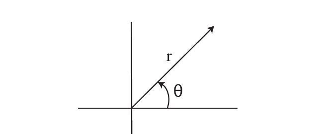

**Figure 1: Polar Co-ordinates（极坐标）。**

在极坐标中，我们用物体到原点的距离 \(r\)，以及从原点到该点的射线与 \(x\) 轴所成的角 \(\theta\)，来指定其位置。

#### Example 1.

直角坐标为 \((1,-1)\) 的点，其极坐标是什么？

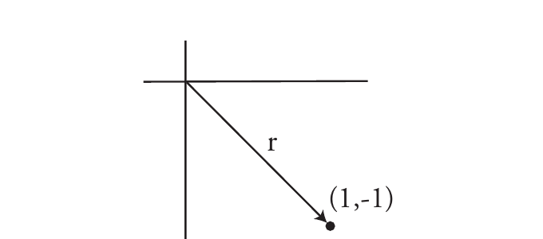

**Figure 2: Rectangular Co-ordinates to Polar Co-ordinates（直角坐标到极坐标）。**

\[
r=\sqrt{1^{2}+(-1)^{2}}=\sqrt{2},\qquad
\theta=-\frac{\pi}{4}.
\]

多数情形采用约定 \(r\ge 0\) 且 \(0\le\theta\le 2\pi\)。另一常见约定是 \(r\ge 0\) 且 \(-\pi\le\theta\le\pi\)。一切 \(\theta\) 值、甚至负的 \(r\) 都可以使用。

---

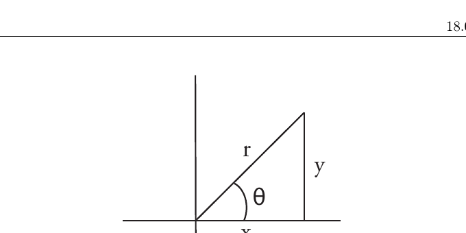

**Figure 3: Rectangular Co-ordinates to Polar Co-ordinates（直角坐标与极坐标）。**

无论我们是否允许 \(r\) 或 \(\theta\) 取正负，**始终成立**的是：

\[
x=r\cos\theta\qquad\text{且}\qquad y=r\sin\theta.
\]

例如，\(x=1,\;y=-1\) 也可表示为 \(r=-\sqrt{2},\;\theta=\dfrac{3\pi}{4}\)：

\[
1=x=-\sqrt{2}\cos\frac{3\pi}{4},\qquad
-1=y=-\sqrt{2}\sin\frac{3\pi}{4}.
\]

#### Example 2.

考虑半径为 \(a\)、圆心在 \(x=a,\;y=0\) 的圆。我们想找联系 \(r\) 与 \(\theta\) 的方程。

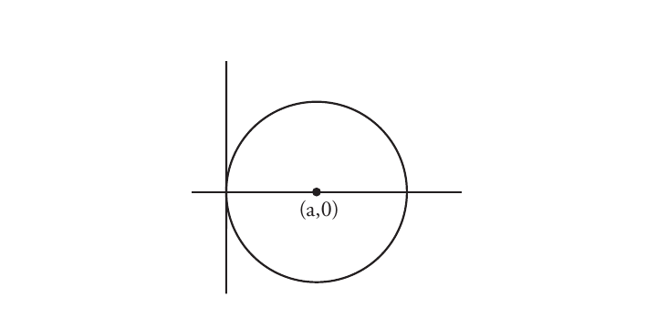

**Figure 4: Circle of radius \(a\) with center at \(x=a,\;y=0\)（圆心在 \((a,0)\)、半径 \(a\) 的圆）。**

直角坐标方程为

\[
(x-a)^{2}+y^{2}=a^{2}.
\]

代入 \(x=r\cos\theta\)、\(y=r\sin\theta\)：

\[
\begin{aligned}
(r\cos\theta-a)^{2}+(r\sin\theta)^{2}&=a^{2},\\
r^{2}\cos^{2}\theta-2ar\cos\theta+a^{2}+r^{2}\sin^{2}\theta&=a^{2},\\
r^{2}-2ar\cos\theta&=0,\\
r&=2a\cos\theta.
\end{aligned}
\]

\(0\le\theta\le\pi/2\) 描出上半圆，\(-\pi/2\le\theta\le 0\) 描出下半圆。作图如下。

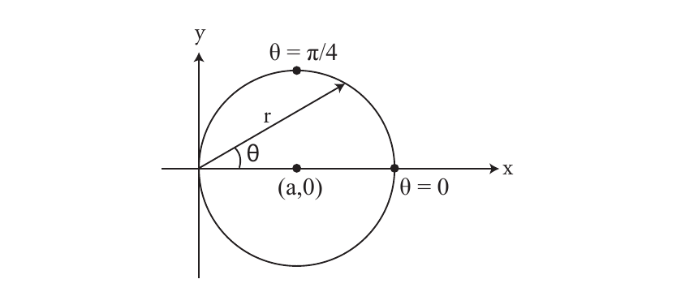

**Figure 5: \(r=2a\cos\theta\), \(-\pi/2\le\theta\le\pi/2\)。**

\[
\begin{aligned}
\theta=0 &\implies r=2a \implies x=2a,\;y=0,\\
\theta=\frac{\pi}{4} &\implies r=2a\cos\frac{\pi}{4}=a\sqrt{2}.
\end{aligned}
\]

关键问题是找出**描圆恰好一周**的 \(\theta\) 范围。此处为 \(-\pi/2<\theta<\pi/2\)：

\[
\theta=-\frac{\pi}{2}\quad\text{（下）},\qquad
\theta=\frac{\pi}{2}\quad\text{（上）}.
\]

怪异范围（应避免）：\(\pi/2<\theta<3\pi/2\)。当 \(\theta=\pi\) 时 \(r=2a\cos\pi=-2a\)，半径「朝后指」。在 \(\pi/2<\theta<3\pi/2\) 内，同一圆被描第二遍。

---

### Area in Polar Coordinates（极坐标下的面积）

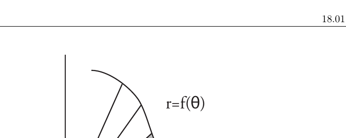

**Figure 6: Using polar co-ordinates to find area of a generic function（用极坐标求一般函数所围面积）。**

由于半径是角的函数（\(r=f(\theta)\)），我们对 \(\theta\) 积分。问题是：究竟该积什么？

\[
\int_{\theta_1}^{\theta_2} ??\,d\theta
\]

看该区域的一个极小切片：

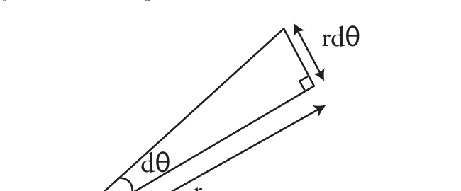

**Figure 7: Approximate slice of area in polar coordinates（极坐标面积的近似切片）。**

这个无穷小切片近似直角三角形。其面积取

\[
\text{切片面积}\approx\frac12(\text{底})(\text{高})=\frac12\,r\,(r\,d\theta).
\]

于是

\[
\text{总面积}=\int_{\theta_1}^{\theta_2}\frac12 r^{2}\,d\theta.
\]

#### Example 3.

\(r=2a\cos\theta\)，且 \(-\pi/2<\theta<\pi/2\)（Figure 5 中的圆）。

\[
A=\int_{-\pi/2}^{\pi/2}\frac12(2a\cos\theta)^{2}\,d\theta
=2a^{2}\int_{-\pi/2}^{\pi/2}\cos^{2}\theta\,d\theta.
\]

因 \(\cos^{2}\theta=\dfrac12+\dfrac12\cos 2\theta\)，

\[
\begin{aligned}
A&=a^{2}\int_{-\pi/2}^{\pi/2}(1+\cos 2\theta)\,d\theta
=a^{2}\int_{-\pi/2}^{\pi/2}d\theta+a^{2}\int_{-\pi/2}^{\pi/2}\cos 2\theta\,d\theta\\
&=\pi a^{2}+\frac12\sin 2\theta\Big|_{-\pi/2}^{\pi/2}
=\pi a^{2}+\frac12\bigl[\sin\pi-\sin(-\pi)\bigr]
=\pi a^{2}.
\end{aligned}
\]

#### Example 4: 圆心在原点的圆

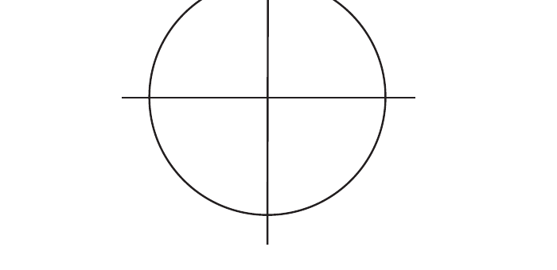

**Figure 8: Example 4: Circle centered at the origin（圆心在原点的圆）。**

\[
x=r\cos\theta,\quad y=r\sin\theta
\qquad\Longrightarrow\qquad
x^{2}+y^{2}=r^{2}.
\]

圆 \(x^{2}+y^{2}=a^{2}\) 即 \(r=a\)，且 \(x=a\cos\theta,\;y=a\sin\theta\)。

\[
A=\int_{0}^{2\pi}\frac12 a^{2}\,d\theta=\frac12 a^{2}\cdot 2\pi=\pi a^{2}.
\]

#### Example 5: 射线

此时 \(\theta=b\)。

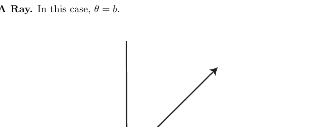

**Figure 9: Example 5: The ray \(\theta=b\), \(0\le r<\infty\)（射线 \(\theta=b\)）。**

\(r\) 的范围是 \(0\le r<\infty\)；\(x=r\cos b\)，\(y=r\sin b\)。

#### Example 6: 由直角公式求极公式

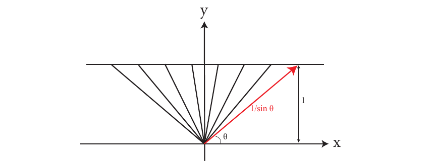

**Figure 10: Example 6: Cartesian Form to Polar Form（直角形式到极形式）。**

考虑直角坐标中的直线 \(y=1\)。求极坐标方程：代入 \(y=r\sin\theta\)（及 \(x=r\cos\theta\)）解出 \(r\)。

\[
r\sin\theta=1\implies r=\frac{1}{\sin\theta},\qquad 0<\theta<\pi.
\]

---

#### Example 7: 从 \(r=f(\theta)\) 回到 \((x,y)\)

从

\[
r=\frac{1}{1+\dfrac12\sin\theta}
\]

出发。故

\[
r+\frac{r}{2}\sin\theta=1.
\]

代入 \(r=\sqrt{x^{2}+y^{2}}\)：

\[
\sqrt{x^{2}+y^{2}}+\frac{y}{2}=1
\implies
\sqrt{x^{2}+y^{2}}=1-\frac{y}{2}
\implies
x^{2}+y^{2}=\Bigl(1-\frac{y}{2}\Bigr)^{2}=1-y+\frac{y^{2}}{4}.
\]

最后

\[
x^{2}+\frac{3y^{2}}{4}+y=1.
\]

这是一个椭圆方程，原点在一个焦点上。

有用的换算公式：

\[
r=\sqrt{x^{2}+y^{2}},\qquad
\theta=\tan^{-1}\Bigl(\frac{y}{x}\Bigr).
\]

#### Example 8: 玫瑰线 \(r=\cos(2\theta)\)

图像有点像花：

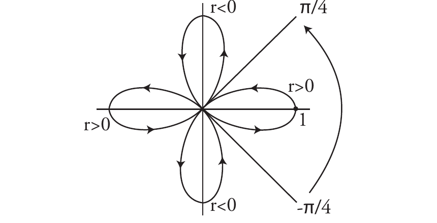

**Figure 11: Example 8: Rose（玫瑰线）。**

第一片「花瓣」：

\[
-\frac{\pi}{4}<\theta<\frac{\pi}{4}.
\]

> **Note：** 下一讲是 Lecture 34，因为 Lecture 33 是 Exam 4。
