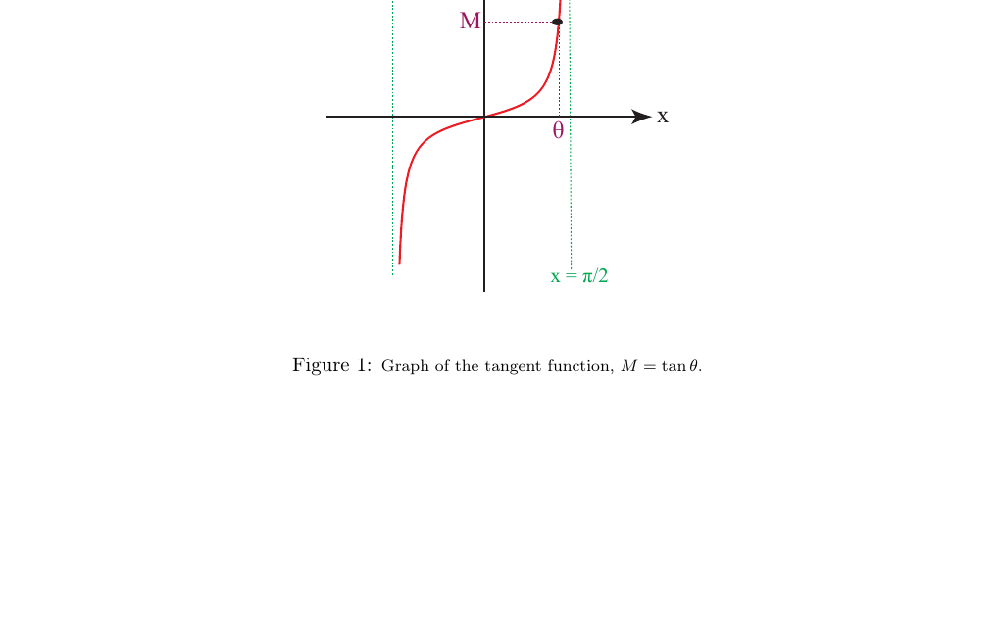
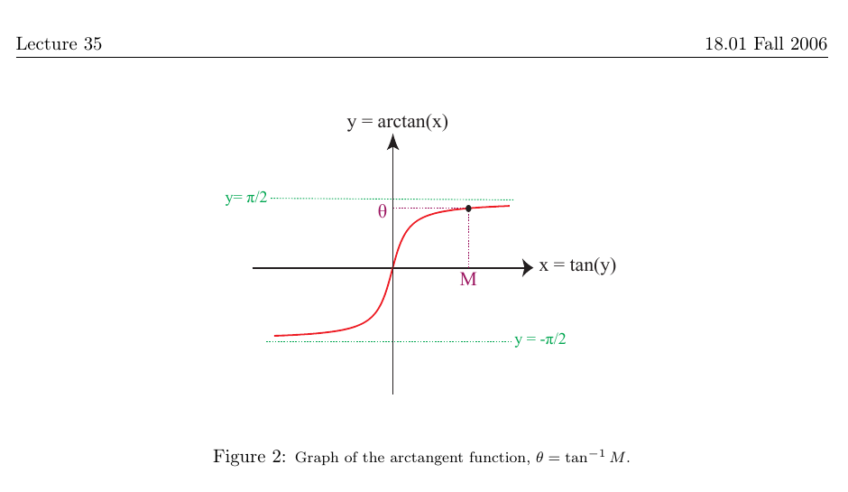
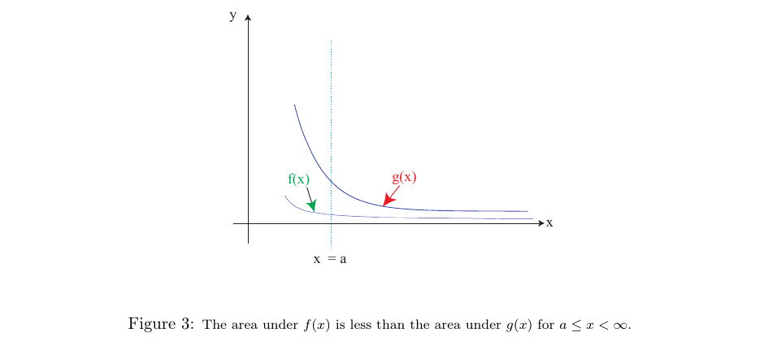

# MIT OCW 18.01 Lecture 35 讲义 · 中文译本

> **编号说明（必读）**：本文件名写作 `OCW_18.01_L32_…`，是为与 Bilibili 合集 **BV1mNgm66EZu · P32**（32-无穷极限与反常积分）对齐。对应的官方 PDF 实为 Fall 2006 **`lec35.pdf`（Lecture 35: Improper Integrals）**。日历 **Lecture 8 / 17 / 27**＝Exam 1–3 空桩；**Ses #34 = Exam 4**（无本系列课堂录像），故 OCW **Video gallery** 常把同一堂课标为 **Lecture 36: Improper Integrals**。对 \(n\ge27\) 有 **P32 ↔ OCW Lecture 35**（Pn ≈ lec\((n+3)\)；视频编号可能显示 36）。课堂口播（例题编号／比较对象与讲义不尽相同；另有 Q&A、fat tails、\(\int_{-1}^{1}dx/x^{2}\) 陷阱）与讲义的差异见同目录 [`MIT1801_L32_课上思路.md`](./MIT1801_L32_课上思路.md) §6。  
> **来源**：https://ocw.mit.edu/courses/18-01-single-variable-calculus-fall-2006/lec35.pdf  
> **课程**：18.01 Single Variable Calculus，Fall 2006  
> **说明**：英文原文具有权威性；本文件为中文学习转写。引用与条款见 http://ocw.mit.edu/terms 。数学式保留 LaTeX；图为 PDF 页渲染裁切，嵌入于对应正文旁。**本文件转写 `lec35.pdf` 全文。**

---

## Lecture 35: Improper Integrals

（第 35 讲：反常积分）

18.01 Fall 2006

---

### Definition.（定义）

**反常积分（improper integral）**定义为

\[
\int_{a}^{\infty}f(x)\,dx
=\lim_{M\to\infty}\int_{a}^{M}f(x)\,dx,
\]

若该极限**存在**，则称积分**收敛（converges）**；若极限不存在，则称**发散（diverges）**。

---

### Example 1.

\[
\int_{0}^{\infty}e^{-kx}\,dx=\frac1k
\quad(k>0).
\]

\[
\int_{0}^{M}e^{-kx}\,dx
=\Bigl(-\frac1k\Bigr)e^{-kx}\Big|_{0}^{M}
=\frac1k\bigl(1-e^{-kM}\bigr).
\]

取 \(M\to\infty\)，得 \(e^{-kM}\to0\)，故

\[
\int_{0}^{\infty}e^{-kx}\,dx=\frac1k.
\]

我们把同一计算写得更不正式一些：

\[
\int_{0}^{\infty}e^{-kx}\,dx
=\Bigl(-\frac1k\Bigr)e^{-kx}\Big|_{0}^{\infty}
=\frac1k\bigl(1-e^{-k\infty}\bigr)
=\frac1k
\qquad(k>0).
\]

注意：无穷区间上的积分 \(\int_{0}^{\infty}e^{-kx}\,dx=1/k\)，其公式比对应的有限积分 \(\int_{0}^{M}e^{-kx}\,dx=(1/k)(1-e^{-kM})\) **更简单**。实务上，当 \(M\) 很大时 \(e^{-kM}\) 可忽略，于是简洁的 \(1/k\) 已是有限积分的好近似。无穷积分往往比有限积分更容易——正如无穷小与导数比差商更容易。

#### Application.（应用）

在 Example 1 中把 \(x\) 换成 \(t=\) 时间（秒）。

\(R=\) 衰变率（decay rate）＝时刻 \(0\) 每秒衰变的原子数。  
在更晚的时刻 \(t>0\)，衰变率为 \(Re^{-kt}\)（被指数因子 \(e^{-kt}\) 缩小）。

最终（在时间 \(0\le t<\infty\) 上）每个原子都会衰变。因此原子总数 \(N\) 用 Example 1 的公式计算：

\[
N=\int_{0}^{\infty}Re^{-kt}\,dt=\frac{R}{k}.
\]

放射性元素的**半衰期（half life）** \(H\) 是衰变率降为初始值一半的时刻。于是

\[
e^{-kH}=\frac12
\implies -kH=\ln\frac12
\implies k=\frac{\ln 2}{H}.
\]

故

\[
R=Nk=N\frac{\ln 2}{H}.
\]

以钋-210（Polonium 210）为例（当时新闻热点）。半衰期为 138 天，即

\[
H=(138\,\text{days})(24\,\text{hr/day})(60^{2}\,\text{sec/hr})
=(138)(24)(60)^{2}\ \text{seconds}.
\]

用此 \(H\) 可得：一克钋-210 每秒发射

\[
(1\,\text{gram})\Bigl(\frac{6\times10^{23}}{210}\,\text{atoms/gram}\Bigr)\frac{\ln2}{H}
=1.66\times10^{14}\ \text{decays/sec}
\approx4500\ \text{curies}.
\]

每次衰变 5.3 MeV，钋每克放出约 140 瓦放射性能量（白热）。钋发射 α 射线：皮肤可挡，但摄入后危险性约为 γ／X 射线的 20 倍；摄入致死剂量约 \(10^{-7}\) 克。

---

### Example 2.

\[
\int_{0}^{\infty}\frac{dx}{1+x^{2}}=\frac{\pi}{2}.
\]

计算：

\[
\int_{0}^{M}\frac{dx}{1+x^{2}}
=\tan^{-1}x\Big|_{0}^{M}
=\tan^{-1}M\to\frac{\pi}{2}
\quad(M\to\infty).
\]

（若 \(\theta=\tan^{-1}M\)，则 \(M\to\infty\) 时 \(\theta\to\pi/2\)。见 Figures 1 与 2。）

*Figure 1: Graph of the tangent function, \(M=\tan\theta\).*  
（图 1：正切函数图像，\(M=\tan\theta\)。）

*Figure 2: Graph of the arctangent function, \(\theta=\tan^{-1}M\).*  
（图 2：反正切函数图像，\(\theta=\tan^{-1}M\)。）

---

### Example 3.

\[
\int_{0}^{\infty}e^{-x^{2}}\,dx=\frac{\sqrt{\pi}}{2}.
\]

回顾：我们已算过这个反常积分（通过两种方式计算同一体积：切片与壳层法）。这鲜明地说明——**有限积分有时比对应的无穷积分更难理解**：

\[
\int_{0}^{M}e^{-x^{2}}\,dx
\]

只能数值求值，没有初等公式；而 \(M=\infty\) 时我们却有显式结果。

---

### Example 4.

\[
\int_{1}^{\infty}\frac{dx}{x}.
\]

\[
\int_{1}^{M}\frac{dx}{x}
=\ln x\Big|_{1}^{M}
=\ln M-\ln1=\ln M\to\infty
\quad(M\to\infty).
\]

该反常积分无限（称为**发散**或**不收敛**）。

---

### Example 5.

\[
\int_{1}^{\infty}\frac{dx}{x^{p}}
\quad(p>1).
\]

\[
\int_{1}^{M}\frac{dx}{x^{p}}
=\frac{1}{1-p}\,x^{1-p}\Big|_{1}^{M}
=\frac{1}{1-p}\bigl(M^{1-p}-1\bigr)
\to\frac{1}{p-1}
\quad(M\to\infty),
\]

因为 \(1-p<0\)。故该积分**收敛**。

---

### Example 6.

\[
\int_{1}^{\infty}\frac{dx}{x^{p}}
\quad(0<p<1).
\]

与上例极相似，但**发散**：

\[
\int_{1}^{M}\frac{dx}{x^{p}}
=\frac{1}{1-p}\,x^{1-p}\Big|_{1}^{M}
=\frac{1}{1-p}\bigl(M^{1-p}-1\bigr)
\to\infty
\quad(M\to\infty),
\]

因为 \(1-p>0\)。

---

### Determining Divergence and Convergence  
（判定发散与收敛）

要判定积分收敛还是发散，**不必**求出其值；可与一个能算出来的更简积分作比较。

**幂的一般情形：**

\[
\int_{1}^{\infty}\frac{dx}{x^{p}}.
\]

由 Examples 4、5、6：当 \(0<p\le1\) 时发散（无限）；当 \(p>1\) 时收敛（有限）。

**积分比较（comparison of integrals）**说：较大的函数有较大的积分。若限于非负函数，即使区域无界（反常积分），较大函数图像下的面积仍大于较小者。考虑 \(0\le f(x)\le g(x)\)（如图 3）。

*Figure 3: The area under \(f(x)\) is less than the area under \(g(x)\) for \(a\le x<\infty\).*  
（图 3：在 \(a\le x<\infty\) 上，\(f(x)\) 下的面积小于 \(g(x)\) 下的面积。）

- 若 \(\displaystyle\int_{a}^{\infty}g(x)\,dx\) **收敛**，则 \(\displaystyle\int_{a}^{\infty}f(x)\,dx\) 也收敛。（换言之：\(g\) 下面积有限 ⇒ 更小的 \(f\) 下面积也有限。）
- 若 \(\displaystyle\int_{a}^{\infty}f(x)\,dx\) **发散**，则 \(\displaystyle\int_{a}^{\infty}g(x)\,dx\) 也发散。（换言之：\(f\) 下面积无限 ⇒ 更大的 \(g\) 下面积也无限。）

使用比较时，用我们能算出积分的更简函数去替换。须决定从上方还是下方去「夹住」——取决于要证明的是有限还是无限。

---

### Example 7.

\[
\int_{0}^{\infty}\frac{dx}{\sqrt{x^{3}+1}}.
\]

自然想用比较

\[
\frac{1}{\sqrt{x^{3}+1}}\le\frac{1}{x^{3/2}}.
\]

但区间 \(0<x<\infty\) 上 \(x^{-3/2}\) 下的面积

\[
\int_{0}^{\infty}\frac{dx}{x^{3/2}}
\]

因 \(x\to0\) 的奇异行为而**无限**。排除近 0 的一段即可挽救比较：

\[
\int_{0}^{\infty}\frac{dx}{\sqrt{x^{3}+1}}
=\int_{0}^{1}\frac{dx}{\sqrt{x^{3}+1}}
+\int_{1}^{\infty}\frac{dx}{\sqrt{x^{3}+1}}.
\]

\(0<x<1\) 上是有限积分；第二段现可用比较：

\[
\int_{1}^{\infty}\frac{dx}{\sqrt{x^{3}+1}}
\le\int_{1}^{\infty}\frac{dx}{x^{3/2}}<\infty,
\]

因为 \(3/2>1\)。

---

### Example 8.

\[
\int_{0}^{\infty}e^{-x^{3}}\,dx.
\]

对 \(x\ge1\)，有 \(x^{3}\ge x\)，故

\[
\int_{1}^{\infty}e^{-x^{3}}\,dx
\le\int_{1}^{\infty}e^{-x}\,dx=1<\infty.
\]

从而 \(0\le x<\infty\) 上 \(e^{-x^{3}}\) 的全积分亦收敛。\(0\le x\le1\) 可忽略：长度有限，且 \(e^{-x^{3}}\) 在该段不趋于无穷。

---

### Limit comparison.（极限比较）

设 \(0\le f(x)\) 且 \(\lim_{x\to\infty}f(x)/g(x)\le1\)。则对充分大的 \(a\)，有 \(f(x)\le2g(x)\)（\(x\ge a\)）。故

\[
\int_{a}^{\infty}f(x)\,dx
\le2\int_{a}^{\infty}g(x)\,dx.
\]

#### Example 9.

\[
\int_{0}^{\infty}\frac{(x+10)\,dx}{x^{2}+1}.
\]

\(x\to\infty\) 时的极限行为：

\[
\frac{x+10}{x^{2}+1}
\sim\frac{x}{x^{2}}=\frac{1}{x}.
\]

由于 \(\int_{1}^{\infty}dx/x=\infty\)，故 \(\int_{0}^{\infty}(x+10)/(x^{2}+1)\,dx\) 也**发散**。

---

### Example 10（来自 PS8）.

\[
\int_{0}^{\infty}x^{n}e^{-x}\,dx.
\]

该积分**收敛**。要做方便的比较，需要熟悉函数增长率。

仅有 \(x^{n}\ll e^{x}\) 不够。改用 \(x^{n}/e^{x/2}\to0\)（由洛必达）。于是

\[
x^{n}\ll e^{x/2}
\implies
x^{n}e^{-x}\ll e^{x/2}e^{-x}=e^{-x/2}.
\]

再由极限比较：因 \(\int_{0}^{\infty}e^{-x/2}\,dx\) 收敛，故所给积分亦收敛。习题集中会处理该积分。

---

## Improper Integrals of the Second Type  
（第二类反常积分）

\[
\int_{0}^{1}\frac{dx}{\sqrt{x}}.
\]

我们知道 \(1/\sqrt{x}\to\infty\)（当 \(x\to0\)）。

\[
\int_{0}^{1}\frac{dx}{\sqrt{x}}
=\lim_{a\to0^{+}}\int_{a}^{1}x^{-1/2}\,dx.
\]

\[
\int_{a}^{1}x^{-1/2}\,dx
=2x^{1/2}\Big|_{a}^{1}
=2-2a^{1/2}.
\]

当 \(a\to0\) 时 \(2a^{1/2}\to0\)。故

\[
\int_{0}^{1}x^{-1/2}\,dx=2.
\]

类似地，对所有 \(p<1\)，

\[
\int_{0}^{1}x^{-p}\,dx=\frac{1}{-p+1}.
\]

例如 \(p=1/2\) 时，

\[
\frac{1}{-\tfrac12+1}=2.
\]

然而当 \(p\ge1\) 时，该积分**发散**。
