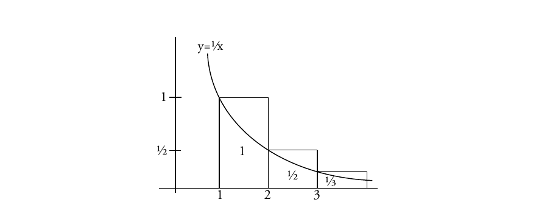
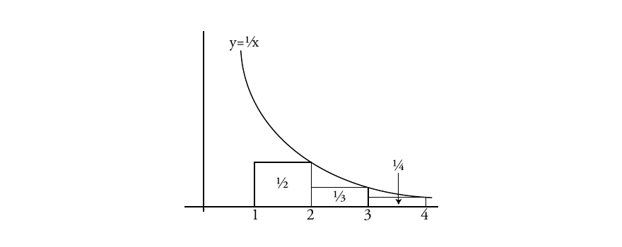
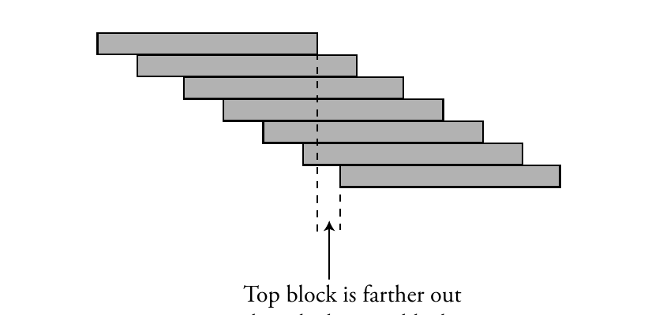
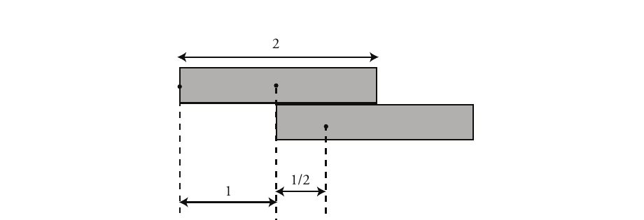
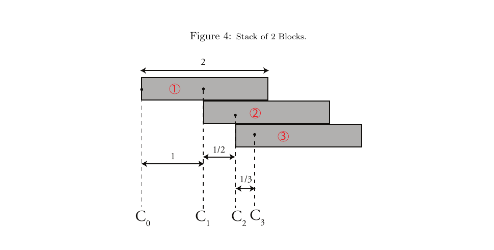
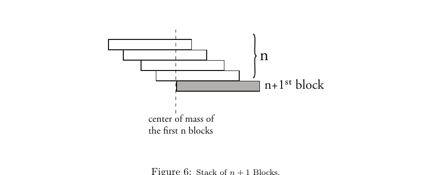
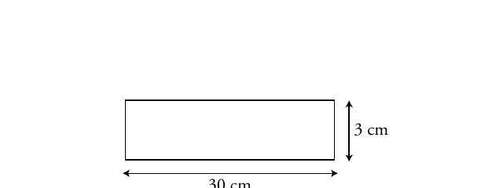

# MIT OCW 18.01 Lecture 36 讲义 · 中文译本

> **编号说明（必读）**：本文件名写作 `OCW_18.01_L33_…`，是为与 Bilibili 合集 **BV1mNgm66EZu · P33**（33-无穷级数与收敛判别）对齐。对应的官方 PDF 实为 Fall 2006 **`lec36.pdf`（Lecture 36: Infinite Series and Convergence Tests）**。日历 **Lecture 8 / 17 / 27**＝Exam 1–3 空桩；**Ses #34 = Exam 4**（无本系列课堂录像），故 OCW **Video gallery** 常把同一堂课标为 **Lecture 37: Infinite Series…**。对 \(n\ge27\) 有 **P33 ↔ OCW Lecture 36**（Pn ≈ lec\((n+3)\)；视频编号可能显示 37）。课堂口播（先收尾第二类反常积分再入级数；例题系数与讲义不尽相同；另有 Q&A、芝诺、积木预告）与讲义的差异见同目录 [`MIT1801_L33_课上思路.md`](./MIT1801_L33_课上思路.md) §6。  
> **来源**：https://ocw.mit.edu/courses/18-01-single-variable-calculus-fall-2006/lec36.pdf  
> **课程**：18.01 Single Variable Calculus，Fall 2006  
> **说明**：英文原文具有权威性；本文件为中文学习转写。引用与条款见 http://ocw.mit.edu/terms 。数学式保留 LaTeX；图为 PDF 页渲染裁切，嵌入于对应正文旁。**本文件转写 `lec36.pdf` 全文。**

---

## Lecture 36: Infinite Series and Convergence Tests

（第 36 讲：无穷级数与收敛判别）

18.01 Fall 2006

---

## Infinite Series（无穷级数）

### Geometric Series.（几何级数）

几何级数形如

\[
1 + a + a^{2} + a^{3} + \cdots = S.
\]

有一个求值技巧：两边同乘 \(a\)，

\[
a + a^{2} + a^{3} + \cdots = aS.
\]

相减得

\[
(1+a+a^{2}+a^{3}+\cdots)-(a+a^{2}+a^{3}+\cdots)=S-aS,
\]

亦即

\[
1 = S - aS \implies 1=(1-a)S \implies S=\frac{1}{1-a}.
\]

这**仅当** \(|a|<1\)（即 \(-1<a<1\)）时成立。

\(a=1\) 不行：

\[
1+1+1+\cdots=\infty.
\]

\(a=-1\) 也不行：

\[
1-1+1-1+\cdots
\ \neq\
\frac{1}{1-(-1)}=\frac12.
\]

---

### Notation.（记号）

处理级数／求和时有用的记号。无穷和写作

\[
\sum_{k=0}^{\infty}a_k = a_0+a_1+a_2+\cdots.
\]

有限和

\[
S_n=\sum_{k=0}^{n}a_k=a_0+\cdots+a_n
\]

称为无穷级数的**第 \(n\) 个部分和（\(n\)th partial sum）**。

---

### Definition.（定义）

\[
\sum_{k=0}^{\infty}a_k=s
\]

意味着

\[
\lim_{n\to\infty}S_n=s,
\quad\text{其中}\quad
S_n=\sum_{k=0}^{n}a_k.
\]

若该极限**存在且有限**，则称级数**收敛到 \(s\)（converges to \(s\)）**。收敛的重要性可由几何级数说明：若 \(a=1\)，则 \(S=1+1+1+\cdots=\infty\)。但

\[
S-aS=1
\quad\text{或}\quad
\infty-\infty=1
\]

无意义、不可用！

---

### Another type of series.（另一类级数）

\[
\sum_{n=1}^{\infty}\frac{1}{n^{p}}.
\]

可用积分判定此类级数是否收敛。先把和「看成」积分：

\[
\sum_{n=1}^{\infty}\frac{1}{n^{p}}
\sim
\int_{1}^{\infty}\frac{dx}{x^{p}}.
\]

若该反常积分算出有限值，则级数收敛。

**注意**：此法只告诉我们级数**是否**收敛，**不**告诉我们收敛到什么数——后者难得多。例如，要确定

\[
\sum_{n=1}^{\infty}\frac{1}{n^{2}}=\frac{\pi^{2}}{6}
\]

需大量工作。数学家们直到近年才得以判定

\[
\sum_{n=1}^{\infty}\frac{1}{n^{3}}
\]

收敛到一个**无理数**！

---

### Harmonic Series.（调和级数）

\[
\sum_{n=1}^{\infty}\frac{1}{n}
\sim
\int_{1}^{\infty}\frac{dx}{x}.
\]

我们借助黎曼和来理解该反常积分。先用**上黎曼和**（见 Figure 1）给出积分的上界。

*Figure 1: Upper Riemann Sum.*  
（图 1：上黎曼和。）

\[
\int_{1}^{N}\frac{dx}{x}
\le 1+\frac12+\cdots+\frac{1}{N-1}
=s_{N-1}\le s_N.
\]

我们知道

\[
\int_{1}^{N}\frac{dx}{x}=\ln N.
\]

当 \(N\to\infty\) 时 \(\ln N\to\infty\)，故 \(s_N\to\infty\)。换言之，

\[
\sum_{n=1}^{\infty}\frac{1}{n}
\]

**发散**。

实际上 \(s_N\) 趋于 \(\infty\) 相当慢。再取**下黎曼和**（见 Figure 2）。

*Figure 2: Lower Riemann Sum.*  
（图 2：下黎曼和。）

\[
s_N
=1+\frac12+\cdots+\frac1N
=1+\sum_{n=2}^{N}\frac1n
\le 1+\int_{1}^{N}\frac{dx}{x}
=1+\ln N.
\]

因此

\[
\ln N < s_N < 1+\ln N.
\]

---

## Integral Comparison（积分比较）

考虑正的递减函数 \(f(x)>0\)（例如 \(f(x)=1/x^{p}\)）。

\[
\Bigl|\sum_{n=1}^{\infty}f(n)-\int_{1}^{\infty}f(x)\,dx\Bigr|
< f(1).
\]

因此两项要么**都收敛**，要么**都发散**。这正是我们说

\[
\sum_{n=1}^{\infty}\frac{1}{n^{p}}
\sim
\int_{1}^{\infty}\frac{dx}{x^{p}}
\]

时所指的含义。

因此，\(\displaystyle\sum_{n=1}^{\infty}\frac{1}{n^{p}}\)：**当 \(p\le1\) 时发散，当 \(p>1\) 时收敛。**

比较中有很大「余量（fudge room）」。例如

\[
\sum_{n=1}^{\infty}\frac{1}{\sqrt{n^{2}+10}}
\]

发散，因为

\[
\frac{1}{\sqrt{n^{2}+10}}
\sim
\frac{1}{(n^{2})^{1/2}}
=\frac{1}{n}.
\]

### Limit comparison.（极限比较）

若 \(x\to\infty\) 时 \(f(x)\sim g(x)\)，则 \(\sum f(n)\) 与 \(\sum g(n)\) 要么都收敛，要么都发散。

\(f\sim g\) **究竟**是什么意思？它指

\[
\lim_{x\to\infty}\frac{f(x)}{g(x)}=c,
\]

其中 \(0<c<\infty\)。

检验：下列级数收敛吗？

\[
\sum_{n=1}^{\infty}\frac{n}{\sqrt{n^{5}-10}}.
\]

\[
\frac{n}{\sqrt{n^{5}-10}}
\sim
\frac{n}{n^{5/2}}
=n^{-3/2}
=\frac{1}{n^{3/2}}.
\]

由于 \(3/2>1\)，该级数**收敛**。

---

## Playing with blocks（玩积木）

讲到此处，教授拿出若干根又长又一样的积木。  
你认为有可能把积木堆成这样吗？

*Figure 3: Collective center of mass of upper blocks is always over the base block.*  
（图 3：上层积木的合质心始终落在底座积木之上。标注：最上一块比最下一块更靠外。）

要堆得住，须使上层积木的**合质心**始终落在底座积木之上。  
教授成功堆出了悬伸。  
能否把这垛积木一直伸过整个教室？

最佳策略是**从上往下**搭。

令 \(C_0=\) 第一块（最上一块）的左端。  
令 \(C_1=\) 第一块的质心。  
把第二块尽量往右放——即令其左端落在 \(C_1\)（Figure 4）。  
令 \(C_2=\) 最上两块的合质心。  
策略：下一块的左端对准**此前所有块合质心**（见 Figure 5）。

*Figure 4: Stack of 2 Blocks.*  
（图 4：两块积木的堆叠。）

*Figure 5: Stack of 3 Blocks. Left end of block 3 is \(C_2=\) center of mass of blocks 1 and 2.*  
（图 5：三块积木的堆叠。第 3 块左端为 \(C_2=\) 第 1、2 块的合质心。）

\[
\begin{aligned}
C_0&=0,\\
C_1&=1,\\
C_2&=1+\frac12.
\end{aligned}
\]

\[
C_{n+1}
=\frac{n\,C_n+1\cdot(C_n+1)}{n+1}
=\frac{(n+1)C_n+1}{n+1}
=C_n+\frac{1}{n+1}.
\]

\[
\begin{aligned}
C_3&=1+\frac12+\frac13,\\
C_4&=1+\frac12+\frac13+\frac14,\\
C_5&=1+\frac12+\frac13+\frac14+\frac15>2.
\end{aligned}
\]

*Figure 6: Stack of \(n+1\) Blocks.*  
（图 6：\(n+1\) 块积木的堆叠。虚线＝前 \(n\) 块的合质心。）

因此——只要积木够多——悬伸可以在水平方向伸到任意远。换种说法：

\[
\sum_{n=1}^{N}\frac{1}{n}=S_N.
\]

回顾本讲开头的黎曼和估计：

\[
\ln N < S_N < (\ln N)+1;
\]

当 \(N\to\infty\) 时 \(S_N\to\infty\)。

若要把积木垛伸过讲台前两张实验桌，会有多高？积木为 \(30\,\text{cm}\times 3\,\text{cm}\)（见 Figure 7）。一张实验桌长 \(6.5\) 块，即 \(13\) 个单位；两张桌 \(26\) 个单位。垛中将有 \(26-2=24\) 个单位的悬伸。

*Figure 7: Side view of one block.*  
（图 7：单块积木侧视，\(30\,\text{cm}\times 3\,\text{cm}\)。）

若 \(\ln N=24\)，则 \(N=e^{24}\)。

\[
\text{Height}=3\,\text{cm}\cdot e^{24}\approx 8\times10^{8}\,\text{m}.
\]

该高度大约是到月球距离的两倍。

若要跨过本教室（\(\sim 30\,\text{ft}\)），垛高约须 \(10^{26}\) 米——大约是可观测宇宙的直径。
